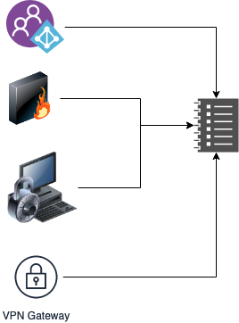

Security space is an ever evolving. It never stays stagnant; everyday you see a new exploit, a new hack. As an individual, you may have Antivirus installed on your system, Firewall - UP, ports blocked yet you are not free from threat

If you have....

1. Digital footprint: Use any of the social apps e.g. Facebook, Twitter etc.
2. Use an email: Gmail, yahoo, live etc.
3. Enter passwords (even though super secure)
4. Shop online,
5. Heck even if you have a smart phone

you are at risk, everyday.

> Even if you do not have or use any of the 5 above, you still have your identity, right? SSN, or UID?

Your Biometrics fingerprints, eyeprints, stored in a DB govt or otherwise.

Just think about it; if this is for an **individual** what about an **organization**?

## Organizations & SIEM

**W**ith the ever evolving space of security the organization are also upping their game. You have dedicated analysts (individually or part of **[SoC](https://digitalguardian.com/blog/what-security-operations-center-soc)** or NoC) analyzing information using variety of tools, one such tool is Splunk (very prevalent), Elastic etc.

## Perspective

### What is threat?

> A declaration of an intention or determination to inflict punishment, injury, etc., in retaliation for, or conditionally upon, some action or course; menace:

[Threat](https://www.dictionary.com/browse/threat?s=t) is always contextual, specifically in the space of security e.g.


```text
[Error: 401] Unauthorized A single authentication failure where say John Doe, operating from Australia tried to access his account in his organization and misspelled his password resulting an error.
```

**Is this threat?**

It might be a a genuine mistake or lets add some spices to the situation

The request came in at a time lets say 5:30 in the evening (AEST) but came in from an IP that is from North Korea

**Rings a bell?**

So now we are thinking

### **Volume Metrics**

Too many unauthorized errors coming might be an anomaly, but may or may not be threat.

> E.g. A configured password was just changed and the dev guy forgot to change one location and hence it may be false positive.

### Behavior Metrics

Behavior is a pattern that is observed over a time for an entity. This entity can be a user or a resource.

> John regularly logs in from Sydney around 8:00 to 8:30 AM and logs out by 6:00 to 6:30 PM sometimes he logs in on weekends, but not regularly.

#### Param : One

**Today**, John logs in at 7:00 PM on **Friday** and from Japan - **Suspicious**?

This is the deviations from historical pattern, which defines John Doe, as a regular user logging in at 8:00 AM logging out 6:00 PM everyday

#### Param : Two

The last login location was Australia, and within 15 minutes John logs in from Japan? **Suspicious again**?

This is what is called anomaly from the regular behavior and may or may not be a threat, considering John may be on a regular visit to Japan, but what is suspicious is he was logged in from Australia 15 minutes ago so physically it is impossible to make a quantum leap in 15 minutes from one geographic location to another.

> So this definitely looks like a genuine threat.

### Spatial: Metric

Spatial is the location element of an entity, which impacts a **V**olume or **B**ehavior metric in a way. It is not just an attribute of an entity it can enrich the information in a decisive way.

### SIEM: Security Information & Event Management

SIEM is a process, approach or tools to monitor, analyze, evaluate and identify threats in an organization.

> It collects security data from appliances like servers, firewalls, domain controllers, and more. It stores & normalizes data to discover trends, threats, and enable organizations to plug the gaps.




The heart of all analysis is the data which is refined, correlated, enriched if required and normalized.


- Identify high-risk threats with near real-time correlation and behavioral anomaly detection.
- Detect vulnerabilities, manage risks and identify high-priority incidents among billions of data points.
- Gain full visibility into network, application and user activity.

### Tools

I have used mostly Splunk and Elastic, but the solutions are plenty depending on your pocket and size of the organization

## Helpful links

- https://digitalguardian.com/blog/what-security-operations-center-soc
- <https://www.dictionary.com/browse/threat?s=t>
- https://developer.mozilla.org/en-US/docs/Web/HTTP/Status/401
