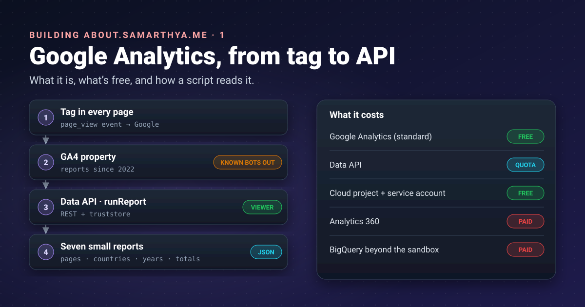


A static blog is a shop with no till: it serves pages, but it can't count who came in. For that I lean on
Google Analytics. This post is about understanding that tool properly, and teaching a small script to read
its numbers, before I trust them on a public page.




## The series

After the [move to Hugo]() the blog is fast and simple,
but it has no front desk: nowhere that says *here is what's new, here is what people keep reading, here is
where they come from*. So I'm building a small hub, **about.samarthya.me**, and writing down each piece:

| Part | What it covers |
|---|---|
| **1. Google Analytics (this post)** | What it is, why I use it, what's free, and reading it from code |
| 2. Keeping the numbers honest | What the stats would have said without filtering, and the ranking that fixes it |
| 3. Cloudflare in front | DNS, certificates, redirects and caching for the new subdomain |
| 4. Who is knocking? | How Cloudflare tells people from bots, and what that showed about my traffic |
| 5. Building the site | A Quarto template: pages, side menu, charts, light and dark |
| 6. Shipping it | Uploading a static site to a host I don't trust, and keeping it fresh |

## What Google Analytics is

Google describes it simply:
["a platform that collects data from your websites and apps"](https://support.google.com/analytics/answer/12159447)
and turns it into reports. The mechanics:

1. A small piece of JavaScript, the **tag**, sits in every page of the blog.
2. When someone opens a page, the tag sends an **event** to Google: *page viewed*, with the address, the
   browser's language, the device type and where the visit came from (a search, a link, nothing).
3. Google adds the events up into **reports**: views per page, visitors per country, time spent reading.

Everything for one site lives in a **property**. GA4 is short for *Google Analytics 4*, the current version.

### Why I use it

- **A static site can't count for itself.** There is no server program on my side to log a visit; GitHub
  Pages serves files and that's all.
- **History.** The same property has measured the blog since 2022, through the WordPress years and the move.
  Starting with a new tool would mean starting from zero.
- **It's free for a site of this size**, and it has an API, so a script can read it.

It isn't the only option. [Cloudflare Web Analytics](https://developers.cloudflare.com/web-analytics/about/)
is free and "does not collect or use your visitors' personal data"; part 4 looks at what Cloudflare sees. For
now, GA4 has the years of history, so it is the source for the stats page.

### What it doesn't do for me

GA4 removes [known bots automatically](https://support.google.com/analytics/answer/9888366), using Google's
research and the IAB's list of spiders and bots, and you "cannot disable known bot traffic exclusion or see
how much known bot traffic was excluded". *Known* is the important word. Crawlers that run JavaScript and
aren't on the list are counted as people. Part 2 shows how many of those I had.

## What's free and what isn't

| Item | Cost | Notes |
|---|---|---|
| Google Analytics (standard) | **Free** | Google: ["free of charge"](https://marketingplatform.google.com/about/analytics/) |
| Analytics 360 | Paid (sales contract) | Higher limits: [2M API tokens a day, 50 months of exploration data, larger exports](https://support.google.com/analytics/answer/11202874) |
| Data API | **No price, quota-limited** | Standard property: [200,000 tokens a day, 40,000 an hour, 14,000 per project per hour](https://developers.google.com/analytics/devguides/reporting/data/v1/quotas); bigger requests cost more tokens |
| Google Cloud project and service account | **Free** | ["All use of Identity and Access Management API is free of charge."](https://cloud.google.com/iam/pricing) |
| BigQuery export (raw events) | Free in the sandbox, then paid | ["Each export will incur costs on the BigQuery side for storage and processing"](https://support.google.com/analytics/answer/9358801); not used here |
| Data retention | Free, but limited | Standard: 2 or 14 months, and it ["only affects explorations and funnel reports"](https://support.google.com/analytics/answer/7667196). Standard reports, which the API reads, keep their totals, which is why I can still read 2022 |

The hidden price is the visitor's: their visit is recorded by Google. That is part of why the hub publishes
only totals (more on privacy below).

## Words used in this post

| Term | Meaning here |
|---|---|
| **API** | A door for programs: send a structured request, get structured data (JSON) back |
| **Dimension / metric** | What to group by (page, country, year) / what to count (views, seconds) |
| **Google Cloud project** | An account container for using Google APIs: it owns the quota and credentials, and here runs nothing |
| **Service account** | A Google identity for a program, not a person |
| **JSON key** | The service account's password, as a file |
| **REST** | Ordinary HTTPS requests with JSON, the same as a browser fetching a page |
| **gRPC** | Google's faster, binary way for programs to [call functions on another machine](https://grpc.io/docs/what-is-grpc/introduction/); the client library's default |
| **TLS certificate** | What lets your computer check it's really talking to Google over HTTPS |

## Setting it up, step by step

Google's [quickstart](https://developers.google.com/analytics/devguides/reporting/data/v1/quickstart-client-libraries)
uses your personal login. A script that runs on its own needs a **service account** instead:

1. **Create (or pick) a Google Cloud project** at the Cloud console.
2. **Enable the Google Analytics Data API** for that project (the quickstart has an *Enable* button).
3. **Create a service account**: *IAM & Admin → Service accounts → Create*
   ([Google's steps](https://docs.cloud.google.com/iam/docs/service-accounts-create)). Give it **no Cloud
   roles**; its only permission will live inside Analytics.
4. **Create a JSON key** for it and download it.
5. **Let it read your property**: in Analytics, *Admin → Property → Access management → + → Add users*, paste
   the service account's e-mail address and choose **Viewer**
   ([Google's steps](https://support.google.com/analytics/answer/9305788)). Viewer reads reports and changes
   nothing.
6. **Install the Python client**, [`google-analytics-data`](https://pypi.org/project/google-analytics-data/)
   (0.23.3 at the time of writing):

```bash
python -m venv .venv
.venv/bin/python -m pip install google-analytics-data==0.23.3 truststore
```

**Look after the key.** Google warns that
[service account keys "can become a security risk if not managed carefully"](https://docs.cloud.google.com/iam/docs/best-practices-for-managing-service-account-keys).
Mine sits outside every repository, the script finds it through an environment variable, and `.gitignore`
blocks key files anyway. If a key is ever committed, deleting the file isn't enough: delete the key itself in
Cloud IAM, then make a new one.

## The first surprise: my antivirus said no

The first run failed with a certificate error on every call.

Here's why. My antivirus checks HTTPS traffic by standing in the middle: it opens the connection to Google
itself and shows my programs its own certificate. Windows trusts that certificate, so browsers are happy.
The client library, though, talks **gRPC** by default, and gRPC
[brings its own list of trusted certificates](https://github.com/grpc/grpc/blob/master/doc/environment_variables.md)
instead of asking Windows, so it refused the antivirus' certificate.

The fix is two lines: talk **REST** (plain HTTPS) instead, and let Python trust what Windows trusts with
[`truststore`](https://github.com/sethmlarson/truststore):

```python
import truststore
truststore.inject_into_ssl()          # Python's HTTPS now uses the Windows certificate store

from google.analytics.data_v1beta import BetaAnalyticsDataClient

client = BetaAnalyticsDataClient.from_service_account_file(KEY_PATH, transport="rest")
```

Same API, same answers, slightly slower, which doesn't matter for seven requests.

## The questions I ask

Each report is one call to
[`runReport`](https://developers.google.com/analytics/devguides/reporting/data/v1/rest/v1beta/properties/runReport).
A helper keeps them short:

```python
from google.analytics.data_v1beta.types import (
    DateRange, Dimension, Metric, OrderBy, RunReportRequest)

def report(client, dims, mets, start, order=None):
    req = RunReportRequest(
        property=f"properties/{PROPERTY_ID}",
        dimensions=[Dimension(name=d) for d in dims],
        metrics=[Metric(name=m) for m in mets],
        date_ranges=[DateRange(start_date=start, end_date="today")],
        order_bys=[OrderBy(metric=OrderBy.MetricOrderBy(metric_name=order), desc=True)] if order else [],
        limit=10000,
    )
    return [([d.value for d in r.dimension_values], [float(m.value) for m in r.metric_values])
            for r in client.run_report(req).rows]
```

Dates can be exact (`2022-01-01`) or
[relative (`28daysAgo`, `today`)](https://developers.google.com/analytics/devguides/reporting/data/v1/rest/v1beta/DateRange).
The field names come from the
[API schema](https://developers.google.com/analytics/devguides/reporting/data/v1/api-schema):

| Question | Dimensions | Metrics | Window | Saved as |
|---|---|---|---|---|
| How much is each page read? | `pagePath` | `screenPageViews`, `userEngagementDuration` | 28 days, 90 days, since 2022 | `pages.json` |
| Where do readers come from? | `country`, `countryId` | `engagedSessions` | since 2022 | `countries.json` |
| How did each year go? | `year` | `activeUsers`, `engagedSessions` | since 2022 | `years.json` |
| Headline totals | none | `activeUsers`, `screenPageViews`, `engagedSessions` | since the new site, since 2022 | `totals.json` |

That's seven calls. `userEngagementDuration` is the total seconds a page was on screen, so dividing by views
gives the **average reading time per view**. Part 2 shows why that number ended up mattering most.

Before writing any code, try each query in Google's
[GA4 Query Explorer](https://ga-dev-tools.google/ga4/query-explorer/), which runs a report in the browser,
and look up field names in the
[Dimensions & Metrics Explorer](https://ga-dev-tools.google/ga4/dimensions-metrics-explorer/).

## Privacy, on purpose

- Only **totals** leave Google: per page, per country, per year. No visitor IDs, cities or single visits.
- Countries with very few visits are folded into "Other", so nobody can be picked out.
- The service account can **view one property** and do nothing else.
- The downloaded JSON stays on my PC; only the finished page is published.

## Takeaways

- Google Analytics counts what a static site can't: a tag in each page sends events, Google adds them up.
- Standard GA4, the Data API, the Cloud project and the service account cost nothing; the limits are quota
  tokens, and the money starts with Analytics 360 or BigQuery beyond the sandbox.
- A service account with **Viewer** on one property is all a build script needs; keep its key out of every repo.
- Behind TLS-inspecting antivirus, use `transport="rest"` and `truststore` rather than fighting gRPC.
- GA4 only removes *known* bots, so don't publish its numbers yet. That's part 2.

## References

- [How Google Analytics works](https://support.google.com/analytics/answer/12159447): Analytics Help, the tag, events and reports
- [Known bot-traffic exclusion](https://support.google.com/analytics/answer/9888366): Analytics Help, what GA4 filters by itself
- [Google Analytics](https://marketingplatform.google.com/about/analytics/): Google Marketing Platform, "free of charge"
- [Analytics 360 and standard property limits](https://support.google.com/analytics/answer/11202874): Analytics Help, standard vs 360
- [Data retention](https://support.google.com/analytics/answer/7667196): Analytics Help, what retention affects
- [BigQuery Export](https://support.google.com/analytics/answer/9358801): Analytics Help, export limits and costs
- [Google Analytics Data API overview](https://developers.google.com/analytics/devguides/reporting/data/v1): Google for Developers
- [Data API quickstart with client libraries](https://developers.google.com/analytics/devguides/reporting/data/v1/quickstart-client-libraries): Google for Developers, enabling the API
- [Method: properties.runReport](https://developers.google.com/analytics/devguides/reporting/data/v1/rest/v1beta/properties/runReport) and [DateRange](https://developers.google.com/analytics/devguides/reporting/data/v1/rest/v1beta/DateRange): Google for Developers
- [API dimensions & metrics](https://developers.google.com/analytics/devguides/reporting/data/v1/api-schema): Google for Developers, field names and meanings
- [Data API quotas](https://developers.google.com/analytics/devguides/reporting/data/v1/quotas): Google for Developers
- [IAM pricing](https://cloud.google.com/iam/pricing): Google Cloud, service accounts are free
- [Create service accounts](https://docs.cloud.google.com/iam/docs/service-accounts-create) and [Best practices for managing service account keys](https://docs.cloud.google.com/iam/docs/best-practices-for-managing-service-account-keys): Google Cloud
- [Add, edit, and delete Analytics users](https://support.google.com/analytics/answer/9305788): Analytics Help, property access management and Viewer
- [GA4 Query Explorer](https://ga-dev-tools.google/ga4/query-explorer/) and [Dimensions & Metrics Explorer](https://ga-dev-tools.google/ga4/dimensions-metrics-explorer/): GA Demos & Tools by Google
- [google-analytics-data on PyPI](https://pypi.org/project/google-analytics-data/) and [reference docs](https://googleapis.dev/python/analyticsdata/latest): the Python client
- [Introduction to gRPC](https://grpc.io/docs/what-is-grpc/introduction/) and [gRPC environment variables](https://github.com/grpc/grpc/blob/master/doc/environment_variables.md): gRPC
- [truststore](https://github.com/sethmlarson/truststore): the operating system's certificate store from Python
- [About Cloudflare Web Analytics](https://developers.cloudflare.com/web-analytics/about/): Cloudflare, the alternative

Earlier: [Rebuilding samarthya.me](), the series
about the move that made this hub possible.
