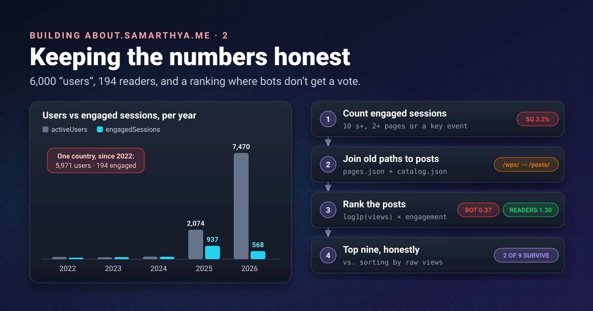


A scoreboard that counts the wind will tell you the wind is your biggest fan. Before the hub showed a single
number about this blog's readers, I checked what the raw numbers would have said. They would have been
confidently wrong.




[Part 1]() set up a script that reads Google Analytics.
This part is about what to do with what it reads. All numbers are from the blog's analytics, since 2022, as
of 7 November 2026.

## Why bother being honest?

It's my own blog; nobody audits it. But the stats page makes three kinds of claim, and each has a reader on
the other end:

- **"People read this."** The Popular tiles are recommendations. If bots pick them, a visitor spends their
  time on a post nobody actually read.
- **"Readers come from here."** A map is a statement about people. Publishing a wrong one is publishing a
  falsehood with a nice colour scale.
- **"This is what works."** I decide what to write next partly from these numbers. Bad numbers, bad decisions.

There's also a plainer reason: this blog was hacked once
([part 1 of the rebuild]()), and I'd rather it be
known for checking its facts than for looking busy.

## What Google already filters, and what it doesn't

GA4 [removes known bots by itself](https://support.google.com/analytics/answer/9888366), using Google's
research and the IAB's list of spiders and bots. That catches the polite crawlers that say who they are.
It doesn't catch automated browsers in data centres that run the page's JavaScript like a person would. To
GA4 those are users. How many? Enough to rewrite the map.

## What if I had not filtered: the countries

GA4's headline count is `activeUsers`, "the number of distinct users who visited". Here is the top of that
list next to **engaged sessions** (more on that measure in a moment):

| Country | Users | Share of users | Engaged sessions | Engagement rate | Avg. seconds per user |
|---|---:|---:|---:|---:|---:|
| Singapore | 5,971 | 57.7% | 194 | 3.2% | 1.7 |
| China | 2,850 | 27.5% | 698 | 24.4% | 3.6 |
| United States | 626 | 6.0% | 494 | 53.6% | 24.3 |
| Russia | 215 | 2.1% | 195 | 69.9% | 21.2 |
| Germany | 54 | 0.5% | 45 | 71.4% | 30.2 |
| India | 52 | 0.5% | 40 | 67.8% | 35.2 |
| United Kingdom | 29 | 0.3% | 29 | 90.6% | 31.3 |

The unfiltered map would have said: **more than half my readers are in Singapore, and 85% are in two
countries.** The other columns say what actually happened: nearly 6,000 "people" in Singapore stayed under
two seconds each, and fewer than 1 in 30 of their visits did anything a reader does. Real readers, in the
rows below, engage in more than half their visits and stay half a minute.

The same thing shows over time:

| Year | Users | Engaged sessions |
|---|---:|---:|
| 2022 | 157 | 108 |
| 2023 | 131 | 144 |
| 2024 | 182 | 175 |
| 2025 | 2,074 | 937 |
| 2026 | 7,470 | 568 |

For three years the columns move together: that's people. From 2025, "users" multiply by forty while engaged
sessions don't follow.

## The fix for countries: count engaged sessions

GA4 already has a test for "someone was really here". An
[**engaged session**](https://support.google.com/analytics/answer/12195621) is one that lasted longer than
10 seconds, had a key event, or viewed two or more pages. A bot that loads one page and leaves in a second
fails all three.

So the map and the country bars count `engagedSessions`, and countries with fewer than three are folded into
"Other" (a small country with one reader shouldn't be pinpointed). The result is a map that looks like the
2022–2024 blog: the US, China, Russia, Europe and India, at believable sizes.

It isn't perfect. A crawler that waits 10 seconds passes, and China's 24% engagement rate says a good part of
its traffic is probably automated too. But engaged sessions bring the numbers back to the same scale as the
years before the bots, and the method is GA4's own, documented, not a threshold I invented.

## What if I had not ranked: the Popular tiles

The home page shows nine Popular posts. Sorting is easy; deciding *by what* is the work. Here are three ways
to pick nine, using the same data:

| Sort by | What the top nine look like | Problem |
|---|---|---|
| **All-time views** | All nine are WordPress-era posts from 2020–2024 (D-Bus errors, Ansible privilege escalation, a Docker registry...). The most recent is from 2024. | Old posts win forever; nothing new can enter. |
| **Views in the last 28 days** | A newest-first list, including an OWASP post read for an average of **2.8 seconds** and a series finale at **4.7 seconds**. | Small numbers; a single burst of quick hits wins. |
| **The score (below)** | A mix: the new SSDLC post (29 s average), Learning OSV part 1 (88 s), two old favourites that are still read, *PAT: Personal Access Token*, *Git: Commit logs*, and three new posts. | It's a judgement call, but an open one. |

Only **two of the nine** all-time favourites survive into the scored list. That's the size of the decision.

### Joining old addresses first

Most of those all-time views were recorded under the WordPress addresses (`/wps/2024/09/11/...`), not today's
`/posts/...`. Without joining them, every old post would start from zero. The blog already keeps each old
address in the post's `aliases` (that's how old links still work), so I made Hugo publish them in a
`/catalog.json` and the build adds up views from every address a post has ever had. Reading time is a
weighted average: an old address with 200 views counts more than a new one with five.

### The score

The ranking is a small, pure function: numbers in, a number out, no surprises.

1. **Split views into non-overlapping windows**: the last 28 days, the 62 days before, and everything older.
2. **Turn older views into a rate per year tracked**, so a post doesn't win by age alone.
3. **Squash each window with [`log1p`](https://docs.python.org/3/library/math.html#math.log1p)**
   (the logarithm of 1 + x). On a log scale 2,000 views is worth about twice as much as 40, not fifty times,
   so one spike can't flatten everything else. Weight the windows 0.45, 0.30, 0.25: recent counts most.
4. **Multiply by an engagement factor** from 0.1 (zero seconds) to 1.0 (two minutes or more). This is the bot
   filter: a page nobody actually reads keeps a tenth of its score.

```python
from math import log1p

def popularity_score(views_28d, views_90d, views_all, avg_engagement_s, age_days, tracked_days):
    recent = max(views_28d, 0)
    middle = max(views_90d - views_28d, 0)
    older = max(views_all - views_90d, 0)
    years = max(min(age_days, tracked_days) - 90, 0) / 365
    views_score = (0.45 * log1p(recent) + 0.30 * log1p(middle)
                   + 0.25 * log1p(older / max(years, 1)))
    engagement = min(max(avg_engagement_s, 0), 120)
    return views_score * (0.1 + 0.9 * engagement / 120)
```

I tested it against the cases I was worried about before trusting it:

| Case | Score |
|---|---:|
| Bot spike: 2,000 views this month at 1 s each | 0.37 |
| New post, real readers: 40 views at 90 s | 1.30 |
| Old favourite: 5 / 15 / 600 views, 60 s, four years old | 1.53 |
| Old and forgotten: 600 views long ago, nothing lately, 60 s | 0.70 |

Fifty times the views, and the bot spike still scores under a third of the real readers. The old favourite
that's still read beats the new post; the forgotten one doesn't. That's the behaviour I wanted.

The first version didn't behave. Its engagement factor had a floor of 0.5, and the log already shrinks a
tenfold spike to about one and a half times, so a zero-second page kept half its score and bots still won the
test. Lowering the floor to 0.1 fixed it. The tests found that, not me reading the code.

## Saying so on the page

Honesty also means telling the reader what they're looking at. Each Popular tile says *"N reads this month"*
or *"N reads since 2022"*, whichever is meaningful, and the grid carries a note: ranked by recent and
long-term reads, weighted by reading time, so bot visits count for little, with a link to how the numbers
work.

## What is still not solved

- **Patient bots** pass the 10-second test. Engaged sessions shrink the problem; they don't end it.
- **Small numbers.** Analytics on the new site started in late October 2026, so "this month" is often a
  handful of reads. The weights will need a look once there are a few months of data.
- **Analytics only sees what runs JavaScript.** Bots that never run the tag never appear in GA4 at all. To
  see those, you have to look at the front door, which is where Cloudflare sits: part 4.

## Takeaways

- **Users are not readers.** Put `activeUsers` next to `engagedSessions` and engagement rate per country and
  per year before publishing any of it.
- GA4 removes *known* bots only; data-centre browsers that run JavaScript are counted as people.
- Count countries in engaged sessions, and fold tiny ones into "Other".
- Rank with a small, pure function: separate time windows, a log scale, and a reading-time factor; then test
  it against the bot spike you're afraid of.
- Tell readers on the page how the numbers were made.

## References

- [Known bot-traffic exclusion](https://support.google.com/analytics/answer/9888366): Analytics Help, what GA4 removes by itself
- [Engaged sessions and engagement rate](https://support.google.com/analytics/answer/12195621): Analytics Help, the definition used for countries
- [API dimensions & metrics](https://developers.google.com/analytics/devguides/reporting/data/v1/api-schema): Google for Developers, `activeUsers`, `engagedSessions`, `sessions`, `userEngagementDuration`
- [Method: properties.runReport](https://developers.google.com/analytics/devguides/reporting/data/v1/rest/v1beta/properties/runReport): Google for Developers, the queries behind the tables
- [math.log1p](https://docs.python.org/3/library/math.html#math.log1p): Python documentation
- [Hugo: URL management and aliases](https://gohugo.io/content-management/urls/#aliases): Hugo documentation, keeping old addresses
- [Hugo: custom output formats](https://gohugo.io/configuration/output-formats/): Hugo documentation, publishing `catalog.json`

Next: part 3, putting Cloudflare in front of the new subdomain.
