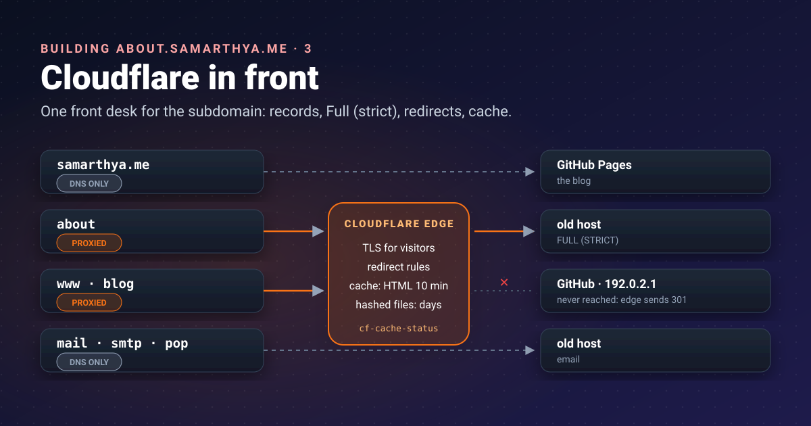


The hub lives on an old server I no longer fully trust. So it gets a receptionist: every visitor talks to
Cloudflare, and only Cloudflare talks to the server. This post is about setting up that front desk, record by
record.




[Part 1]() and
[part 2]() produced the data. Before the site can be
published (part 6), it needs an address, a certificate and a sensible cache.

## Words used in this post

| Term | Meaning here |
|---|---|
| **DNS record** | A line in the domain's phone book: "this name is at that address" |
| **Origin** | The server that actually holds the files (here, the old host) |
| **Edge** | Cloudflare's servers near the visitor, which answer first |
| **Proxied / DNS-only** | Cloudflare's orange and grey clouds: answer *as* the site, or just hand out the address |
| **TLS certificate** | Proof that a server really is the name in the address bar |
| **ACME** | The protocol Let's Encrypt uses to issue certificates automatically |
| **Cache** | A stored copy, so the next visitor doesn't need the origin |

## Why this subdomain is proxied when the blog isn't

In [Rebuilding, part 4]() I left the blog itself
**DNS-only**: GitHub Pages has its own fast network and renews its own certificate. The hub is different. Its
origin is the shared host that was [breached last month](),
which now only runs email and serves static files.

A [proxied record](https://developers.cloudflare.com/dns/proxy-status/) answers with Cloudflare's addresses
instead of the origin's, so visitors' requests land at Cloudflare, where its TLS, caching and rules apply.
For this site that means:

- **One front door.** Redirects, caching and, later, the like button (a Cloudflare
  Worker) all live at the edge, not on the host.
- **TLS checked twice.** Visitor to Cloudflare, and Cloudflare to the origin, both encrypted and verified.
- **Less traffic at the origin.** Cached files are served without touching it.

What it *doesn't* do here is hide the server. Mail can't be proxied (Cloudflare proxies only
[A, AAAA and CNAME records](https://developers.cloudflare.com/dns/proxy-status/); MX and the mail host stay
DNS-only), and the mail host is the same machine. Anyone curious can find the origin. The proxy is about
control, not secrecy, and the origin is hardened as if it were public (part 6).

## The records

No addresses here, only their shape:

| Name | Type | Proxy | Points to | Job |
|---|---|---|---|---|
| `samarthya.me` | A | DNS only | GitHub Pages | The blog |
| `www` | CNAME | **Proxied** | GitHub Pages | Redirected to the apex by Cloudflare |
| `about` | A | **Proxied** | the old host | This hub |
| `blog` | A | **Proxied** | `192.0.2.1` | Old address: redirected by Cloudflare |
| `mail`, `smtp`, `pop` | A | DNS only | the old host | Email |

`192.0.2.1` deserves a note. It's in a block [reserved for documentation](https://www.rfc-editor.org/rfc/rfc5737)
that "SHOULD NOT appear on the public Internet". Proxying the old `blog` name to it means no request ever
reaches a real server: Cloudflare answers every one of them with a redirect.

`www` was a surprise. I thought it was DNS-only like the blog, but the dashboard showed **90,000 requests in a
week, 86,000 "served by origin"**, far more than a week-old hub could explain. A quick check found `www`
proxied: every request went through Cloudflare to GitHub Pages, only for GitHub to answer "go to the apex".
Two-thirds of it turned out to be Googlebot re-checking old addresses after the move (part 4). Now Cloudflare answers `www` itself (step 3), and GitHub is
never asked.

## Step 1: a certificate at the origin that renews itself

Cloudflare's edge has its own certificate for visitors. The origin needs one too, or the connection between
Cloudflare and the host can't be verified.

The hosting panel issues one from **Let's Encrypt** using the
[HTTP-01 challenge](https://letsencrypt.org/docs/challenge-types/): Let's Encrypt asks for a token at
`http://about.<domain>/.well-known/acme-challenge/<token>`, and the panel puts it there. That works through
Cloudflare's proxy, because the request simply passes through to the origin, and Let's Encrypt follows
redirects to HTTPS on port 443 if there are any.

Two things surprised me:

1. **"Names skipped" is not an error.** The panel tries every name it knows. Names that now point elsewhere
   (the blog moved to GitHub) fail the check and are left out. The certificate is still issued for the rest.
2. **The first certificate was the wrong one.** Until provisioning re-ran with `about` included, the origin
   answered with the host's default certificate, issued for the provider's own server name. Visitors saw
   nothing wrong yet, because the SSL mode wasn't strict. That's exactly the gap the next step closes.

I chose HTTP-01 over **DNS-01** on purpose. DNS-01 needs a DNS API token on the server, and Let's Encrypt
itself warns that "putting your full DNS API credentials on your web server significantly increases the impact
if that web server is hacked". On a host that *was* hacked, that's a no.

Check what the origin really serves, bypassing Cloudflare (replace the placeholders):

```bash
openssl s_client -connect ORIGIN_IP:443 -servername about.example.com </dev/null 2>/dev/null \
  | openssl x509 -noout -subject -ext subjectAltName -enddate
```

The `subjectAltName` line must list `about.example.com`.

## Step 2: SSL mode Full (strict)

Cloudflare's [encryption modes](https://developers.cloudflare.com/ssl/origin-configuration/ssl-modes/) decide
how it talks to the origin:

| Mode | Cloudflare → origin |
|---|---|
| Off | No encryption at all |
| Flexible | **Plain HTTP**; only the visitor's half is encrypted |
| Full | HTTPS, but the origin's certificate isn't checked |
| **Full (strict)** | HTTPS, and the certificate must be valid for the name |

Cloudflare "strongly recommends using Full or Full (strict) modes". Flexible looks secure in the browser
while the second half travels in the clear. Full encrypts but would happily accept the wrong certificate from
step 1. **Full (strict)** turns that mistake into a visible error, which is what you want. Set it under
*SSL/TLS → Overview*, after step 1 shows the right name.

The catch: with strict mode, an expired origin certificate means the site is down. The panel renews
automatically; I've noted the renewal date anyway.

## Step 3: redirect rules for the old address

Six years of links point at `blog.samarthya.me/wps/...`. Before the move, the old host answered them with
a page that *said* "301 Moved" but returned **HTTP 200**, which search engines treat as a real page. So the
redirect moved to Cloudflare, under *Rules → Redirect Rules*
([Single Redirects](https://developers.cloudflare.com/rules/url-forwarding/single-redirects/); the free plan
allows [10](https://developers.cloudflare.com/rules/url-forwarding/)):

| Order | When | Then |
|---|---|---|
| 1 | `http.host eq "blog.samarthya.me" and http.request.uri.path in {"/feed" "/feed/" "/wps/feed/"}` | Static: `https://samarthya.me/index.xml`, 301 |
| 2 | Hostname equals `blog.samarthya.me` | Dynamic: `concat("https://samarthya.me", http.request.uri.path)`, 301, **preserve query string** |
| 3 | Hostname equals `www.samarthya.me` | The same dynamic redirect, 301, **preserve query string** |

The `www` rule replaced a round trip to GitHub. Before it, the response came from GitHub through Cloudflare
(`cf-cache-status: DYNAMIC`); now it comes straight from the edge, and GitHub's certificate for `www` no
longer matters.

Three details matter:

- **Order.** The feed rule must sit above the general one, or old feed readers get sent to a page that
  doesn't exist. The end-to-end test caught the missing feed, not me.
- **Preserve query string** is [off by default](https://developers.cloudflare.com/rules/url-forwarding/single-redirects/settings/).
  Turn it on for the general rule (old `?p=123` links need it), and leave it off for the feed rule, which
  always goes to one fixed address.
- **301** means permanent: browsers and search engines remember it and update their links.

```bash
curl -sI "https://blog.example.com/wps/some/post/?a=1" | grep -i "^HTTP\|^location"
# HTTP/1.1 301 Moved Permanently
# Location: https://example.com/wps/some/post/?a=1
```

## Step 4: what gets cached

By default, ["the Cloudflare CDN does not cache HTML or JSON"](https://developers.cloudflare.com/cache/concepts/default-cache-behavior/);
it caches files by extension: CSS, JS, images, fonts. You can see it in the headers:

```bash
curl -sI https://about.example.com/ | grep -i "cf-cache-status\|cache-control"
# cache-control: max-age=600
# cf-cache-status: DYNAMIC
```

[`DYNAMIC`](https://developers.cloudflare.com/cache/concepts/cache-responses/) means Cloudflare
"determined at request time that the asset is not eligible for cache": every page view goes to the origin.

For a site that only changes when I publish, that's wasted trips to a server I'd rather keep quiet. So I added
one [Cache Rule](https://developers.cloudflare.com/cache/how-to/cache-rules/) (the free plan has 10):

| Setting | Value | Why |
|---|---|---|
| When | Hostname equals `about.samarthya.me` | This site only |
| Cache eligibility | Eligible for cache | Include HTML |
| Edge TTL | Use cache-control header if present | The origin already says how long ([settings](https://developers.cloudflare.com/cache/how-to/cache-rules/settings/)) |
| Browser TTL | Respect origin | Same |

Right after creating it, the first request showed `MISS` and the next ones `HIT`, with `max-age=600` intact.

The origin's `.htaccess` sets the lifetimes: **10 minutes** for HTML, 7 days for CSS and scripts, 30 days for
images. Long lifetimes are only safe for files whose **name changes when the content does**: Quarto names its
stylesheet `bootstrap-<hash>.min.css`, and the page loads `live.js?v=<hash>`. A new publish produces new
names, so nobody gets yesterday's stylesheet with today's page.

That design also means I don't need to purge the cache after each publish. HTML expires within ten minutes
on its own, and Cloudflare warns that a full purge means ["every subsequent request must be served from your
origin until the cache is repopulated"](https://developers.cloudflare.com/cache/how-to/purge-cache/purge-everything/).

### Cache and freshness

Caching makes a static page *more* static. That's why the home page doesn't depend on the cache for news:
the Recent tiles are refreshed in the visitor's browser from the blog's own `latest.json`, every load. The
cache holds the frame; the posts come live. Part 6 has the details.

## Checking it from the outside

| Check | Expect |
|---|---|
| `curl -sI https://about.example.com/` | `server: cloudflare`, 200 |
| `openssl s_client` to the origin (step 1) | the `about` name in `subjectAltName` |
| `curl -sI https://blog.example.com/wps/x/?a=1` | 301 to the same path and query on the apex |
| `curl -sI https://blog.example.com/feed/` | 301 to `/index.xml` |
| `curl -sI https://about.example.com/` twice | `MISS` the first time, then `cf-cache-status: HIT` |

## Takeaways

- Proxy a subdomain when you want one front door for TLS, rules and caching; don't expect it to hide an origin
  that also runs mail.
- Get the origin certificate right **first**, then switch to **Full (strict)**, so a wrong certificate becomes
  an error instead of a silent gap.
- Prefer HTTP-01 on a server you don't fully trust: DNS-01 would put DNS credentials on it.
- Redirect at the edge with a real 301, keep query strings where old links use them, and mind the rule order.
- Cache HTML briefly, cache hashed files for long, and you rarely need to purge.

## References

- [Proxy status](https://developers.cloudflare.com/dns/proxy-status/): Cloudflare, proxied vs DNS-only and which records can be proxied
- [Encryption modes](https://developers.cloudflare.com/ssl/origin-configuration/ssl-modes/): Cloudflare, Off to Full (strict)
- [Challenge types](https://letsencrypt.org/docs/challenge-types/): Let's Encrypt, HTTP-01 and DNS-01
- [Single Redirects](https://developers.cloudflare.com/rules/url-forwarding/single-redirects/), [settings](https://developers.cloudflare.com/rules/url-forwarding/single-redirects/settings/) and [availability](https://developers.cloudflare.com/rules/url-forwarding/): Cloudflare
- [Default cache behaviour](https://developers.cloudflare.com/cache/concepts/default-cache-behavior/) and [cache responses](https://developers.cloudflare.com/cache/concepts/cache-responses/): Cloudflare
- [Cache Rules](https://developers.cloudflare.com/cache/how-to/cache-rules/) and [their settings](https://developers.cloudflare.com/cache/how-to/cache-rules/settings/): Cloudflare
- [Purge everything](https://developers.cloudflare.com/cache/how-to/purge-cache/purge-everything/): Cloudflare
- [RFC 5737: IPv4 address blocks reserved for documentation](https://www.rfc-editor.org/rfc/rfc5737): IETF

Next: part 4, how Cloudflare tells people from bots.
