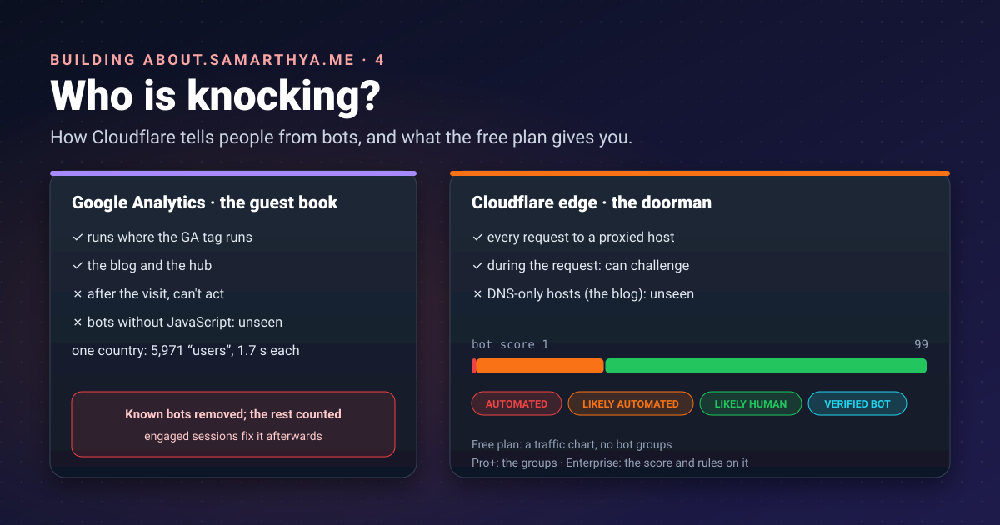
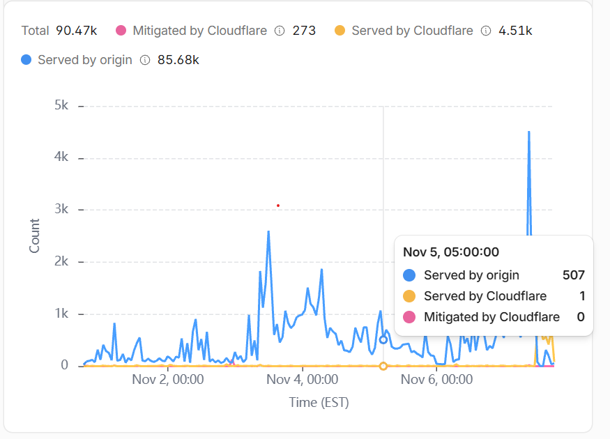
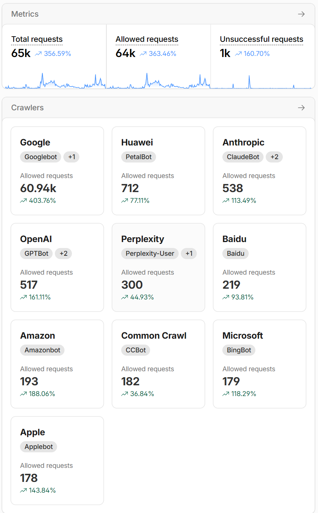


Google Analytics is the guest book: it only knows who signed it. Cloudflare is the doorman: it sees everyone
who walks up, including the ones who never come in. In part 2 the guest book was full of fake names. This
post is about the doorman.


## Two sets of eyes

In [part 2]() one country showed 5,971 "users" with an
average visit of 1.7 seconds. Google Analytics could only tell me that afterwards, and only for visitors that
ran its JavaScript. Cloudflare sits in front of the site, so it sees each request before the server does.
They see different things:

| | Google Analytics | Cloudflare edge |
|---|---|---|
| Sees | Browsers that run the GA tag | Every HTTP request to a **proxied** host |
| When | After the visit, in reports | During the request, and can act on it |
| Misses | Bots that never run JavaScript | Hosts that are DNS-only |
| Judges bots by | Its [known-bot list](https://support.google.com/analytics/answer/9888366), and what you infer (engagement) | Its own detection engines, per request |
| On this domain | The blog **and** the hub | The hub, and the `www.` and old `blog.` addresses it redirects |

That last row matters. The blog itself is DNS-only, served straight by GitHub Pages
([Rebuilding, part 4]() explains why), so Cloudflare
never sees a blog reader. It sees requests to `about.samarthya.me`, which is proxied
([part 3]()), and to the `www.` and old `blog.`
names, which it answers with redirects. So the two can't be compared post by post; they answer different
questions.

## How Cloudflare decides

Cloudflare runs several [detection engines](https://developers.cloudflare.com/bots/concepts/bot-detection-engines/):

| Engine | What it does |
|---|---|
| **Heuristics** | Runs on every request and compares it with a database of known malicious fingerprints |
| **JavaScript Detections** | Injects a small, invisible script into HTML pages to spot headless browsers and other automated clients |
| **Machine learning** (Adaptive Intelligence) | Gives each request a score; Enterprise Bot Management only |
| **Anomaly Detection** | Learns a site's normal traffic and flags outliers; Enterprise only, and being retired |

A *fingerprint* is the shape of a connection rather than what the client claims to be. Cloudflare's
[JA3/JA4 fingerprints](https://developers.cloudflare.com/bots/additional-configurations/ja3-ja4-fingerprint/),
for example, "identify TLS clients based on how they initiate connections". A script can call itself Chrome
in its user agent; it's much harder to *connect* like Chrome. (Seeing the raw fingerprints is an Enterprise feature;
the heuristics engine, which checks requests against known malicious fingerprints, runs on every request.)

The result is a [bot score](https://developers.cloudflare.com/bots/concepts/bot-score/) from 1 to 99:

| Score | Meaning |
|---|---|
| 1 | Automated: Cloudflare is "quite certain the request was automated" |
| 2–29 | Likely automated |
| 30–99 | Likely human |
| (separate) | **Verified bot**: automated, but known and well behaved |

The individual score is for [Enterprise customers with Bot Management](https://developers.cloudflare.com/bots/concepts/bot-score/);
Pro and higher plans see the groups. On the free plan,
[Security Analytics](https://developers.cloudflare.com/waf/analytics/security-analytics/) is included with
31 days of history, but on my zone it showed traffic, not bot groups (more below).

### Good bots get a pass

Not every bot is a problem. Search engines, link previews and uptime monitors are bots I want.
[Verified bots](https://developers.cloudflare.com/bots/concepts/bot/verified-bots/) are ones Cloudflare has
confirmed are "transparent about who it is and what it does": they prove their identity with a published IP
list or a cryptographic *Web Bot Auth* signature, follow `robots.txt` and keep their request rates
reasonable. Googlebot, Bingbot, link previews from Slack and Discord, and Lighthouse are on the list; a bot
that misbehaves is taken off it.

## What the free plan gives you

| Feature | What it does | Plan |
|---|---|---|
| [Bot Fight Mode](https://developers.cloudflare.com/bots/get-started/bot-fight-mode/) | Challenges ["simple bots from cloud hosting providers and headless browsers"](https://developers.cloudflare.com/bots/plans/free/) with CPU-expensive puzzles | Free |
| [AI Crawl Control](https://developers.cloudflare.com/ai-crawl-control/) | Shows which AI services crawl the site, whether they follow `robots.txt`, and lets you allow or block each | All plans |
| [Managed robots.txt](https://developers.cloudflare.com/bots/additional-configurations/managed-robots-txt/) | Adds AI-crawler rules and *Content Signals* (`search`, `ai-input`, `ai-train`) before your own `robots.txt` | All plans |
| [AI Labyrinth](https://developers.cloudflare.com/bots/additional-configurations/ai-labyrinth/) | Hides `nofollow` links that only bots see; crawlers that ignore the rules wander into a maze, and get recorded | Listed for Free |
| [Security Analytics](https://developers.cloudflare.com/waf/analytics/security-analytics/) | All requests, 31 days; on my free zone a traffic chart with source IP, country and method filters, no bot groups | All plans |
| Super Bot Fight Mode | Bot Fight Mode with exceptions and finer control | Pro and up |
| Bot Management | Per-request scores, rules on the score | Enterprise |

### Bot Fight Mode: read the small print first

It's one switch, and that's both the appeal and the catch. Cloudflare's own page lists the trade-offs:

- It ["cannot be customized, adjusted, or reconfigured via WAF custom rules"](https://developers.cloudflare.com/bots/get-started/bot-fight-mode/),
  and "you cannot bypass or skip Bot Fight Mode using WAF custom rules or Page Rules".
- It "may challenge API or mobile app traffic".
- JavaScript Detections come with it and can't be turned off. The injected script loads from
  `/cdn-cgi/challenge-platform/` on the site's own address, so a Content Security Policy must allow it
  ([details](https://developers.cloudflare.com/bots/additional-configurations/javascript-detections/)). Mine
  allows `script-src 'self'`, which covers it.

For this site, two of my own automated clients go through the edge: the publish script's checks (part 6)
and, potentially, the certificate authority's HTTP-01 check when the origin certificate renews (part 3). I
can't add an exception for either. So the switch gets turned on only together with a test of both: run the
publish checks, and watch the next certificate renewal.

## What Cloudflare saw on my site

The first surprise was what the free plan *doesn't* show. Security Analytics on the free plan has a traffic
chart and filters for source IP, country and HTTP method, but no host filter and no bot groups. Everything in
it is the whole zone's proxied traffic. Here's one week, 1–7 November 2026:

| | Requests |
|---|---:|
| Total | 90,470 |
| Served by origin | 85,680 |
| Served by Cloudflare | 4,510 |
| Mitigated by Cloudflare | 273 |

Ninety thousand requests, for a hub that was days old and redirects that never reach a server? The answer was
`www`. It was proxied without my noticing, so every request to `www.samarthya.me` went through Cloudflare to
GitHub Pages just to get a redirect to the apex: that's the "served by origin". Real readers rarely type
`www.`, and GA saw a few hundred page views on the new blog in the same weeks. So who was it?

The fix was one more redirect rule ([part 3]()):
Cloudflare now answers `www` itself, so those requests move from "served by origin" to "served by Cloudflare"
and GitHub never sees them.

### The crawlers have names

The free plan has no bot groups, but [AI Crawl Control](https://developers.cloudflare.com/ai-crawl-control/)
names the crawlers it recognises, and it answered the question at once:

| Crawler | Operator | Requests |
|---|---|---:|
| Googlebot (+1) | Google | 60,940 |
| PetalBot | Huawei | 712 |
| ClaudeBot (+2) | Anthropic | 538 |
| GPTBot (+2) | OpenAI | 517 |
| Perplexity-User (+1) | Perplexity | 300 |
| Baidu | Baidu | 219 |
| Amazonbot | Amazon | 193 |
| CCBot | Common Crawl | 182 |
| BingBot | Microsoft | 179 |
| Applebot | Apple | 178 |

**Two-thirds of all the proxied traffic was Googlebot**: 60,940 of 90,470 requests, both views covering
the same last seven days. That isn't an attack; it's Google doing what it
[says it does after a site move](https://developers.google.com/search/docs/crawling-indexing/site-move-with-url-changes):
it must "visit every old and new URL at least once", and it "will temporarily crawl your new site more heavily
than usual". The blog changed host and address scheme in October, so Google is walking through six years of
old `www.` and `blog.` links and following each redirect. The same page says to keep redirects "generally at
least 1 year", which is one more reason they live at the edge, where they cost nothing.

The AI crawlers together made around 2,000 requests: Huawei, Anthropic, OpenAI, Perplexity, Amazon, Common
Crawl, Apple. All were allowed, because I haven't set a policy yet (below).

So the doorman's view corrects my guess from the guest book. In GA the bots were anonymous data-centre
browsers that pretend to be people. At the door, most of the traffic is *declared* crawlers, mostly one I
want.

### What got blocked without me asking

The 273 "mitigated" requests came from rules I never wrote. The event log for one day (7 November) shows 24
of them, and they tell one story:

| | |
|---|---|
| Action | Block, all 24 |
| By | Cloudflare's managed rules, described as "Wordpress – Broken Access Control, File Inclusion" |
| Target | 23 to the old `blog.` address, 1 to `about` |
| Paths | `/wp-config.php` and its leftovers: `.bak`, `.old`, `.new`, `.swp`, `~`, `/app/wp-config.php`, and one disguised as `/%77p-config.php` |
| Who | 16 from one scanner on one hosting network, the rest from three other networks |

`wp-config.php` is the file that holds a WordPress site's database password. Editors leave backup copies of
it (`.bak`, `.swp`, `~`) that a web server will hand out as plain text. Scanners still try the old address of a
WordPress blog that was [hacked in October](), hoping
a copy survived. None did: that site is gone, and the address only redirects. But Cloudflare's
[free managed ruleset](https://developers.cloudflare.com/waf/managed-rules/), "available on all Cloudflare
plans" and aimed at "high-impact and widely exploited vulnerabilities", blocked them anyway.

### What I expect next

The `www` redirect rule went in on 7 November, the same day as the screenshot above. From then on Cloudflare
answers those old links itself, so the "served by origin" line should fall while the total stays about the
same: Googlebot keeps knocking, it just stops getting through to GitHub. I'll add a second screenshot to this
post in two weeks to show whether it did.

## What I've turned on so far: nothing, on purpose

Every switch on the Bots page changes who gets in, and a week of data is not much to judge by. So for now:

1. **Watch first.** Security Analytics and AI Crawl Control cost nothing and change nothing. Two weeks of data
   before any switch.
2. **Then decide on a managed robots.txt** and its Content Signals: `search` (yes, clearly), `ai-input`
   (answers that quote me) and `ai-train` (training data). That's a values question, not a technical one, and
   I'd rather answer it with the numbers in front of me.
3. **Bot Fight Mode** only after testing the publish checks and a certificate renewal, as above.
4. **Keep the stats page honest either way.** Blocking bots at the door would make *future* GA numbers
   cleaner, but the engaged-session counting from part 2 stays: it's what keeps the four years of history
   comparable.

## Takeaways

- Analytics tells you who signed the guest book; the edge sees everyone at the door. Use both, and know which
  hosts each can see.
- Cloudflare sorts requests into automated, likely automated, likely human and verified bots; Pro and higher
  plans show the groups, Enterprise shows the score, and the free plan shows declared crawlers in AI Crawl
  Control.
- Verified bots prove who they are; that's why search engines and link previews keep working when you block
  the rest.
- Bot Fight Mode is free but has no exceptions: test your own automation before switching it on.
- Deciding what AI crawlers may do with your writing is a policy choice; Cloudflare gives you the switches, not
  the answer.

## References

- [Bot detection engines](https://developers.cloudflare.com/bots/concepts/bot-detection-engines/): Cloudflare
- [Bot scores](https://developers.cloudflare.com/bots/concepts/bot-score/): Cloudflare, the 1–99 scale and its groups
- [JA3/JA4 fingerprints](https://developers.cloudflare.com/bots/additional-configurations/ja3-ja4-fingerprint/): Cloudflare, connection fingerprints
- [Verified bots](https://developers.cloudflare.com/bots/concepts/bot/verified-bots/): Cloudflare
- [Free plan bot features](https://developers.cloudflare.com/bots/plans/free/): Cloudflare
- [Bot Fight Mode](https://developers.cloudflare.com/bots/get-started/bot-fight-mode/): Cloudflare, behaviour and limitations
- [JavaScript detections](https://developers.cloudflare.com/bots/additional-configurations/javascript-detections/): Cloudflare, the injected script and CSP
- [AI Crawl Control](https://developers.cloudflare.com/ai-crawl-control/): Cloudflare
- [Managed robots.txt](https://developers.cloudflare.com/bots/additional-configurations/managed-robots-txt/): Cloudflare, Content Signals
- [AI Labyrinth](https://developers.cloudflare.com/bots/additional-configurations/ai-labyrinth/): Cloudflare
- [Security Analytics](https://developers.cloudflare.com/waf/analytics/security-analytics/): Cloudflare, availability and retention
- [Known bot-traffic exclusion](https://support.google.com/analytics/answer/9888366): Analytics Help, what GA4 filters
- [Site moves with URL changes](https://developers.google.com/search/docs/crawling-indexing/site-move-with-url-changes): Google Search Central, recrawling after a move and keeping redirects
- [WAF managed rules](https://developers.cloudflare.com/waf/managed-rules/): Cloudflare, the free managed ruleset

Next: part 5, building the site itself in Quarto.
