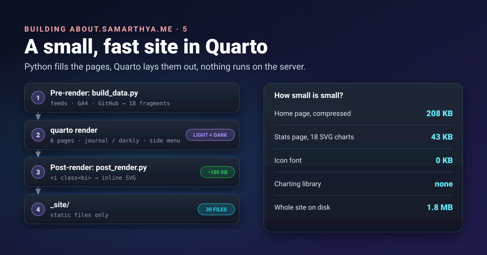


A hub page is a signpost, and nobody wants to wait for a signpost to load. The goal for this site was simple:
a handful of pages, built on my PC from data, light enough to open instantly on a phone, and with nothing on
the server that can run.




Parts [1]() and
[2]() produced the numbers,
[3]() and
[4]() the front door. This part is the house itself.

## Why Quarto, when the blog is Hugo

The blog stays on [Hugo](): hundreds of posts,
fast builds, a theme I like. The hub is a different job. It has six pages, and almost everything on them is
*computed*: tiles from the blog's feeds, rankings from analytics, charts from numbers. That's Python's home
ground.

[Quarto](https://quarto.org/) is a publishing system that turns Markdown (with optional Python, R or Julia)
into websites. It has Bootstrap themes, light and dark mode, and a side menu built in, and it can run a
script of mine before and after every build. So Python does the data, Quarto does the pages, and neither has
to pretend to be the other.

## Words used in this post

| Term | Meaning here |
|---|---|
| **Static site** | Plain files (HTML, CSS, images); the server only hands them out, nothing runs |
| **Pre-render / post-render** | Scripts Quarto runs before and after building the pages |
| **Fragment** | A small generated piece of Markdown or HTML, pulled into a page |
| **SCSS** | CSS with variables; Quarto themes are written in it |
| **SVG** | Pictures described as text (shapes and coordinates), so they stay sharp and small |
| **Icon font** | A font whose "letters" are icons; easy to use, heavy to download |

## The shape of the project

```text
_quarto.yml          site settings: side menu, themes, the two scripts
index.qmd, stats.qmd, code.qmd, work.qmd, contact.qmd, 404.qmd
_generated/          fragments written by the pre-render script
styles/custom.scss   light theme tweaks, tiles, charts, menu
styles/dark.scss     dark theme values
icons/               Bootstrap Icons as SVG files
tools/build_data.py  pre-render: fetch, rank, draw, write fragments
tools/charts.py      bar charts, columns and the world map, as SVG
tools/post_render.py post-render: icon glyphs -> inline SVG
live.js              refreshes the home page's tiles in the browser (part 6)
```

The pages themselves are short. The home page is a heading, a sentence, and *includes*:

```markdown


::: {.panel-tabset}
## Recent

## Popular

:::
```

An [include](https://quarto.org/docs/authoring/includes.html) is "equivalent to copying and pasting the text
from the included file into the main file". The underscore in `_generated/` matters: Quarto ignores files and
folders starting with `_` when it looks for pages to render.

## The build, step by step

```yaml
project:
  type: website
  pre-render: tools/build_data.py
  post-render: tools/post_render.py
  render: ["*.qmd"]
```

1. **Pre-render** ([Quarto's project scripts](https://quarto.org/docs/projects/scripts.html)):
   `build_data.py` downloads the blog's `latest.json` and `catalog.json`, my GitHub profile, and reads the
   analytics files from part 1. It ranks, draws, and writes eighteen fragments into `_generated/`. Every
   download is cached, so a build still works offline with the last good copy.
2. **Render**: Quarto turns each `.qmd` into HTML with the theme and side menu.
3. **Post-render**: `post_render.py` edits the finished HTML (icons, below).

Three things bit me on the way:

- **Includes must exist before the pre-render runs.** Quarto reads the pages, and their includes, before it
  calls my script. On a fresh checkout there were no fragments yet, so the build failed before the script that
  would have made them. The fix is unglamorous: commit `_generated/` to git, so there is always a last copy.
- **`render: ["*.qmd"]`.** Without it Quarto also rendered my `PLAN.md` notes as a public page. Rendering only
  `.qmd` files keeps notes, the README and the series outline out of the site.
- **Don't build while previewing.** `quarto preview` (live reload while editing) and `quarto render` share
  temporary folders. Running both at once fails with confusing "file not found" errors.

## Navigation: a side menu, not a top bar

Wide screens have room to the side, so the menu is a
[floating sidebar](https://quarto.org/docs/websites/website-navigation.html): five pages (Home, Stats, Code,
Work, Find me) and a row of tool icons for the blog, GitHub, LinkedIn, X and RSS. On a phone Quarto folds it
into "a title bar at the top which you can click or touch to reveal the navigation", so there's nothing extra
to build for mobile.

## Themes: light, dark, and an ordering trap

Quarto supports a [light and a dark theme](https://quarto.org/docs/output-formats/html-themes.html) and,
with `respect-user-color-scheme: true`, follows the visitor's system setting:

```yaml
format:
  html:
    theme:
      light: [journal, styles/custom.scss]
      dark: [darkly, styles/dark.scss, styles/custom.scss]
    respect-user-color-scheme: true
```

`custom.scss` holds everything shared: the blog's orange as the accent (`#c2410c`, about 5.2:1 against white,
enough for link text), system fonts instead of a web-font download, tile and chart styles. `dark.scss` holds
the dark values: a lighter orange and its own chart colours.

The trap was the order. In dark mode my dark chart colours were ignored. The shared file declares them with
Sass's `!default` flag, which ["assigns a value to a variable *only if* that variable isn't defined"](https://sass-lang.com/documentation/variables/).
So whichever file sets a variable *first* wins, and `dark.scss` has to come **before** `custom.scss`, not
after it as you'd expect for "overrides".

## Icons without an icon font

Quarto draws its menu icons with the Bootstrap Icons font: one `<i class="bi bi-github">` per icon, and a
**180 KB** font file to make them appear. For fifteen icons that's a poor trade.

`post_render.py` fixes it after the build. It finds each `<i class="bi bi-NAME">` in the HTML, replaces it with
the same icon as inline SVG from `icons/` ([Bootstrap Icons](https://icons.getbootstrap.com/), MIT licence, kept next to the icons),
adds an icon in front of each menu entry, and, once no glyph is left anywhere, deletes the font and its
stylesheet from the site:

```python
GLYPH = re.compile(r'<i class="bi bi-([a-z0-9-]+)"[^>]*></i>')

for page in SITE.rglob("*.html"):
    html = page.read_text(encoding="utf-8")
    html = GLYPH.sub(lambda m: svg(m.group(1)) or m.group(0), html)  # unknown names stay as they were
    page.write_text(html, encoding="utf-8")
```

Inline SVG also takes the page's text colour, so the icons follow light and dark mode for free.

## Charts drawn at build time

The Stats page has eighteen charts and a world map, and loads no charting library. `charts.py` writes each
chart as SVG text while the site is built:

- **Bars and columns** with the value at the tip and labels in text colours, not the bar colour.
- **A tooltip per mark** using SVG's own `<title>` element: hover shows the value, no JavaScript.
- **A table view** under each chart, in a `<details>` element ("Show as a table"), for screen readers and
  anyone who prefers numbers.
- **Colours as CSS variables**, so the same SVG follows light and dark mode. The map's colour steps were run
  through a contrast checker for both backgrounds, rather than picked by eye.

The map uses the [Equal Earth projection](https://en.wikipedia.org/wiki/Equal_Earth_projection) (Šavrič,
Patterson and Jenny, 2018). It's equal-area, so countries near the poles aren't inflated as they are on web
maps, which matters when colour means "how many". The outlines are
[Natural Earth's 110m countries](https://www.naturalearthdata.com/downloads/110m-cultural-vectors/),
[in the public domain](https://www.naturalearthdata.com/about/terms-of-use/). Rounding every point to a whole
pixel and dropping repeats keeps the map small enough to inline.

## How small is small?

| Measure | Value |
|---|---|
| Files in the site | 30 |
| Size on disk | 1.8 MB |
| Home page with its CSS and scripts, compressed | about 208 KB |
| Largest single items | Bootstrap CSS, about 69 KB compressed, once per theme |
| Stats page HTML with all 18 SVG charts, compressed | about 43 KB |
| Icon font | 0 KB (was 180 KB) |

The post images in the tiles come from the blog and load lazily, as they scroll into view. What's left is
mostly Bootstrap. It's the next thing to trim, and the last: the rest is already text.

## Takeaways

- Use the tool that fits the job: Hugo for hundreds of posts, Quarto for a few computed pages.
- Generate fragments in a pre-render script and pull them in with includes; commit the fragments so a fresh
  checkout can build.
- Render only `.qmd` files, so notes never become pages.
- With Sass `!default`, the file listed first wins.
- A post-render step can replace a 180 KB icon font with a few hundred bytes of inline SVG.
- SVG charts drawn at build time need no library, work in both themes, and can carry their own tooltips and
  table view.

## References

- [Quarto](https://quarto.org/): the publishing system
- [Project scripts](https://quarto.org/docs/projects/scripts.html): Quarto, pre-render and post-render
- [Includes](https://quarto.org/docs/authoring/includes.html): Quarto, the include shortcode and underscore files
- [Website navigation](https://quarto.org/docs/websites/website-navigation.html): Quarto, sidebars and tools
- [HTML themes](https://quarto.org/docs/output-formats/html-themes.html): Quarto, light/dark and custom SCSS
- [Variables](https://sass-lang.com/documentation/variables/): Sass, the `!default` flag
- [Bootstrap Icons](https://icons.getbootstrap.com/): the icon set (MIT)
- [Equal Earth projection](https://en.wikipedia.org/wiki/Equal_Earth_projection): Wikipedia, citing Šavrič, Patterson and Jenny, *International Journal of Geographical Information Science* 33(3), 2018
- [Natural Earth 110m cultural vectors](https://www.naturalearthdata.com/downloads/110m-cultural-vectors/) and [terms of use](https://www.naturalearthdata.com/about/terms-of-use/): public-domain country outlines

Next: part 6, shipping it to a server I don't trust, and keeping it fresh.
