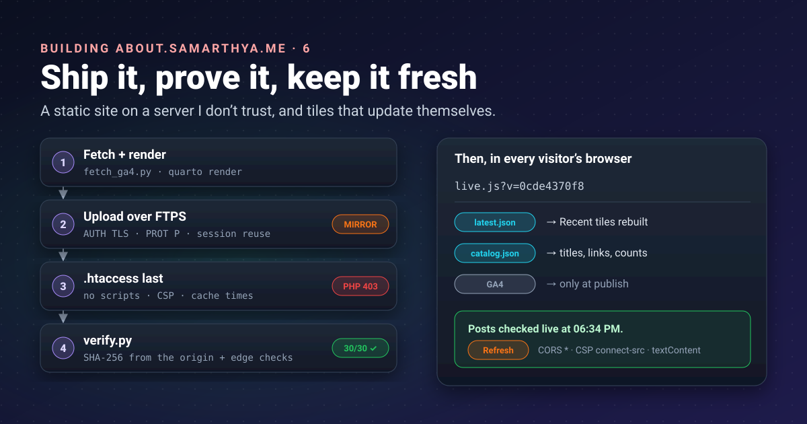


Imagine delivering furniture to a house that was burgled last month. You don't just drop the boxes at the
door: you check the locks, take away anything that isn't yours, and photograph every room before you leave.
That's how this site gets published.




The site from [part 5]() is thirty files on my PC. The
server they go to is the shared host whose WordPress site was
[compromised in October](). It still runs my email
and it can serve files; it's the only server I have for this. So the rule for everything below is: **treat
the server as untrusted storage.** It holds files; it never runs code; and I check what it serves.

## Words used in this post

| Term | Meaning here |
|---|---|
| **FTP / FTPS** | The old file-transfer protocol; FTPS is FTP wrapped in TLS, so passwords and files are encrypted |
| **TLS session** | The agreed keys of an encrypted connection; *reusing* one skips a new handshake |
| **Mirror** | Make the remote folder an exact copy: upload what's new, delete what's extra |
| **Hash (SHA-256)** | A fingerprint of a file's bytes; change one byte and the hash changes completely |
| **`.htaccess`** | A settings file the Apache web server reads per folder |
| **CSP** | Content Security Policy: a header telling the browser what a page may load and run |
| **CORS** | The rule that decides whether a page on one site may read data from another |

## The threat model, in four lines

1. **Anything could be planted** in the site's folder if the account is abused again: a PHP back door, a
   changed page.
2. **So nothing may run.** The site is static; the server is told to refuse scripts even if one appears.
3. **So every publish overwrites everything and deletes the rest.**
4. **And then I prove it**: fetch every file back and compare fingerprints.

## Getting the files there: FTPS, the careful way

The host offers FTP, not SSH. FTP on its own sends the password in plain text, so it has to be **explicit
FTPS** ([RFC 4217](https://www.rfc-editor.org/rfc/rfc4217)): connect, upgrade to TLS with `AUTH TLS`, check
the server's certificate, *then* log in, then encrypt the file transfers too. Python's
[`ftplib.FTP_TLS`](https://docs.python.org/3/library/ftplib.html) does it, with one catch: "the user must
explicitly secure the data connection by calling the `prot_p()` method".

The account is a separate FTP user that can only see the site's folder. Its password lives in Windows
Credential Manager through the [`keyring`](https://pypi.org/project/keyring/) library, never in a file:

```python
ftp = FTPS(context=ssl.create_default_context(), timeout=30)   # certificate and host name checked
ftp.connect(host, 21)
ftp.auth()          # AUTH TLS before any credentials
ftp.login(user, keyring.get_password("my-site-ftp", user))     # from Windows Credential Manager
ftp.prot_p()        # encrypt the data channel too
```

### TLS session reuse

FTP uses a second connection for each file transferred. Many FTPS servers insist that this second connection
*reuses* the TLS session of the first, and the RFC allows exactly that: "It is reasonable for the server to
insist that the data connection uses a TLS cached session", with a `522` reply if not. Python's `ftplib`
doesn't reuse sessions; the request to add it, [bpo-19500](https://bugs.python.org/issue19500), is still open.
So the deploy script has a five-line subclass from the start, handing the control connection's session to
every data connection:

```python
class FTPS(ftplib.FTP_TLS):
    """FTP_TLS that reuses the control channel's TLS session on data connections."""
    def ntransfercmd(self, cmd, rest=None):
        conn, size = ftplib.FTP.ntransfercmd(self, cmd, rest)
        if self._prot_p:
            conn = self.context.wrap_socket(conn, server_hostname=self.host, session=self.sock.session)
        return conn, size
```

## Mirror, don't merge

`deploy.py` makes the remote folder match `_site/` exactly:

1. **List** every remote file and folder (FTP's `MLSD` command, recursively).
2. **Upload every file**, every time. The whole site is under 2 MB, so there's no point being clever about
   "only what changed": a tampered file gets overwritten whether I know about it or not.
3. **Delete everything that isn't in `_site/`.** Two exceptions: `.htaccess` (mine, next) and
   `.well-known/` (where the certificate renewal from
   [part 3]() puts its tokens).
4. **Upload `.htaccess` last**, once the files it protects are in place.
5. **Write a manifest**: the SHA-256 of every file I uploaded.

A `--dry-run` lists all of that without touching anything; it's how I check a first publish.

## An `.htaccess` that runs nothing

[`.htaccess`](https://httpd.apache.org/docs/2.4/howto/htaccess.html) files "provide a way to make configuration
changes on a per-directory basis". Mine is mostly *no*:

```apache
Options -Indexes -ExecCGI
<FilesMatch "\.(php\d?|phtml|phar|pl|py|cgi|sh|asp|aspx|jsp)$">
    Require all denied
</FilesMatch>
<FilesMatch "^(\.|manifest\.json$)">
    Require all denied
</FilesMatch>
```

- No folder listings, no CGI, and **any script file is refused**, not run, even if one gets planted.
- Dotfiles (including this file) and the manifest aren't served.
- Security headers: `nosniff`, no framing, a strict referrer policy, and a
  [Content Security Policy](https://developer.mozilla.org/en-US/docs/Web/HTTP/Guides/CSP) that allows only the
  site's own files, plus images and data from the blog
  ([`connect-src`](https://developer.mozilla.org/en-US/docs/Web/HTTP/Reference/Headers/Content-Security-Policy/connect-src)
  "restricts the URLs which can be loaded using script interfaces").
- Cache lifetimes with [`mod_expires`](https://httpd.apache.org/docs/2.4/mod/mod_expires.html), which sets
  "the `max-age` directive of the `Cache-Control` HTTP header": 10 minutes for HTML, 7 days for CSS and
  scripts, 30 days for images. Cloudflare's cache follows the same numbers (part 3).

## Proving what the server serves

Uploading isn't the same as serving. `verify.py` checks the result from the outside:

1. **From the origin, bypassing Cloudflare**, fetch every file in the manifest and compare its SHA-256 with
   what I uploaded. Bypassing matters: Cloudflare may rewrite HTML in transit (its
   [email obfuscation](https://developers.cloudflare.com/waf/tools/scrape-shield/email-address-obfuscation/),
   on by default, "replaces visible email addresses in your HTML"), which would make a page look tampered. The script connects to the server's address directly but still checks the TLS certificate for the
   site's name.
2. **Through Cloudflare**, check the behaviour visitors get: pages answer 200, a missing page 404, and
   `/.htaccess`, `/manifest.json` and a made-up `/test.php` are refused.

The run after the last publish:

```text
[verify] origin: 30/30 files identical
[verify] edge /                200 ok
[verify] edge /stats.html      200 ok
[verify] edge /contact.html    200 ok
[verify] edge /no-such-page/   404 ok
[verify] edge /.htaccess       403 ok
[verify] edge /manifest.json   403 ok
[verify] edge /test.php        403 ok
```

Any difference exits with an error. If it ever says **VERIFY FAILED**, the right response is to publish again
and, if it fails twice, go and look: something on the server is changing files.

## One command

```powershell
pwsh -File .\publish.ps1            # add -DryRun to see what would change
```

It runs the analytics fetch from [part 1](), the build,
the upload and the check, and stops at the first failure. It needs PowerShell 7 (`pwsh`): on my PC, the older
Windows PowerShell only runs signed scripts, and I'd rather not lower that.

## Fresh or stale?

A static site is a photograph: it shows the moment I published. When I write a new blog post, the hub's
"Recent" tiles don't know until I publish the hub again. Scheduling a publish every few hours would work, but
it means my PC, my keys and an FTP login on a timer, for what is really just a list of posts.

The blog already publishes that list. So the home page refreshes itself, in the visitor's browser:

| Part of the page | How fresh |
|---|---|
| Recent tiles | **Every page load**: rebuilt from the blog's `latest.json` |
| Popular tiles: titles, images, links | **Every page load**, from `catalog.json` (following a post if it moved) |
| Popular tiles: the order | Each publish: it comes from analytics, which needs a private key |
| Posts, years, words, topics | **Every page load**, recomputed from `catalog.json` |
| Stats page, map, Code page | Each publish |

A small script, `live.js`, does it. Three things make it safe and reliable:

- **Allowed by both sides.** The blog's host sends `Access-Control-Allow-Origin: *`, which tells browsers to
  ["allow any origin to access the resource"](https://developer.mozilla.org/en-US/docs/Web/HTTP/Guides/CORS),
  and the hub's CSP allows `connect-src` to the blog and nothing else.
- **Nothing from the feed is trusted as code.** Tiles are built with DOM methods and `textContent`, never
  `innerHTML`, and only links and images on the blog's own address are accepted. A broken or hostile feed can
  show wrong text, but can't inject anything.
- **Honest about itself.** Under the tiles it says *"Posts checked live at 06:34 PM"* or, if the blog can't be
  reached, keeps the built tiles and says so. A **Refresh** button repeats the check, and the line
  *"Reading numbers as of …"* says how old the analytics are.

One caching detail: scripts are cached for 7 days, so a changed `live.js` could reach returning visitors a
week late. The page loads it as `live.js?v=<hash of the file>`; a new version is a new address, fetched at
once.

I tested it the way it runs in production: the built site served locally with the same CSP header, opened in
a headless browser, with one tile's title deliberately broken. After load, the broken title was gone and the
status line said the posts were checked live.

## What went wrong along the way

- **The favicons were missing** from the first publish: Quarto only copies files it's told about, and the icon
  set wasn't listed as a resource. The verify step passed, because it checks what was *uploaded*, not what
  *should* have been. A checklist item now.
- **`SecurityException`** on the first `publish.ps1` run, from Windows PowerShell's signing policy: use `pwsh`.

## Takeaways

- Treat a host you don't trust as storage: static files only, scripts refused, everything overwritten, extras
  deleted.
- Explicit FTPS with a checked certificate and an encrypted data channel; if the server wants TLS session
  reuse, give it the five-line subclass.
- Keep a manifest of hashes and fetch every file back from the origin. Uploading isn't serving.
- Put the freshness where the data already is: a static page can refresh its lists from the source's own feeds,
  safely, with CORS, a tight CSP and `textContent`.
- Tell readers how fresh each number is.

## References

- [RFC 4217: Securing FTP with TLS](https://www.rfc-editor.org/rfc/rfc4217): IETF, explicit FTPS and cached sessions
- [ftplib](https://docs.python.org/3/library/ftplib.html): Python documentation, `FTP_TLS` and `prot_p()`
- [bpo-19500: ftplib: add client-side SSL session resumption](https://bugs.python.org/issue19500): CPython issue tracker
- [keyring](https://pypi.org/project/keyring/): Python library for the system credential store
- [Email address obfuscation](https://developers.cloudflare.com/waf/tools/scrape-shield/email-address-obfuscation/): Cloudflare, why the hash check bypasses the edge
- [.htaccess files](https://httpd.apache.org/docs/2.4/howto/htaccess.html) and [mod_expires](https://httpd.apache.org/docs/2.4/mod/mod_expires.html): Apache HTTP Server documentation
- [Content Security Policy](https://developer.mozilla.org/en-US/docs/Web/HTTP/Guides/CSP) and [connect-src](https://developer.mozilla.org/en-US/docs/Web/HTTP/Reference/Headers/Content-Security-Policy/connect-src): MDN
- [Cross-Origin Resource Sharing](https://developer.mozilla.org/en-US/docs/Web/HTTP/Guides/CORS): MDN

That's the hub, end to end. Still to come: a like button without cookies, and how the numbers look after a few
months.
