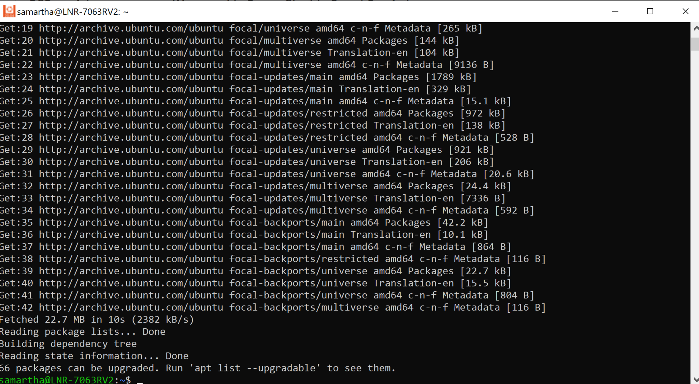
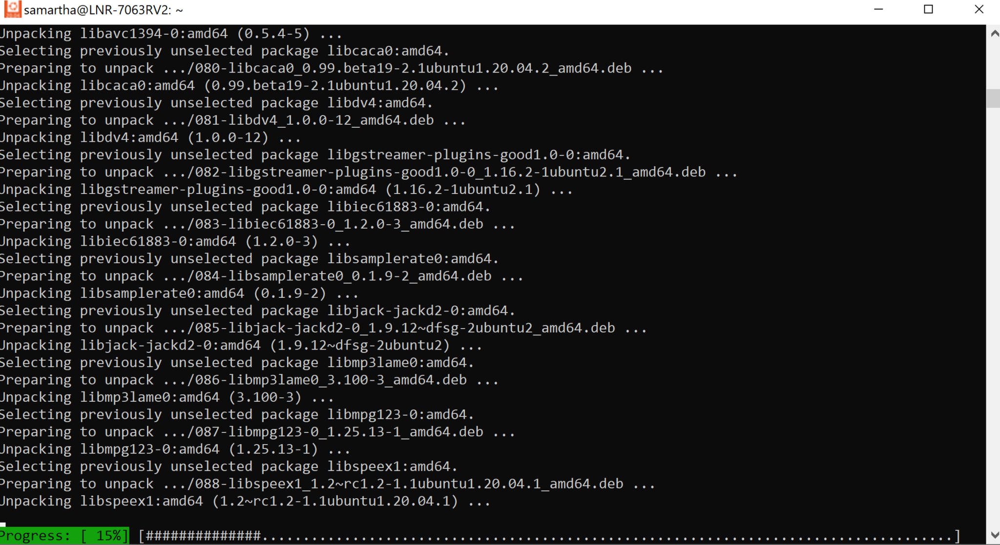

Life is bringing it own challenges as I have moved to the United States of America. One of the immediate tech challenge has been using the loaner windows box and still be productive.


Life will be colorless, if there are no ups and downs.


So, here I am trying to get used to not using `brew` and using `choco` and still enjoy the same. In order to get back to the old ways, the basic requirement were to deploy `vagrant` and `ansible` and at least be able to use the old code base.

### Challenge - 1

The bigger challenge was to get a vagrant set up up and start using `ansbile`.

The official documentation was helpful :)


No, Ansible can only manage Windows hosts. Ansible cannot run on a Windows host natively.
— https://docs.ansible.com/ansible/latest/user_guide/windows_faq.html#windows-faq-ansible


I still thought let me try and see what happens, and here is the first and only futile attempt to justify my stupidity

```text

PS C:\windows\system32> python -m pip install --user ansible

Collecting ansible
  Using cached ansible-5.7.1.tar.gz (35.7 MB)

ERROR: Could not install packages due to an OSError: [Errno 2] No such file or directory: 'C:\\Users\\samarthya\\AppData\\Local\\Temp\\pip-install-4tkoy6fn\\ansible_40b36fdfcde9402ca024913dda46284d\\ansible_collections/amazon/aws/tests/unit/plugins/modules/placebo_recordings/cloudformation/client_request_token_s3_stack/cloudformation.DescribeStackEvents_1.json'
HINT: This error might have occurred since this system does not have Windows Long Path support enabled. You can find information on how to enable this at https://pip.pypa.io/warnings/enable-long-paths
```

Pretty straight-forward, all I had to do was

```text
New-ItemProperty -Path "HKLM:\SYSTEM\CurrentControlSet\Control\FileSystem" `
>> -Name "LongPathsEnabled" -Value 1 -PropertyType DWORD -Force
```

```text
LongPathsEnabled : 1
PSPath           : Microsoft.PowerShell.Core\Registry::HKEY_LOCAL_MACHINE\SYSTEM\CurrentControlSet\Control\FileSystem
PSParentPath     : Microsoft.PowerShell.Core\Registry::HKEY_LOCAL_MACHINE\SYSTEM\CurrentControlSet\Control
PSChildName      : FileSystem
PSDrive          : HKLM
PSProvider       : Microsoft.PowerShell.Core\Registry
```

Hopes were high now I just need to run it again

```text
python -m pip install --user ansible
```

So here, where I knew this is not going to work

```text
Using legacy 'setup.py install' for ansible, since package 'wheel' is not installed.
Using legacy 'setup.py install' for ansible-core, since package 'wheel' is not installed.
Installing collected packages: resolvelib, PyYAML, pyparsing, pycparser, MarkupSafe, packaging, jinja2, cffi, cryptography, ansible-core, ansible
  Running setup.py install for ansible-core ... error
  error: subprocess-exited-with-error
```

So, the better option was Windows subsytem for linux.



## Vagrant


