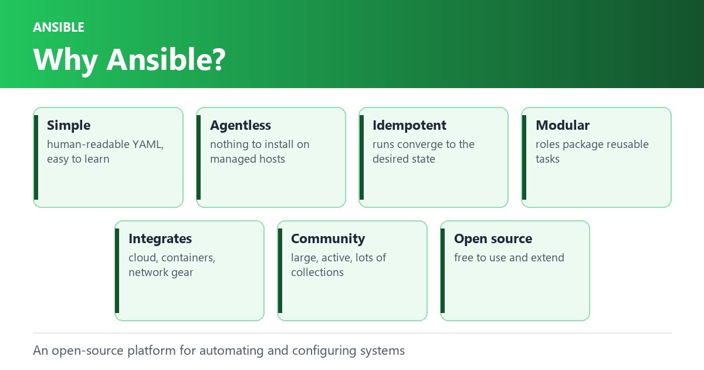

## What is Ansible?

Ansible is an open-source software platform for automating and configuring computer systems. It allows you to manage, deploy and orchestrate applications, infrastructure, and network devices using a simple, human-readable language. Ansible uses a push-based architecture, where tasks are executed on remote hosts from a central control machine, and does not require agents to be installed on target systems.

## Why use Ansible?

There are several reasons why Ansible is a popular choice for IT automation and configuration management:

1. Simple and easy to use: Ansible uses a simple and human-readable language, making it easy to learn and use, even for those without prior experience with automation tools.
2. Agentless architecture: Ansible does not require any agents to be installed on the managed hosts, making it easy to deploy and reducing the attack surface of the infrastructure.
3. Idempotent tasks: Ansible ensures that tasks are executed only once and in the desired state, reducing the risk of configuration drift and unintended changes.
4. Modular and reusable: Ansible roles provide a way to encapsulate and reuse tasks and configurations, making it easy to manage complex systems and automate complex tasks.
5. Integrates with other tools: Ansible integrates with a wide range of other tools and technologies, including cloud platforms, containers, and network devices.
6. Large and active community: Ansible has a large and active community of users, developers, and contributors, providing a wealth of resources, examples, and plugins to help with automation tasks.
7. Open-source: Ansible is open-source software, which means that it is free to use and can be easily customized to meet specific needs.


[Best Practices](https://docs.ansible.com/ansible/2.7/user_guide/playbooks_best_practices.html)
— ansible.com


## What are Roles?

In Ansible, a role is a way to organize and structure playbooks and tasks into reusable units. A role consists of a collection of tasks, files, templates, and variables that are used to perform specific functions in a predictable and repeatable manner. Roles can be used to install and configure software, manage users and permissions, or manage network devices. Roles can be shared among multiple playbooks and can be included in other roles, making it easy to manage complex systems and automate complex tasks. Roles provide a way to encapsulate and modularize Ansible content, making it easier to maintain and share playbooks across teams and projects.

## What is Playbook?

An Ansible playbook is a YAML-based script that defines a series of tasks to be executed by Ansible on one or more managed hosts. It is used to automate complex IT tasks, such as application deployments, configuration management, and scaling. Playbooks can include tasks defined in Ansible modules, as well as custom commands and shell scripts. Playbooks can be executed on the command line, and can also be used as part of larger orchestration processes. They provide a human-readable format for defining the desired state of a system and can be version-controlled for easier collaboration and reuse. Playbooks can also reference and reuse roles, which are modular units of organization that encapsulate tasks, files, templates, and variables.

## What is Inventory?

In Ansible, the inventory is a file or a directory that defines the managed hosts that Ansible will operate on. The inventory is used to manage the list of hosts and host groups, and can also include variables and configuration parameters that are specific to each host or group of hosts. The inventory can be a static file in INI or YAML format, or can be generated dynamically using scripts or cloud provider APIs. The inventory can also be organized into groups of hosts, which can be used to target specific subsets of the infrastructure for specific tasks or playbooks. By using the inventory, Ansible is able to abstract the underlying infrastructure and provide a unified and consistent way to manage multiple hosts and devices, regardless of the underlying technology.

## Getting Started?

Here are the basic steps to get started with Ansible:

1. Install Ansible: You can install Ansible on your control machine using the package manager for your operating system or using the pip package manager for Python.
2. Create an inventory: Create an inventory file that defines the managed hosts that Ansible will operate on. The inventory can be a static file in INI or YAML format or can be generated dynamically using scripts or cloud provider APIs.
3. Write a playbook: Write a YAML-based Ansible playbook that defines the tasks to be executed on the managed hosts. The playbook can include tasks defined in Ansible modules, as well as custom commands and shell scripts.
4. Execute the playbook: Use the ansible-playbook command to execute the playbook on the managed hosts. The playbook can be executed on a specific host or group of hosts defined in the inventory.
5. Monitor and review: Monitor the execution of the playbook and review the output to ensure that the tasks were executed as expected.

Note: Before getting started with Ansible, it’s recommended to have some basic understanding of YAML syntax, Linux command line, and network fundamentals. You can find many resources and tutorials on Ansible official website to help you get started with Ansible.
