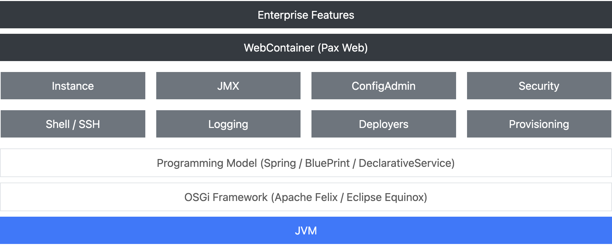

Apache Karaf - I had only heard of it and never had practical exposure to this technology. Main questions in my mind were - What purpose does it serves? and Who uses it?

## What is it?

So it seems that it is an enterprise ready runtime and kind of platform from Apache, and as they officially put it


Karaf is a project and a bunch of subprojects!
— https://karaf.apache.org/projects.html


It supports several frameworks and programming model like REST/API, web, Spring Boot etc.

### Architecture



Some of the Key sub projects are as below

- Karaf runtime
- Karaf Cellar
- Karaf Cave
- Karaf Decanter

## Karaf Runtime

Karaf is a suitable solution powered by OSGi for `microservices`, `systems integration` & `big data`. It can be scaled from a very lightweight container to a fully featured enterprise service.

Some of the key features of `Karaf` `Runtime` and typical of any container are as under

#### 1. Support hot deployment

Drop your applications in the `Karaf` deploy folder and they will deployed.

#### 2. Dynamic Configuration

All configurations are located in the `Karaf` folder and any changes to the configuration are loaded on the fly.

#### 3. Logging System

Supports popular logging systems like `slf4j` and `log4j`. With the current CVE's of log4j not sure if that is a good support? :-)

Other features are `Provisioning`, `Shell Console`, `Remote management`, `Web Console`, `Security, Instances management`, `Docker and cloud ready`


Official documentation - link
— Help link


```text
samarthya apache-karaf-4.4.2 % ./bin/karaf            
        __ __                  ____      
       / //_/____ __________ _/ __/      
      / ,<  / __ `/ ___/ __ `/ /_        
     / /| |/ /_/ / /  / /_/ / __/        
    /_/ |_|\__,_/_/   \__,_/_/         

  Apache Karaf (4.4.2)

Hit '<tab>' for a list of available commands
and '[cmd] --help' for help on a specific command.
Hit '<ctrl-d>' or type 'system:shutdown' or 'logout' to shutdown Karaf.

karaf@root()> version
4.4.2
```
