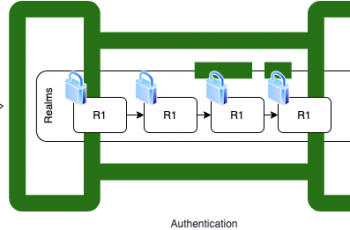

As a software professional, I have been working in the space of IAM, SSO, DRM for quite some time and from my experience I can say, the way Elastic has simplified the integration of external or internal security for access is a treat for fellow developers. It was interesting to experiment with the security settings, and control tenancy.

In this multi step blog, I will try and capture the concepts first and then do a final integration with a dummy IdP to show case a demo.

## Realms

Realms in the context of elastic is a service that provides authentication.

> ```text
https://www.elastic.co/guide/en/elasticsearch/reference/current/realms.html
```

From the official documentation - A *realm* is used to resolve and authenticate users based on authentication tokens.

The beauty is the chaining that allows to plug in one ore more such services as a fallback option. A prioritized list of configured realms of different types.

> The priority in the realm chain is always ascending; implying the lowest order is evaluated first.

## Authentication explained

During authentication the incoming request is tried against one realm at a time. Once one of the realms **successfully authenticates** the request, the authentication is considered to be successful. The authenticated user is associated with the request, which then proceeds to the **authorization** **phase**.

If a realm cannot authenticate the request, the next realm in the chain is consulted. If all realms in the chain cannot authenticate the request, the authentication is considered to be unsuccessful and an authentication error is returned.



### Only when the security is enabled

When security features (**xpack.security.enabled: true**) are enabled, depending on the realms you’ve configured the authentication will be evaluated.


```text
Internal realms are managed by elastic
```

## Types of realms

There are two main categories

- Internal : Do not require external communication.
- External : Require external communication.

Internal allows only one one to be configured at a time, either of file or native. No such restriction applies to external which can be `ldap`, `active_directory`, `saml`, `kerberos`, and `pki`.

## Details

- [*native*](https://www.elastic.co/guide/en/elasticsearch/reference/current/security-api.html#security-user-apis) realm is where users are stored in a dedicated Elasticsearch index.
- [*ldap*](https://www.elastic.co/guide/en/elasticsearch/reference/current/ldap-realm.html) realm uses an external LDAP server to authenticate the users.
- [*active\_directory*](https://www.elastic.co/guide/en/elasticsearch/reference/current/active-directory-realm.html) realm uses an external Active Directory Server to authenticate the users.
- *pki* realm authenticates users using Public Key Infrastructure (PKI).
- [*file*](https://www.elastic.co/guide/en/elasticsearch/reference/current/file-realm.html) (internal) realm defines users in a files stored on each node in the Elasticsearch cluster.
- [*saml*](https://www.elastic.co/guide/en/elasticsearch/reference/current/saml-realm.html) realm facilitates authentication using the SAML 2.0 Web SSO protocol. This realm is designed to support authentication through Kibana and is not intended for use in the REST API.
- *kerberos* realm authenticates a user using Kerberos authentication.
- *dc* realm facilitates authentication using OpenID Connect.

## -- THE - END --
