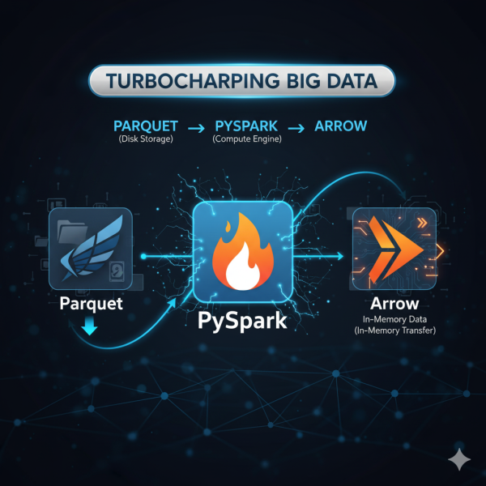

In my [last post](), we explored the divide between **Pandas** (single machine) and **PySpark** (distributed computing).

> The conclusion: for massive datasets, PySpark is the clear winner.

But simply choosing PySpark isn’t the end of the optimization journey. If PySpark is the engine for big data, then **Apache Parquet** and **Apache Arrow** are the high-octane fuel and the specialized transmission that make it fly.

If you’re already using Parquet and seeing the benefits, you’ve experienced the storage side of the equation. Now let’s see how **Arrow** completes the picture, turning your PySpark cluster into a zero-copy data powerhouse.

---

## **A Quick History Lesson: Storage vs. Memory**

The two projects address different phases of the data lifecycle:

| Technology | Focus | Released | Purpose |
| --- | --- | --- | --- |
| **Apache Parquet** | **Disk Storage** | **2013** (Joint effort by Twitter & Cloudera) | An **on-disk columnar file format** designed for efficient storage and optimal query performance. |
| **Apache Arrow** | **In-Memory** | **2016** (By Wes McKinney, creator of Pandas) | A **language-agnostic, in-memory columnar data format** for zero-copy data transfer and vectorized computation. |

### **1. Apache Parquet: The Storage Champion**

Parquet was created to solve the storage efficiency and query speed problems inherent in traditional row-based formats (like CSV).

- **Columnar Storage:** Instead of storing data row-by-row, Parquet stores columns of data together.
  - **Benefit 1: Compression:** Each column contains data of the same type (e.g., all integers). This allows for highly efficient, type-specific compression (like dictionary encoding), drastically reducing file size.
  - **Benefit 2: Pruning:** When you run a query like `SELECT name FROM sales`, the engine only has to read the `name` column data from the disk, completely skipping other columns (like `price` or `timestamp`). This is known as **columnar pruning** or **predicate pushdown**.

### **2. Apache Arrow: The Zero-Copy Accelerator**

Arrow was created to solve the massive inefficiency of moving data between different systems or languages (Python, Java, R, etc.) on a machine.

- **The Problem:** When data moved from the PySpark engine (which runs on the Java Virtual Machine or JVM) to a Python process (like Pandas for User-Defined Functions – UDFs), it had to be **serialized** (converted to a byte stream) and then **deserialized** (converted back to an object). This is expensive and slow.
- **The Solution:** Arrow provides a **standardized, columnar memory format** that is ready for computation. It’s like a universal language for data in RAM. When PySpark sends data to Python (or vice-versa), it can use the Arrow format, allowing for **zero-copy reads** with no serialization/deserialization cost.

---

## **The PySpark Trio: Complementary Roles**

Together, these three technologies form a powerful data pipeline:

1. **Parquet (Disk):** Stores your data efficiently on disk (e.g., HDFS, S3).
2. **PySpark (Compute):** Reads the Parquet file and partitions the work across the cluster.
3. **Arrow (Memory):** When data needs to move between the JVM (Spark) and Python processes (PySpark workers), Arrow ensures the transfer is fast and requires minimal copying, often boosting UDF performance by **10x to 100x**.

---

## **Use Case & Code Snippets**

The most common way to enable this synergy is by configuring Arrow for the transfer of data between Spark and Python (i.e., when converting a **Spark DataFrame to a Pandas DataFrame**).

### **1. Enable Apache Arrow in PySpark**

You configure Arrow support directly in your Spark Session builder. This tells Spark to use the Arrow format for conversions between the Spark JVM and the Python process.

```text
from pyspark.sql import SparkSession

# Enable Arrow for fast conversion between Spark and Pandas DataFrames
spark = SparkSession.builder \
    .appName("Samarthya") \
    .config("spark.sql.execution.arrow.pyspark.enabled", "true") \
    .getOrCreate()

print("Apache Arrow is now enabled for data transfer.")

# Create a sample PySpark DataFrame
data = [("A1", 100), ("B2", 200), ("C3", 300)]
columns = ["Product_ID", "Sales_Volume"]
spark_df = spark.createDataFrame(data, columns)
```

### **2. PySpark Writing to Parquet (Disk)**

PySpark inherently knows how to write to Parquet. The columnar storage of Parquet is the ideal default for big data persistence.

```text
# Write the PySpark DataFrame to a Parquet file
output_path = "data/sales_data.parquet"
spark_df.write.mode("overwrite").parquet(output_path)

print(f"Data written to disk in Parquet format: {output_path}")

# Note: The Parquet files on disk will be compressed and columnar.
```

### **3. Reading Parquet and Converting to Pandas (Arrow in Action)**

This is where the magic of **Arrow** happens. When you call `.toPandas()` on a large Spark DataFrame, the enabled Arrow flag allows for a highly optimized, vectorized conversion, speeding up the data transfer to a single node.

```text
# Read the Parquet file back into a PySpark DataFrame
parquet_df = spark.read.parquet(output_path)

# Convert the Spark DataFrame to a Pandas DataFrame using the Arrow optimization
# This is a highly efficient transfer for data that fits on a single machine.
pandas_df = parquet_df.toPandas()

print("\nPandas DataFrame (from Parquet via Arrow transfer):")
print(pandas_df)

spark.stop()
```

By leveraging **Parquet for storage** and **Arrow for data interchange**, you ensure that your PySpark jobs are not just running at a massive scale, but that every component of the pipeline—disk I/O and in-memory transfer—is operating at peak efficiency.
