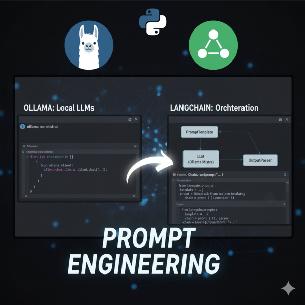

This post walks through a tiny, practical example that uses `LangChain` primitives and a local `Ollama` server to run a prompt-based summarization. The project is intentionally small so you can learn the core ideas quickly: extracting prompts, initializing an LLM client, composing a chain, and running it locally.

Repository used in this post: [llangchain-tutorial`llangchain-tutorial`](https://github.com/samarthya/langchain-ollama-tutorial.git)

## What you’ll learn

- How to separate prompts from code for rapid iteration.
- How to initialize and call a local `Ollama` server from Python using `ChatOllama`.
- The basics of composing a LangChain chain: PromptTemplate | LLM.
- How to structure code for clarity and reusability.

## Why use a local runtime (Ollama)?

Local runtimes like Ollama let you iterate quickly without network latency and without sending data to a cloud provider — useful for testing, privacy, and cost control. In this demo we use Ollama as the model host and `ChatOllama` from the `langchain_ollama` integration to talk to it.

## Project walkthrough

Files we care about:

- `main.py` — entrypoint and orchestrator
- `prompts/summary_template.txt` — extracted prompt template
- `README.md` — run instructions and a Mermaid flowchart

### Core idea

`main.py` follows a simple pattern:

1. Load environment variables (`OLLAMA_HOST`, `OLLAMA_PORT`).
2. Load a prompt template from `prompts/summary_template.txt`.
3. Initialize a `ChatOllama` client using the host and port.
4. Build a chain by composing a PromptTemplate with the LLM (`PromptTemplate(...) | llm`).
5. Invoke the chain with `chain.invoke(input={"information": information})` and print the response.

Keeping the prompt in a file makes it easy for non-developers to tweak the prompt text without touching code. The helper functions in `main.py` (`load_prompt`, `init_ollama_llm`, `build_chain`) make each step testable and reusable.

### Prompt template

The prompt is intentionally simple and lives in `prompts/summary_template.txt`:

```text
Given the information {information}, about the person I want you to create:
    1. A short summary
    2. Two interesting facts about them.
```

### Key snippet: building and invoking the chain

```text
# load prompt
prompt_text = load_prompt("prompts/summary_template.txt")

# init llm
llm = init_ollama_llm()

# compose chain
chain = build_chain(prompt_text, ["information"], llm)

# invoke
response = chain.invoke(input={"information": information})
print(response.content)
```

Note: The keys in the `input` dict must match the `input_variables` declared when creating the PromptTemplate. Passing a different key (e.g., `"info"`) without updating the template will raise a missing-variable error.

## How to run the demo

1. Copy the env example and edit if necessary:

```text
cp .env.example .env
```

2. Create a virtual environment and install dependencies:

```text
python -m venv .venv
source .venv/bin/activate
pip install -r requirements.txt
```

3. Ensure Ollama is running and reachable (default: `localhost:11434`). You can check:

```text
curl http://localhost:11434/api/models
curl http://localhost:11434/api/tags
```

4. Run the example:

```text
python main.py
```

You should see a short printed summary and two facts derived from the `information` sample in the repo.

## Common pitfalls and debugging

- Prompt variable mismatch: ensure the dict keys you pass to `chain.invoke` match the PromptTemplate’s `input_variables`.
- Ollama connectivity: if the server isn’t running, `curl` the endpoints above and verify the host/port.

## Next steps and experiments

- Add memory to the chain to keep conversation context across invocations.
- Swap `ChatOllama` for another provider (OpenAI, Anthropic) to compare behavior.
- Add unit tests: validate `load_prompt` and use a mocked LLM to ensure the prompt is formatted correctly.
- Create a small web UI to let users paste text and see summarization results.

## Conclusion

This project shows how to structure a small LangChain-based demo that talks to a local LLM runtime. The key takeaways are: keep prompts separate, build small reusable helpers, and use local runtimes for fast iteration.
