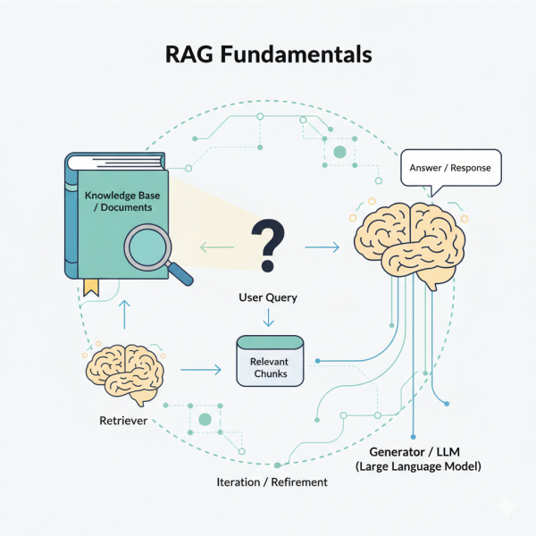
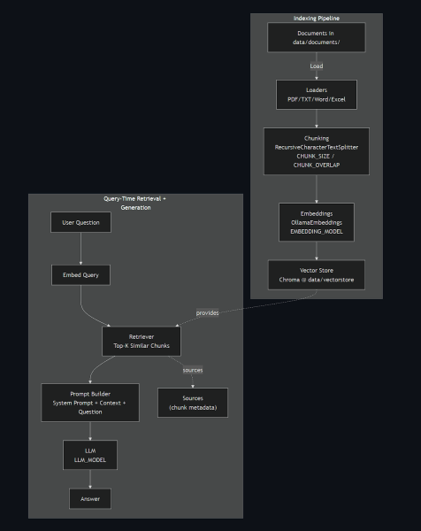

The elements of information discussed here are all present in my [github repository](https://github.com/samarthya/rag-one.git).


with `Ollama`, `LangChain`, and `Chroma`


## 1. Why I Built This

Large Language Models are powerful, but they hallucinate and forget your private knowledge. We set out to build a small, local Retrieval-Augmented Generation (RAG) assistant that:

- Lets us query our own documents (PDFs, text files, Word, Excel) safely.
- Keeps responses grounded in actual source chunks.
- Runs locally (LLM + embeddings via Ollama) inside WSL while Ollama itself runs on Windows.
- Is easy to iterate: add documents, re-index, ask questions—no model fine-tuning.

## 2. What Is RAG (In Plain Terms)

RAG glues together two stages:

1. Retrieval: Find the **most relevant** pieces of text for a user question (using embeddings + vector similarity).
2. Generation: Ask the LLM to answer using only those retrieved chunks as context.

Why? It keeps answers current and factual without stuffing all your data into the model weights.

## 3. Core Objectives Mapped to Implementation

| Objective | Implementation |
| --- | --- |
| Multi-format document ingestion | Specialized loaders in `src/document_processor.py` |
| Precise context selection | Chunking (RecursiveCharacterTextSplitter) with overlap |
| Efficient semantic search | Embeddings (`nomic-embed-text` via Ollama) + Chroma vector store |
| Grounded answers + sources | RetrievalQA chain in `src/rag_engine.py` returns chunks + metadata |
| Local-only operation | WSL Python code calls Windows Ollama via IP (`OLLAMA_BASE_URL` in `src/config.py`) |
| Configurability | Central knobs (`CHUNK_SIZE`, `CHUNK_OVERLAP`, `TOP_K_RESULTS`, model names) in `src/config.py` |
| Defensive robustness | None guards around vector store & QA chain initialization |

### What is chunking (in RAG)?

Chunking is the process of splitting larger documents into smaller, manageable text units (chunks) before generating embeddings. Instead of embedding an entire PDF or a huge page, you embed bite‑sized segments. At query time you retrieve only the most relevant chunks (not whole documents) and feed them to the LLM.

This improves:

- Precision: You avoid stuffing irrelevant paragraphs into the prompt.
- Recall: Multiple distinct, relevant parts of a long document can surface independently.
- Token efficiency: Smaller pieces fit comfortably into the model’s context window.
- Grounding quality: Less unrelated filler reduces hallucination risk.

Typical trade‑off:

- Chunks too large → waste context space; retrieval brings in lots of irrelevant text.
- Chunks too small → you lose semantic coherence (fragmented sentences, missing context).
- Overlap smooths boundaries so meaning crossing chunk edges isn’t lost.

In my [config.py](https://raw.githubusercontent.com/samarthya/rag-one/refs/heads/main/src/config.py):

- CHUNK\_SIZE = 1000 (characters)
- CHUNK\_OVERLAP = 200 (characters)

### What is RecursiveCharacterTextSplitter?

`RecursiveCharacterTextSplitter` (from LangChain) is a hierarchical splitter. You give it:

- A list of separator candidates (e.g. [“\n\n”, “\n”, ” “, “”])
- A target chunk\_size and chunk\_overlap.

## 4. High-Level Architecture



## 5. The Ingestion Pipeline

Ingestion pipeline is the end‑to‑end process that transforms raw documents into a searchable semantic index used later for retrieval. In plain terms: it takes files, cleans and segments them, converts each meaningful chunk into an embedding, and stores those embeddings so queries can efficiently find relevant context.

Implemented in `src/document_processor.py`:

1. Load: Select loader by file extension (`PyPDFLoader`, `TextLoader`, `UnstructuredWordDocumentLoader`, `Excel` via `openpyxl`).
2. Normalize: Wrap content into `Document` objects with `metadata['source']` (and sheet names for Excel).
3. Chunk: Split with `RecursiveCharacterTextSplitter` using:
   - `CHUNK_SIZE = 1000`
   - `CHUNK_OVERLAP = 200` Overlap prevents awkward sentence splits.
4. Embed: Each chunk converted to a vector via Ollama embeddings (`nomic-embed-text`).
5. Persist: Store vectors in Chroma located at `data/vectorstore/` (avoid recomputation next run).

Public entry point: `process_all_documents()` returns stats (files processed, chunks created).

## 6. Retrieval & Answering

- Retrieval: Think of it as asking a librarian to pull the most relevant index cards from your library for your question. We don’t hand the AI the whole book; we hand it just the best snippets.
- Answering: The AI reads those snippets and writes an answer that sticks to what’s in them. If the snippets don’t contain the answer, it should say so.

Implemented in `src/rag_engine.py`:

- Converts Chroma vector store to a retriever (`vectorstore.as_retriever(k=TOP_K_RESULTS)`).
- Builds a prompt template combining:
  - System instructions (`SYSTEM_PROMPT`)
  - Retrieved chunk text
  - User question
- Runs a LangChain `RetrievalQA` chain with chain type `"stuff"` (simple concatenation).
- Returns answer + source metadata (filenames / pages / sheets) + raw context chunks.

## 7. Configuration Strategy

Centralized in `src/config.py`:

- Paths: `DOCUMENTS_DIR`, `VECTORSTORE_DIR`
- Models: `LLM_MODEL = "gpt-oss:20b"`, `EMBEDDING_MODEL = "nomic-embed-text"`
- Chunking knobs: `CHUNK_SIZE`, `CHUNK_OVERLAP`
- Retrieval knob: `TOP_K_RESULTS = 4`
- Optional similarity filtering stub: `SIMILARITY_THRESHOLD` (can be applied in `search` later)
- WSL/Ollama IP bridging: `WINDOWS_IP` + `OLLAMA_BASE_URL`

## 8. WSL + Ollama Integration

Running Python in WSL while Ollama hosts models on Windows:

- Discover Windows host IP from WSL:`ip route show | grep default | awk '{print $3}'`
- Set `WINDOWS_IP` in `src/config.py`.
- All embed & generate calls go through `http://<WINDOWS_IP>:11434`.

This avoids Docker complexity and keeps local iteration fast.

## 9. Defensive Coding Patterns

To prevent subtle runtime errors:

- Annotated `self.vectorstore: Optional[Chroma]` and guard before use.
- QA chain creation inside try/except; failure doesn’t crash initialization.
- Graceful fallback answers when knowledge base is empty.

## 10. Running the System

```text
# Start the app (if you have a Streamlit UI defined in src/app.py)
streamlit run src/app.py
```

## 11. Concepts Along the Way

| Concept | Why It Matters Here |
| --- | --- |
| Embeddings | Enable semantic similarity search instead of brittle keyword matching |
| Chunking | Provides granularity; improves recall & reduces prompt bloat |
| Overlap | Maintains continuity across boundaries; prevents dropped context |
| Vector Store (Chroma) | Persistent, efficient similarity search layer |
| Prompt Template | Ensures consistent grounding and honesty (don’t fabricate) |
| RetrievalQA Chain | Orchestrates retrieval + prompt assembly seamlessly |
| System Prompt | Establishes tone and factual discipline for answers |

## 12. Common Pitfalls & Mitigations

| Pitfall | Mitigation |
| --- | --- |
| Empty results due to improper chunking | Adjust `CHUNK_SIZE` / `CHUNK_OVERLAP`; re-index |
| Slow indexing for large docs | Run once; persists to disk; process incremental additions |
| Irrelevant retrieval | Reduce chunk size or increase `TOP_K_RESULTS` then filter low-similarity |
| Hallucinations | System prompt enforces “If not in documents, say so.” |
| Excel ingestion failing | Install `openpyxl` before indexing spreadsheets |

## Summary

We built a self-contained RAG assistant:

- Local, privacy-preserving.
- Structured for clarity: ingestion vs query-time logic.
- Configurable and well-documented.
- Guarded against uninitialized components.
