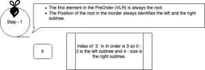

What good is an software engineer if he can't keep revisiting the DS problems. It is like a pill for my laziness that keeps crawling ever so often.

> The problem I am talking about is mentioned in this cool portal `exercism.io` that I use almost on a weekly basis.

The problem was to construct a tree from the inorder and preorder traversal.


In Order = LVR

Pre Order = VLR
— Where L = Left, V = Vertex and R = Right


The complexity is basically recursively finding the root of the tree/subtree and the left and right subtree and managing the relations downwards or upwards.



The Logic is a multi step process

1. Identify the root
   - The first element in the preorder traveral is always the root.
2. Identify the left and the right subtree.
   - The elements from left to the index of root in the inorder are the left subtree
   - The elements from the right of the index of the root in the inorder are the right subtree.
3. Identify the root of the subsequent subtree.

Let's look at our example

```text
    private Node buildNodes(List<Character> preOrder, List<Character> inOrder) {

        // If any of the tree is empty return null.
        if(preOrder.isEmpty() || inOrder.isEmpty()){
            return null;
        }

        // Root is always the first element in InOrder
        Node root = new Node(preOrder.get(0).charValue());
       

        // The Index of the root i identifies the Left and Right Subtree
        // 0 - i-1 is left and i+1 - n is the Right subtree
        int iRoot = inOrder.indexOf(preOrder.get(0));

        

        // Build the left tree first
        root.left = buildNodes(preOrder.subList(1, preOrder.size()), inOrder.subList(0, iRoot));

        // Build the right tree
        root.right = buildNodes(preOrder.subList(iRoot + 1, preOrder.size()), inOrder.subList(iRoot+1, inOrder.size()));

        return root;
    }
```

What do you think what more can I optimise?
