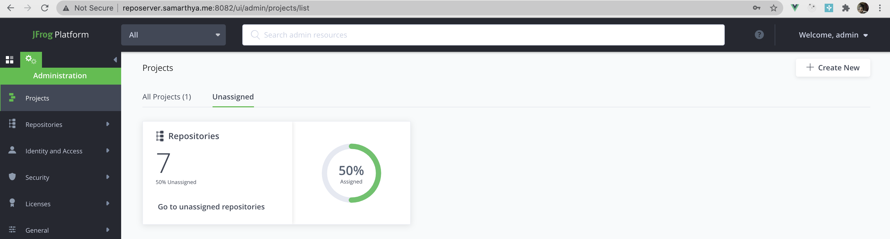
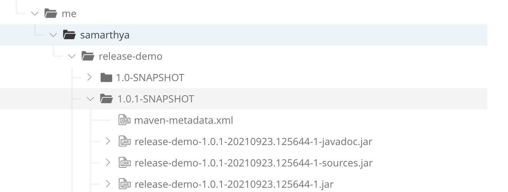
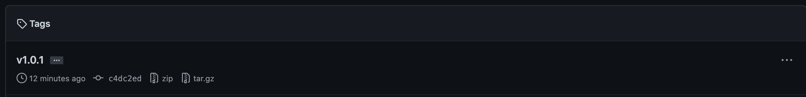
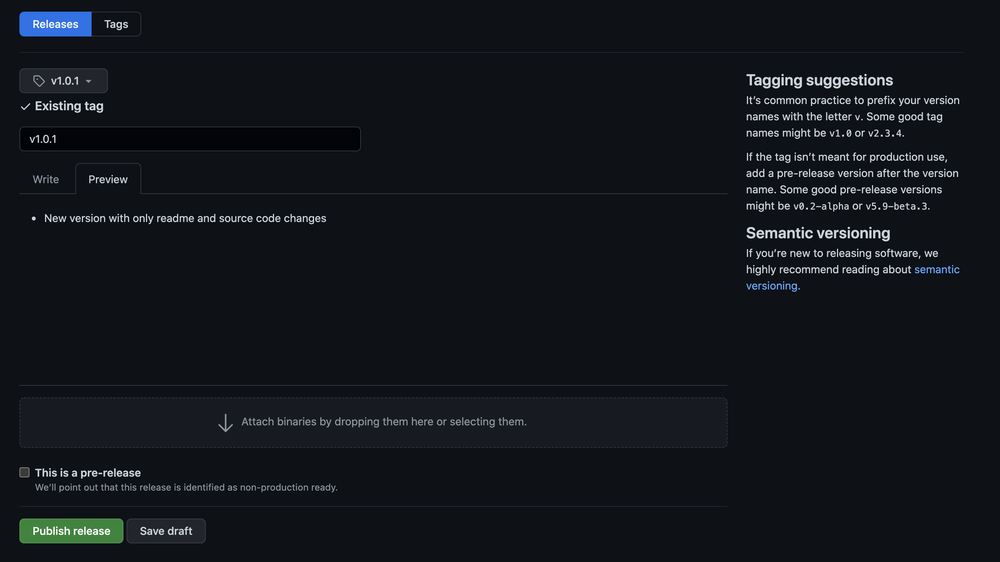
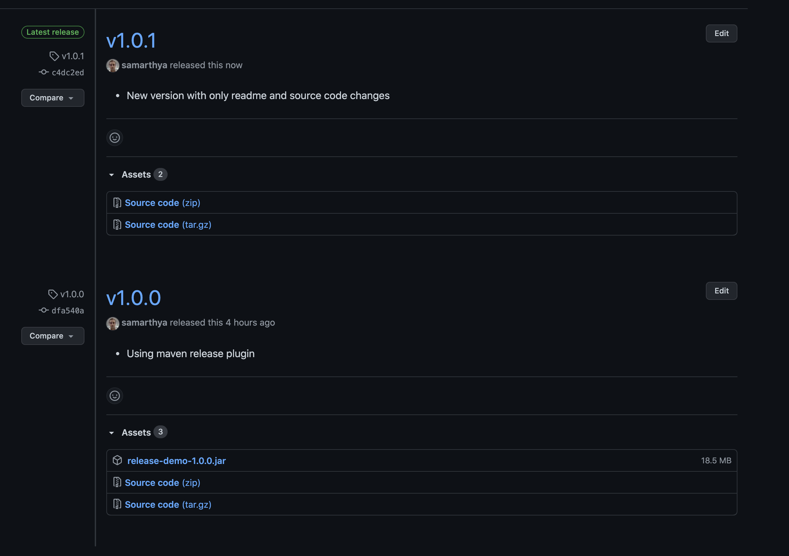

Everything starts form `a single source file` and as the time goes by, it gradually transforms into multiple modules, bulky source files and a source control repository. Mostly by this time the team has already adopted a a build tool, and a repository to publish the versioned `artifacts.` Journey is similar for every project successful or not.

The choice of tools can be pre-defined or adopted as explored, but the last step is almost similar for everyone, where you have to publish a release binary.

In this blog, I will try to talk about the last step only, as the other tools and choices have already been made for me and I am just publishing a convenient way of building & publishing your artifacts in a `JFrog` repository.

## Tools

- `JFrog` repository to store the `snapshot` and `release` versions.
- User account that has pubilsh/delete access to these repo(s)
- Maven as the build tool
- Java OpenJDK preferably
- Any IDE ( I use IntelliJ )
- Access to GitHub (User name and Personal Access Token)

## mvn: Version

```text
mvn -version
Apache Maven 3.8.2 (ea98e05a04480131370aa0c110b8c54cf726c06f)
Maven home: /usr/local/Cellar/maven/3.8.2/libexec
Java version: 17, vendor: Homebrew, runtime: /usr/local/Cellar/openjdk/17/libexec/openjdk.jdk/Contents/Home
Default locale: en_IN, platform encoding: UTF-8
OS name: "mac os x", version: "10.15.7", arch: "x86_64", family: "mac"
```

## Java: version

```text
java -version
openjdk version "16.0.1" 2021-04-20
OpenJDK Runtime Environment AdoptOpenJDK-16.0.1+9 (build 16.0.1+9)
OpenJDK 64-Bit Server VM AdoptOpenJDK-16.0.1+9 (build 16.0.1+9, mixed mode, sharing)
```

## Project Setup (GITHUB)

I will be using the source code from the location mentioned below


All the source code is pushed [here](https://github.com/samarthya/release-demo.git).


To create a personal access token ([you can find steps here]()) that shall be used in the `server.xml` for scm settings please refer to documentation [here](https://docs.github.com/en/enterprise-server@3.1/authentication/keeping-your-account-and-data-secure/creating-a-personal-access-token).

```text
mvn scm:checkout -DconnectionUrl=scm:git:https://github.com/samarthya/release-demo.git -DscmVersion=main -DscmVersionType=branch -DcheckoutDirectory=.
```

It will checkout the code in the current directory. (More information available [here](https://maven.apache.org/scm/maven-scm-plugin/index.html))

## JFrog repository

This repo shall have all the artifacts we wish to publish



A shout out to @JFROG for providing the trial license that helped me build the repo a docker deployment

```text
root@docker>docker ps
CONTAINER ID   IMAGE                                                            COMMAND                  CREATED         STATUS       PORTS                                                                                                                                                                                        NAMES
51b8aba2293b   releases-docker.jfrog.io/jfrog/xray-analysis:3.27.4              "./bin/wrapper.sh"       13 days ago     Up 13 days                                                                                                                                                                                                xray_analysis
a948186f1326   releases-docker.jfrog.io/jfrog/xray-indexer:3.27.4               "./bin/wrapper.sh"       13 days ago     Up 13 days                                                                                                                                                                                                xray_indexer
0a6671c91fec   releases-docker.jfrog.io/jfrog/xray-persist:3.27.4               "./bin/wrapper.sh"       13 days ago     Up 13 days                                                                                                                                                                                                xray_persist
7142c819fd51   releases-docker.jfrog.io/jfrog/xray-server:3.27.4                "./bin/wrapper.sh"       13 days ago     Up 13 days                                                                                                                                                                                                xray_server
8e4309d97e51   releases-docker.jfrog.io/jfrog/artifactory-pro:7.25.6            "/entrypoint-artifac…"   13 days ago     Up 13 days   0.0.0.0:8081-8082->8081-8082/tcp, :::8081-8082->8081-8082/tcp                                                                                                                                artifactory
5507e78cca13   releases-docker.jfrog.io/jfrog/router:7.21.4                     "/opt/jfrog/router/a…"   13 days ago     Up 13 days   8082/tcp, 0.0.0.0:8083->8083/tcp, :::8083->8083/tcp                                                                                                                                          xray_router
20b266981815   releases-docker.jfrog.io/postgres:13.2-alpine                    "docker-entrypoint.s…"   13 days ago     Up 13 days   0.0.0.0:5432->5432/tcp, :::5432->5432/tcp                                                                                                                                                    postgresql
23a68fd1c8f5   releases-docker.jfrog.io/jfrog/xray-rabbitmq:3.8.14-management   "/bin/bash -c ' (/se…"   13 days ago     Up 13 days   5671/tcp, 0.0.0.0:4369->4369/tcp, :::4369->4369/tcp, 15671/tcp, 10.109.34.77:5672->5672/tcp, 0.0.0.0:15672->15672/tcp, :::15672->15672/tcp, 15691-15692/tcp, 10.109.34.77:25672->25672/tcp   xray_rabbitmq
```

## SCM: pom.xml

```text
 <scm>
        <developerConnection>scm:git:${project.scm.url}</developerConnection>
        <connection>scm:git:${project.scm.url}</connection>
        <url>https://github.com/samarthya/release-demo.git</url>
  </scm>
```

The repository for source goes into the SCM `connection` and `developerConnection`.

Before I walk through the process of how you can use a release and snapShot build let's have a look at the `release` plugin and the `POM`.


Official documentation for [maven-release-plugin](https://maven.apache.org/maven-release/maven-release-plugin/index.html)


## maven-release-plugin

Releasing is a two step process

1. [Prepare release](https://maven.apache.org/maven-release/maven-release-plugin/prepare-mojo.html) &
2. [Perform release](https://maven.apache.org/maven-release/maven-release-plugin/perform-mojo.html)

## `mvn release:prepare`

Steps through several phases to ensure the POM is ready to be released and then prepares SCM to eventually contain a tagged version of the release and a record in the local copy of the parameters used.

In case of error and if you need to run again you can use

`mvn release:prepare -Dresume=false`

or you can use `mvn release:clean`

## `mvn release:perform`

After completion of the previous step (no failure) you can perform the release. ([Examples](https://maven.apache.org/maven-release/maven-release-plugin/examples/perform-release.html))

## `POM.xml`

Wont go into each plugin details here but just for reference you can identify the `maven-enforcer-plugin` which enforces the `maven` and `JDK` version requirements

```text
<plugin>
                <groupId>org.apache.maven.plugins</groupId>
                <artifactId>maven-enforcer-plugin</artifactId>
                <version>${maven.enforcer.version}</version>
                <executions>
                    <execution>
                        <id>enforce-matching-compiler-target-and-bundle-required-execution-environment</id>
                        <phase>validate</phase>
                    </execution>
                    <execution>
                        <id>enforce-build-tools-versions</id>
                        <goals>
                            <goal>enforce</goal>
                        </goals>
                        <configuration>
                            <rules>
                                <requireJavaVersion>
                                    <version>[11,)</version>
                                    <message>Invalid Java Version (min 11)
                                    </message>
                                </requireJavaVersion>
                                <requireMavenVersion>
                                    <version>[3.6.2,)</version>
                                    <message>Invalid Maven Version. (min 3.6.2)
                                    </message>
                                </requireMavenVersion>
                                <banDuplicatePomDependencyVersions />
                            </rules>
                            <fail>true</fail>
                        </configuration>
                    </execution>
                </executions>
            </plugin>
```

You can also see the plugin for maven-release-plugin with [configuration](http://maven.apache.org/guides/mini/guide-configuring-plugins.html) as below.

```text
                <plugin>
                    <groupId>org.apache.maven.plugins</groupId>
                    <artifactId>maven-release-plugin</artifactId>
                    <version>${maven.release.version}</version>
                    <configuration>
                        <scmCommentPrefix>[scm bot]</scmCommentPrefix>
                        <tagNameFormat>@{project.version}</tagNameFormat>
                        <encoding>UTF-8</encoding>
                    </configuration>
                </plugin>
```

Where,

- `scmCommentPrefix` - The message prefix to use for all SCM changes.
- `tagNameFormat` - Format to use when generating the tag name.

If you are not using `setting.xml` for the SCM you can also use `username` and `password` to specify the credentials. In my example I am using the setting.xml.

```text
      <server>
         <id>github.com</id>
         <username><myusername></username>
         <password><my token></password>
      </server>
```

The complete source code is available in [github](https://github.com/samarthya/release-demo.git).

## Main `pom.xml`

```text
<build>
        <pluginManagement>
            <plugins>
                <plugin>
                    <groupId>org.apache.maven.plugins</groupId>
                    <artifactId>maven-resources-plugin</artifactId>
                    <version>${maven.resources.plugin.version}</version>
                    <configuration>
                        <encoding>UTF-8</encoding>
                    </configuration>
                </plugin>

                <plugin>
                    <groupId>org.apache.maven.plugins</groupId>
                    <artifactId>maven-compiler-plugin</artifactId>
                    <version>${maven.compiler.plugin.version}</version>
                    <configuration>
                        <encoding>UTF-8</encoding>
                    </configuration>
                </plugin>

                <plugin>
                    <groupId>org.apache.maven.plugins</groupId>
                    <artifactId>maven-release-plugin</artifactId>
                    <version>${maven.release.version}</version>
                    <configuration>
                        <scmCommentPrefix>[scm bot]</scmCommentPrefix>
                        <tagNameFormat>@{project.version}</tagNameFormat>
                        <encoding>UTF-8</encoding>
                    </configuration>
                </plugin>
            </plugins>
        </pluginManagement>

        <plugins>
            <plugin>
                <groupId>org.apache.maven.plugins</groupId>
                <artifactId>maven-enforcer-plugin</artifactId>
                <version>${maven.enforcer.version}</version>
                <executions>
                    <execution>
                        <id>enforce-matching-compiler-target-and-bundle-required-execution-environment</id>
                        <phase>validate</phase>
                    </execution>
                    <execution>
                        <id>enforce-build-tools-versions</id>
                        <goals>
                            <goal>enforce</goal>
                        </goals>
                        <configuration>
                            <rules>
                                <requireJavaVersion>
                                    <version>[11,)</version>
                                    <message>Invalid Java Version. It should be Java 11.0.x at
                                        least.
                                    </message>
                                </requireJavaVersion>
                                <requireMavenVersion>
                                    <version>[3.6.2,)</version>
                                    <message>Invalid Maven Version. It should be Maven 3.6.2 at
                                        least.
                                    </message>
                                </requireMavenVersion>
                                <banDuplicatePomDependencyVersions />
                            </rules>
                            <fail>true</fail>
                        </configuration>
                    </execution>
                </executions>
            </plugin>

            <plugin>
                <groupId>org.apache.maven.plugins</groupId>
                <artifactId>maven-source-plugin</artifactId>
                <version>${maven.source.plugin.version}</version>
                <executions>
                    <execution>
                        <id>attach-sources</id>
                        <goals>
                            <goal>jar</goal>
                        </goals>
                    </execution>
                </executions>
            </plugin>

            <plugin>
                <groupId>org.apache.maven.plugins</groupId>
                <artifactId>maven-javadoc-plugin</artifactId>
                <version>${maven.javadoc.plugin.version}</version>
                <configuration>
                    <encoding>UTF-8</encoding>
                    <author>true</author>

                </configuration>
                <executions>
                    <execution>
                        <id>attach-javadocs</id>
                        <goals>
                            <goal>jar</goal>
                        </goals>
                    </execution>
                </executions>
            </plugin>

            <plugin>
                <groupId>org.apache.maven.plugins</groupId>
                <artifactId>maven-scm-plugin</artifactId>
                <version>${maven.scm.plugin.version}</version>
                <configuration>
                    <goals>install</goals>
                </configuration>
            </plugin>

            <plugin>
                <groupId>org.apache.maven.plugins</groupId>
                <artifactId>maven-surefire-plugin</artifactId>
                <version>${maven.surefire.version}</version>
                <configuration>
                    <encoding>UTF-8</encoding>
                </configuration>
            </plugin>

            <plugin>
                <groupId>org.springframework.boot</groupId>
                <artifactId>spring-boot-maven-plugin</artifactId>
                <version>${spring.boot.version}</version>
                <executions>
                    <execution>
                        <goals>
                            <goal>repackage</goal>
                        </goals>
                    </execution>
                </executions>
            </plugin>
        </plugins>
    </build>
```

Now, it is time to use the plugin to `prepare` and `perform`.

## Step 0

Check the snapshot version currently marked in the `pom.xml`

```text
mvn -Dexec.executable='echo' -Dexec.args='${project.groupId}:${project.version}:${project.artifactId}:${project.packaging}' exec:exec -q
```

```text
me.samarthya:1.0.1-SNAPSHOT:release-demo:jar
```

## Step 1

`mvn release:prepare`

```text
mvn release:prepare
[INFO] Scanning for projects...
[INFO] 
[INFO] ---------------------< me.samarthya:release-demo >----------------------
[INFO] Building release-demo 1.0.1-SNAPSHOT
[INFO] --------------------------------[ jar ]---------------------------------
[INFO] 
[INFO] --- maven-release-plugin:3.0.0-M4:prepare (default-cli) @ release-demo ---
[INFO] phase verify-release-configuration
[INFO] starting prepare goal, composed of 17 phases: check-poms, scm-check-modifications, check-dependency-snapshots, create-backup-poms, map-release-versions, input-variables, map-development-versions, rewrite-poms-for-release, generate-release-poms, run-preparation-goals, scm-commit-release, scm-tag, rewrite-poms-for-development, remove-release-poms, run-completion-goals, scm-commit-development, end-release
[INFO] [prepare] 1/17 check-poms
[INFO] [prepare] 2/17 scm-check-modifications
[INFO] Verifying that there are no local modifications...
```

```text
[INFO] [prepare] 4/17 create-backup-poms
[INFO] [prepare] 5/17 map-release-versions
What is the release version for "release-demo"? (me.samarthya:release-demo) 1.0.1: : 
[INFO] [prepare] 6/17 input-variables
What is the SCM release tag or label for "release-demo"? (me.samarthya:release-demo) 1.0.1: : v1.0.1
[INFO] [prepare] 7/17 map-development-versions
What is the new development version for "release-demo"? (me.samarthya:release-demo) 1.0.2-SNAPSHOT: : 
[INFO] [prepare] 8/17 rewrite-poms-for-release
[INFO] Transforming 'release-demo'...
[INFO] [prepare] 9/17 generate-release-poms
[INFO] Not generating release POMs
[INFO] [prepare] 10/17 run-preparation-goals
[INFO] Executing goals 'clean verify'...
[WARNING] Maven will be executed in interactive mode, but no input stream has been configured for this MavenInvoker instance.
```

```text
[INFO] [prepare] 17/17 end-release
[INFO] Release preparation complete.
[INFO] ------------------------------------------------------------------------
[INFO] BUILD SUCCESS
[INFO] ------------------------------------------------------------------------
[INFO] Total time:  23.413 s
[INFO] Finished at: 2021-09-23T20:58:13+05:30
[INFO] ------------------------------------------------------------------------
```

It generates a `release.properties`

```text
#release configuration
#Thu Sep 23 20:58:13 IST 2021
projectVersionPolicyId=default
scm.branchCommitComment=@{prefix} prepare branch @{releaseLabel}
pinExternals=false
project.scm.me.samarthya\:release-demo.connection=scm\:git\:${project.scm.url}
project.scm.me.samarthya\:release-demo.tag=v1.0.0
project.rel.me.samarthya\:release-demo=1.0.1
exec.activateProfiles=profile-mine
pushChanges=true
project.scm.me.samarthya\:release-demo.developerConnection=scm\:git\:${project.scm.url}
project.dev.me.samarthya\:release-demo=1.0.2-SNAPSHOT
scm.rollbackCommitComment=@{prefix} rollback the release of @{releaseLabel}
remoteTagging=true
scm.commentPrefix=[scm bot]
releaseStrategyId=default
completedPhase=end-release
scm.url=scm\:git\:https\://github.com/samarthya/release-demo.git
scm.id=github.com
scm.developmentCommitComment=@{prefix} prepare for next development iteration
scm.tagNameFormat=@{project.version}
project.scm.me.samarthya\:release-demo.url=https\://github.com/samarthya/release-demo.git
scm.tag=v1.0.1
exec.snapshotReleasePluginAllowed=false
preparationGoals=clean verify
scm.releaseCommitComment=@{prefix} prepare release @{releaseLabel}
exec.pomFileName=pom.xml
```

## Step 2

Time to `perform` release

`mvn release:perform`

```text
[INFO] Uploaded to virtual-repo-release: http://reposerver.samarthya.me:8082/artifactory/maven-local-release/me/samarthya/release-demo/1.0.1/release-demo-1.0.1-sources.jar (4.2 kB at 4.8 kB/s)
[INFO] Uploading to virtual-repo-release: http://reposerver.samarthya.me:8082/artifactory/maven-local-release/me/samarthya/release-demo/1.0.1/release-demo-1.0.1-javadoc.jar
[INFO] Progress (1): 4.1/125 kB
[INFO] Progress (1): 8.2/125 kB
[INFO] Progress (1): 12/125 kB 
[INFO] Progress (1): 16/125 kB
[INFO] Progress (1): 20/125 kB
[INFO] Progress (1): 25/125 kB
[INFO] Progress (1): 29/125 kB
[INFO] Progress (1): 33/125 kB
[INFO] Progress (1): 37/125 kB
[INFO] Progress (1): 41/125 kB
[INFO] Progress (1): 45/125 kB
[INFO] Progress (1): 49/125 kB
[INFO] Progress (1): 53/125 kB
[INFO] Progress (1): 57/125 kB
[INFO] Progress (1): 61/125 kB
[INFO] Progress (1): 66/125 kB
[INFO] Progress (1): 70/125 kB
[INFO] Progress (1): 74/125 kB
[INFO] Progress (1): 78/125 kB
[INFO] Progress (1): 82/125 kB
[INFO] Progress (1): 86/125 kB
[INFO] Progress (1): 90/125 kB
[INFO] Progress (1): 94/125 kB
[INFO] Progress (1): 98/125 kB
[INFO] Progress (1): 102/125 kB
[INFO] Progress (1): 106/125 kB
[INFO] Progress (1): 111/125 kB
[INFO] Progress (1): 115/125 kB
[INFO] Progress (1): 119/125 kB
[INFO] Progress (1): 123/125 kB
[INFO] Progress (1): 125 kB    
[INFO]
```

```text
[INFO] Uploaded to virtual-repo-release: http://reposerver.samarthya.me:8082/artifactory/maven-local-release/me/samarthya/release-demo/1.0.1/release-demo-1.0.1-javadoc.jar (125 kB at 134 kB/s)
[INFO] [INFO] ------------------------------------------------------------------------
[INFO] [INFO] BUILD SUCCESS
[INFO] [INFO] ------------------------------------------------------------------------
[INFO] [INFO] Total time:  19.830 s
[INFO] [INFO] Finished at: 2021-09-23T21:07:09+05:30
[INFO] [INFO] ------------------------------------------------------------------------
[INFO] phase cleanup
[INFO] Cleaning up after release...
[INFO] ------------------------------------------------------------------------
[INFO] BUILD SUCCESS
[INFO] ------------------------------------------------------------------------
[INFO] Total time:  30.575 s
[INFO] Finished at: 2021-09-23T21:07:09+05:30
[INFO] ------------------------------------------------------------------------
```



In the source repository also it has created a tag for the new build (an automated build)



We can manually now mark a new release in the GitRepo.



Finally!


