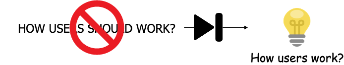

## Update

A dull Saturday, lazy morning and unfortunately the next door neighbor is down thanks to COVID-19. Hopefully he should recover just fine but till then we are also forced to be Home quarantined.

As the hours are passing by, I have to ensure some intellectual `bon-appétite pour mon **cerveau**`

Topic to read today is `Business Agility`, and we will go through customer centricity and design thinking before we reach there.

*The figures for this post are on Scaled Agile's site: [Customer Centricity](https://www.scaledagileframework.com/customer-centricity/), [Design Thinking](https://www.scaledagileframework.com/design-thinking/) and [Business Agility](https://www.scaledagileframework.com/business-agility/) (© Scaled Agile, Inc.).*

Just a note before we get started

Agile is a philosophy to develop software, something in concept similar to a model of development.

> It is more of a philosophical approach to how things should be done.
>
> © Scaled Agile, Inc.

I started with a water-fall model, which ideally was not too bad for us and had its moments.

It was detailed (rather too detailed), everything was documented, approved and executed. We used to have demos not usually at the end, but it was almost towards the end e.g.s RC's (Alpha, Beta, GA). Everything had a milestone date, which was seldom missed, automation was still not big, but quality plans and unit testing was still there.


Each framework contains a general overview and links to find additional information. Not all Agile frameworks or methodologies are isolated to software development projects.
— © Scaled Agile, Inc.


# NOTE: THIS CONTENT IS MOSTLY FROM SAFE5 official - WEBSITE.

In Safe everything is around Customer - Customer Centricity (read [Design Thinking](https://www.scaledagileframework.com/design-thinking/)). Safe describes it as a mindset & a way of doing business that creates positive experience for customers by the enterprises products and services.


The core process of design thinking focuses thoroughly on the problem space before thinking about solution.
— © Scaled Agile, Inc.


> Design thinking emphasizes understanding the problem to be solved, the context in which the solution will be used, and the evolution of that solution.
>
> © Scaled Agile, Inc.

*Figure: design thinking; see [Design Thinking](https://www.scaledagileframework.com/design-thinking/) on Scaled Agile's site (© Scaled Agile, Inc.).*


Please do visit Safe5 site for more on Divergent thinking, Convergent thinking, Personas and Empathy maps.


Business Agility is all about responding swiftly to an every changing and demanding market with innovative business solutions not just to compete but to thrive.

> Those who master large-scale software delivery will define the economic landscape of the 21st century.
>
> © Scaled Agile, Inc.

It recommends use of Lean and Agile practices to continually deliver innovative, quality services and products with involvement of all the stakeholders.

1. business and technology leaders
2. development
3. IT operations
4. legal, marketing
5. finance
6. support
7. compliance
8. security, and others.

*Figure: business agility; see [Business Agility](https://www.scaledagileframework.com/business-agility/) on Scaled Agile's site (© Scaled Agile, Inc.).*

### How it all starts?

At the beginning everything starts small, focused. It is race against time to create an impact define value and bring in the customers. As the time passes and the enterprise grows, it is usually silo'd in hierarchies and verticals. Which might be useful as it provides time tested policies and practices but with ever diminishing returns.

*Figure: how an enterprise grows; see [Business Agility](https://www.scaledagileframework.com/business-agility/) on Scaled Agile's site (© Scaled Agile, Inc.).*

`John Kotter` proposed not trashing the existing knowledge but introducing a second Operating System which requires expertise over seven competencies as prescribed by Safe 5.

> By organizing the second operating system around value streams instead of departments, SAFe offers a way for enterprises to focus on customers, products, innovation, and growth
>
> © Scaled Agile, Inc.

- Lean portfolio management
- Organization agility
- Continuous learning culture
- Lean agile leadership
- Team and technical agility
- Agile product delivery
- Enterprise solution delivery

*Figure: the core competencies; see [Business Agility](https://www.scaledagileframework.com/business-agility/) on Scaled Agile's site (© Scaled Agile, Inc.).*

## References

- https://www.scaledagileframework.com/business-agility/
- https://agile-mercurial.com/2019/02/06/agile-frameworks-fact-sheet/
- https://www.scaledagileframework.com/customer-centricity/
- https://www.scaledagileframework.com/design-thinking/
- John Kotter - Accelerate: Building Strategic Agility for a Faster Moving World.
- Dual operating system.
