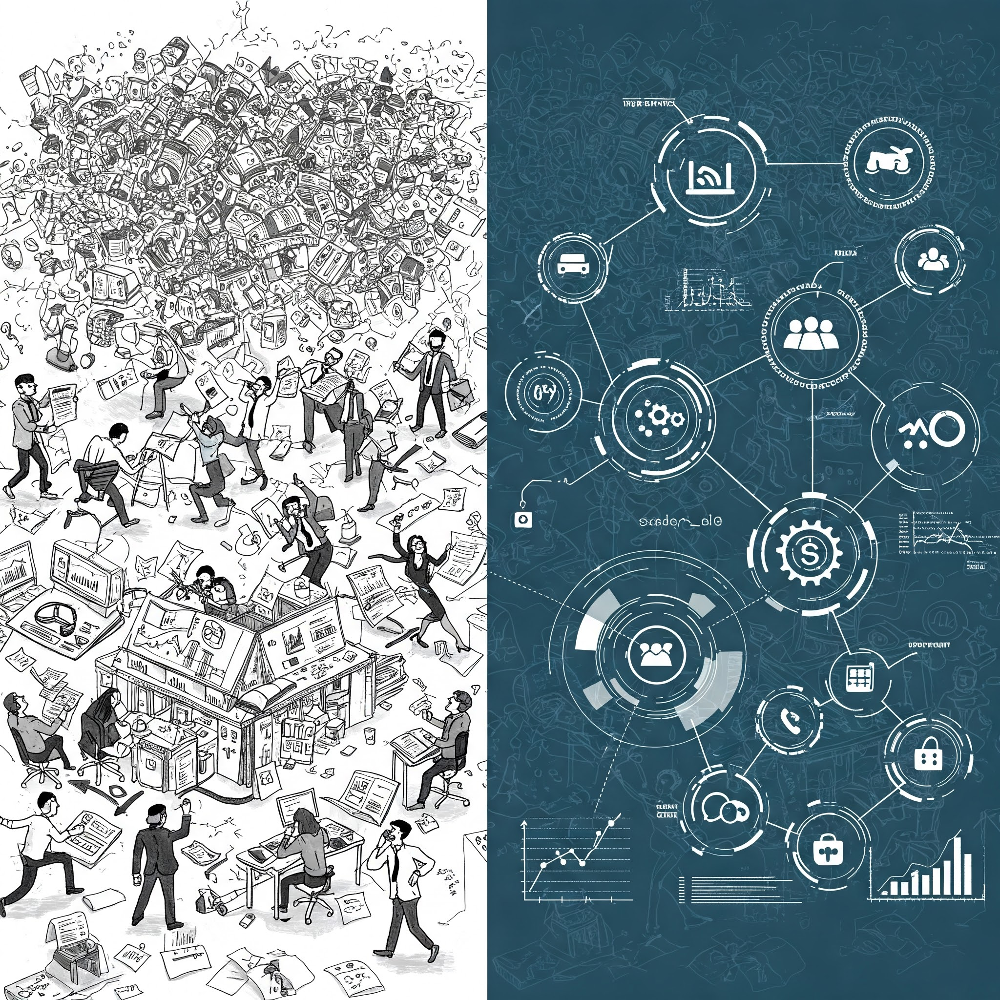

Imagine you’re a business owner trying to figure out why your sales are down. You could `guess`, or you could use **business analytics**.

In simple terms, business analytics is like a detective for your business. It uses data to uncover clues and insights that help you make better decisions. Instead of relying on gut feelings, you use facts and figures to understand what’s happening and what you can do about it.

Think of it like this:

- **The Problem:** Sales are down.
- **The Clues:** You have sales data, customer reviews, website traffic, and competitor information.
- **The Detective (Business Analytics):** You use tools and techniques to analyze this data, looking for patterns and connections.
- **The Insights:** Maybe you find that website traffic is down, or customers are complaining about a new policy.
- **The Solution:** Based on these insights, you can make informed decisions, like improving your website or changing your policy.



Let’s break down the Managerial Decision-Making Process and the Business Analytics Process, aligning them with the concepts presented in Jaggia’s `Business Analytics: Communicating with Numbers.`

### **Stage 1: Managerial Decision-Making Process**

- **Definition:** The managerial decision-making process is a systematic approach used by managers to identify problems, evaluate alternatives, and choose the best course of action to achieve organizational goals. It’s a structured way to make informed choices in complex situations.
- **Stages:**
  1. **Problem Identification:** `Recognizing` and clearly defining the issue or opportunity. This often involves `understanding` the context, stakeholders, and potential consequences.
  2. **Information Gathering:** `Collecting` relevant data and insights related to the problem. This might involve market research, financial analysis, or internal data review.
  3. **Alternative Generation:** `Brainstorming` and developing potential solutions or courses of action. Creativity and diverse perspectives are valuable here.
  4. **Evaluation of Alternatives:** Assessing the pros and cons of each `alternative`. This often involves considering factors like cost, feasibility, risk, and impact.
  5. **Selection of the Best Alternative:** Choosing the most `suitable` solution based on the evaluation. This decision should align with organizational strategy and objectives.
  6. **Implementation:** Putting the chosen solution into action. This requires planning, resource allocation, and communication.
  7. **Evaluation of Outcomes:** Monitoring the results of the decision and making adjustments if necessary. This `feedback` loop is crucial for continuous improvement.
- **Tools and Terms:** SWOT analysis, cost-benefit analysis, decision trees, risk assessment, brainstorming, scenario planning.
- **Input:** Information about the problem, organizational goals, available resources, and constraints.
- **Process:** The seven stages outlined above.
- **Output:** A chosen course of action or decision, along with its anticipated outcomes.

### **Stage 2: Business Analytics Process**

- **Definition:** The business analytics process involves `using` data and analytical techniques to gain insights, make predictions, and support better business decisions. Jaggia emphasizes the importance of communication throughout this process.
- **Stages:**
  1. **Problem Definition (Business Understanding):** Clearly defining the business problem or opportunity that analytics will address. This stage is crucial for framing the analysis and ensuring it’s relevant.
  2. **Data Collection and Preparation (Data Wrangling):** Gathering and cleaning the necessary data. This often involves dealing with messy or incomplete datasets, requiring data cleaning, transformation, and integration.
  3. **Data Analysis (Descriptive, Predictive, Prescriptive Analytics):** Applying appropriate analytical techniques to the data. This could include descriptive statistics, data visualization, predictive modeling, or optimization.
  4. **Communication of Insights:** Presenting the findings in a clear, concise, and compelling way to stakeholders. This often involves creating reports, visualizations, and presentations.
  5. **Implementation and Monitoring:** Putting the insights into action and tracking the results. This stage links back to the managerial decision-making process.
- **Tools and Terms:**
  - **Data Wrangling:** Data cleaning, transformation, integration, SQL, data mining techniques.
  - **Descriptive Analytics:** Summary statistics, data visualization (charts, graphs), dashboards.
  - **Predictive Analytics:** Regression analysis, time series analysis, machine learning algorithms (e.g., classification, clustering).
  - **Prescriptive Analytics:** Optimization models, simulation, decision rules.
  - **Communication:** Storytelling with data, data visualization best practices, report writing, presentation skills.
- **Input:** Business problem, raw data from various sources.
- **Process:** The five stages outlined above.
- **Output:** Insights, predictions, recommendations, reports, visualizations, and ultimately, improved business decisions.

### **Stage 3: Linking Managerial Decision-Making and Business Analytics**

Jaggia’s approach emphasizes the crucial link between these two processes. Business analytics provides the data-driven insights that inform and enhance managerial decision-making.

- **How Methods and Models are Selected:** The choice of analytical methods and models depends on the specific business problem being addressed, the type and quality of data available, and the desired outcome. Jaggia’s book likely guides students through this selection process.

```text
[Business Problem] --> [Business Analytics Process (Jaggia)] --> [Insights/Recommendations] --> [Managerial Decision-Making Process] --> [Improved Business Outcomes
```

This diagram above shows how the business analytics process feeds into the managerial decision-making process. The insights gained from data analysis inform the evaluation of alternatives and the selection of the best course of action. The feedback loop emphasizes the iterative nature of both processes and the importance of monitoring and evaluating the outcomes of decisions.
