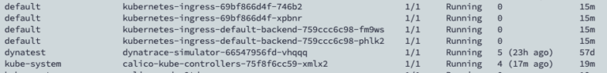

In my cluster things went haywire all of a sudden without a proper showcase, I tried multiple things but it was just not working. Specifically my `core-dns` and `calico-kube-controllers` were not coming up and were constantly showing `not ready` and `CrashLoop` respectively

```text
k describe pod -nkube-system  calico-kube-controllers-75f8f6cc59-xmlx2
```

The error was evident as under - `networkPlugin cni failed to set up pod "calico-kube-controllers-75f8f6cc59-xmlx2_kube-system"`

```text
Events:
  Type     Reason                  Age                From               Message
  ----     ------                  ----               ----               -------
  Normal   Scheduled               17m                default-scheduler  Successfully assigned kube-system/calico-kube-controllers-75f8f6cc59-xmlx2 to mymachine.local.net
  Warning  FailedCreatePodSandBox  17m                kubelet            Failed to create pod sandbox: rpc error: code = Unknown desc = [failed to set up sandbox container "cc4c71d1969bfe80b08055c3f685f3218b17a865ef7e069cbe37b9c830f791f5" network for pod "calico-kube-controllers-75f8f6cc59-xmlx2": networkPlugin cni failed to set up pod "calico-kube-controllers-75f8f6cc59-xmlx2_kube-system" network: error getting ClusterInformation: connection is unauthorized: Unauthorized, failed to clean up sandbox container "cc4c71d1969bfe80b08055c3f685f3218b17a865ef7e069cbe37b9c830f791f5" network for pod "calico-kube-controllers-75f8f6cc59-xmlx2": networkPlugin cni failed to teardown pod "calico-kube-controllers-75f8f6cc59-xmlx2_kube-system" network: error getting ClusterInformation: connection is unauthorized: Unauthorized]
```

I looked at the not read `coredns` and it was timing out.

```text
k logs -n kube-system coredns-78fcd69978-8sqqd
```

```text
[INFO] 127.0.0.1:53136 - 58052 "HINFO IN 1705020418207355632.1388822312682969349. udp 57 false 512" NOERROR - 0 2.000338997s
[ERROR] plugin/errors: 2 1705020418207355632.1388822312682969349. HINFO: read udp 10.98.34.204:50841->192.19.189.10:53: i/o timeout
[INFO] plugin/ready: Still waiting on: "kubernetes"
```

The thing that helped me solve the problem was setting up the iptables policy as under

```text
iptables -P INPUT ACCEPT
iptables -P FORWARD ACCEPT
iptables -P OUTPUT ACCEPT
iptables -F
```

This resulted in containers coming up for both `coredns` and `controllers`

```text
Normal   SandboxChanged          16m (x2 over 17m)  kubelet            Pod sandbox changed, it will be killed and re-created.
  Warning  Unhealthy               16m (x3 over 16m)  kubelet            Readiness probe failed: Failed to read status file /status/status.json: unexpected end of JSON input
  Warning  BackOff                 16m (x7 over 16m)  kubelet            Back-off restarting failed container
  Normal   Pulled                  15m (x4 over 16m)  kubelet            Container image "docker.io/calico/kube-controllers:v3.20.2" already present on machine
  Normal   Created                 15m (x4 over 16m)  kubelet            Created container calico-kube-controllers
  Normal   Started                 15m (x4 over 16m)  kubelet            Started container calico-kube-controllers
```
