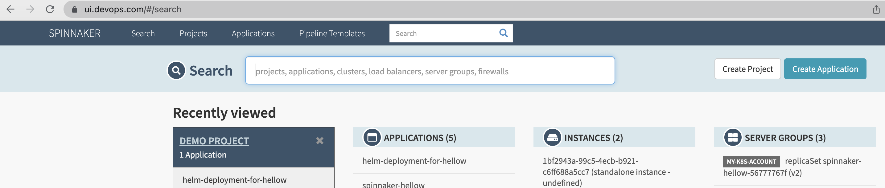

A common use-case for cert-manager is requesting TLS signed certificates to secure your ingress resources.


`cert-manager` adds certificates and certificate issuers as resource types in Kubernetes clusters, and simplifies the process of obtaining, renewing and using those certificates.


## Installation

The easiest way is to use helm charts.

```text
helm repo add jetstack https://charts.jetstack.io
```

```text
root@master>helm repo list
NAME                    URL                                                                                         
stable                  https://charts.helm.sh/stable                                                                                                        
jetstack                https://charts.jetstack.io
```

```text
helm install cert-manager jetstack/cert-manager \
  --namespace cert-manager \
  --create-namespace \
  --version v1.7.1 \
  --set prometheus.enabled=false \
  --set webhook.timeoutSeconds=4 \
  --set installCRDs=true
```

Once deployed you can see the k8s objects deployed

```text
root@master>k get all -n cert-manager
```

```text
NAME                                           READY   STATUS    RESTARTS   AGE
pod/cert-manager-86f4f985d6-ntgtf              1/1     Running   0          7d23h
pod/cert-manager-cainjector-56bc5f744c-tdhx6   1/1     Running   0          7d23h
pod/cert-manager-webhook-997b5dd88-4jbmf       1/1     Running   0          7d23h

NAME                           TYPE        CLUSTER-IP     EXTERNAL-IP   PORT(S)    AGE
service/cert-manager           ClusterIP   10.100.35.73   <none>        9402/TCP   67d
service/cert-manager-webhook   ClusterIP   10.96.67.112   <none>        443/TCP    67d

NAME                                      READY   UP-TO-DATE   AVAILABLE   AGE
deployment.apps/cert-manager              1/1     1            1           67d
deployment.apps/cert-manager-cainjector   1/1     1            1           67d
deployment.apps/cert-manager-webhook      1/1     1            1           67d

NAME                                                 DESIRED   CURRENT   READY   AGE
replicaset.apps/cert-manager-57d89b9548              0         0         0       67d
replicaset.apps/cert-manager-86f4f985d6              1         1         1       7d23h
replicaset.apps/cert-manager-cainjector-56bc5f744c   1         1         1       7d23h
replicaset.apps/cert-manager-cainjector-5bcf77b697   0         0         0       67d
replicaset.apps/cert-manager-webhook-997b5dd88       1         1         1       7d23h
replicaset.apps/cert-manager-webhook-9cb88bd6d       0         0         0       67d
```

## Example

```text
>kubectl get Issuers,ClusterIssuers,Certificates,CertificateRequests,Orders,Challenges -A
```

### Issuers

```text
NAMESPACE           NAME                                          READY   AGE
cert-manager-test   issuer.cert-manager.io/test-selfsigned        True    7d21h
jenkins             issuer.cert-manager.io/jenkins-selfsigned     True    6d18h
spinnaker           issuer.cert-manager.io/spinnaker-selfsigned   True    7d21h
```

```text
NAMESPACE           NAME                                            READY   SECRET                AGE
cert-manager-test   certificate.cert-manager.io/selfsigned-cert     True    selfsigned-cert-tls   7d21h
jenkins             certificate.cert-manager.io/jenkinsdevops.com   True    jenkinsdevops.com     6d18h
spinnaker           certificate.cert-manager.io/devops.com          True    devops.com            7d19h
spinnaker           certificate.cert-manager.io/selfsigned-cert     True    devops.com            7d21h
```

```text
NAMESPACE           NAME                                                         APPROVED   DENIED   READY   ISSUER                 REQUESTOR                                         AGE
cert-manager-test   certificaterequest.cert-manager.io/selfsigned-cert-hnd85     True                True    test-selfsigned        system:serviceaccount:cert-manager:cert-manager   7d21h
jenkins             certificaterequest.cert-manager.io/jenkinsdevops.com-75hdn   True                True    jenkins-selfsigned     system:serviceaccount:cert-manager:cert-manager   6d18h
spinnaker           certificaterequest.cert-manager.io/devops.com-g6b2m          True                True    spinnaker-selfsigned   system:serviceaccount:cert-manager:cert-manager   5d22h
spinnaker           certificaterequest.cert-manager.io/devops.com-rz6db          True                True    spinnaker-selfsigned   system:serviceaccount:cert-manager:cert-manager   5d23h
spinnaker           certificaterequest.cert-manager.io/devops.com-wzs4h          True                True    spinnaker-selfsigned   system:serviceaccount:cert-manager:cert-manager   5d22h
spinnaker           certificaterequest.cert-manager.io/selfsigned-cert-mfggn     True                True    spinnaker-selfsigned   system:serviceaccount:cert-manager:cert-manager   7d21h
```

## After Installation, Configure

The first thing you’ll need to configure after you’ve installed cert-manager is an issuer which you can then use to issue certificates.

### Before you begin

#### `Issuers` & `ClusterIssuer`

`Issuers`, and `ClusterIssuers`, are Kubernetes resources that represent certificate authorities (CAs) that are able to generate signed certificates by honoring certificate signing requests.

#### Example – Issuer

```text
apiVersion: cert-manager.io/v1
kind: Issuer
metadata:
  name: jenkins-selfsigned
  namespace: jenkins
spec:
  selfSigned: {}
```

#### Example – ClusterIssuer

```text
apiVersion: cert-manager.io/v1
kind: ClusterIssuer
metadata:
  name: selfsigned-cluster-issuer
spec:
  selfSigned: {}
```


An `Issuer` is a namespaced resource, and it is not possible to issue certificates from an `Issuer` in a different namespace.


If you want to create a single `Issuer` that can be consumed in multiple namespaces, you should consider creating a `ClusterIssuer` resource.

#### Certificate

A `Certificate` is a namespaced resource that references an `Issuer` or `ClusterIssuer` that determine what will be honoring the certificate request.

When a `Certificate` is created, a corresponding `CertificateRequest` resource is created by cert-manager containing the encoded X.509 certificate request, `Issuer` reference, and other options based upon the specification of the `Certificate` resource.

## Securing Ingress

As I conclude the blog, let me use the deployed cert-manager to secure the TLS deployment for my spinnaker instance.

Supported Annotations in Ingress: <https://cert-manager.io/docs/usage/ingress/#supported-annotations>

In our example we will use mostly

- `cert-manager.io/issuer`
- `cert-manager.io/cluster-issuer`

### Deployed Spinnaker Pods

```text
root@master>k get pods -n spinnaker
NAME                                  READY   STATUS    RESTARTS   AGE
minio-5bbd54df5b-qnfvs                1/1     Running   0          8d
spin-clouddriver-ddd75554c-tts9z      1/1     Running   0          45h
spin-deck-649d97f44f-kp59x            1/1     Running   0          8d
spin-echo-9587cdc9d-gm7pt             1/1     Running   0          4d16h
spin-front50-7dbbb7668-qpr5f          1/1     Running   0          5d23h
spin-gate-69b9f88748-pppwm            1/1     Running   0          5d23h
spin-igor-6bcc768f9c-fzr8c            1/1     Running   0          47h
spin-orca-68ff75b6f8-r6872            1/1     Running   0          5d23h
spin-redis-864dff6b7-82m55            1/1     Running   0          8d
spin-rosco-68dc887685-sm9p8           1/1     Running   0          5d23h
```

## Services

```text
root@master>k get svc -n spinnaker
NAME                  TYPE        CLUSTER-IP       EXTERNAL-IP   PORT(S)    AGE
minio                 ClusterIP   10.96.179.180    <none>        9000/TCP   8d
spin-clouddriver      ClusterIP   10.107.86.175    <none>        7002/TCP   8d
spin-deck             ClusterIP   10.106.159.232   <none>        9000/TCP   8d
spin-echo             ClusterIP   10.98.31.29      <none>        8089/TCP   8d
spin-front50          ClusterIP   10.106.148.148   <none>        8080/TCP   8d
spin-gate             ClusterIP   10.105.124.157   <none>        8084/TCP   8d
spin-igor             ClusterIP   10.99.29.79      <none>        8088/TCP   5d23h
spin-orca             ClusterIP   10.103.240.238   <none>        8083/TCP   8d
spin-redis            ClusterIP   10.99.134.213    <none>        6379/TCP   8d
spin-rosco            ClusterIP   10.110.22.96     <none>        8087/TCP   8d
```

I will use the Ingress to expose the UI and API

```text
apiVersion: networking.k8s.io/v1
kind: Ingress
metadata:
  annotations:
    haproxy.org/cors-allow-origin: "*.devops.com"
    haproxy.org/ingress.class: haproxy
    cert-manager.io/issuer: "spinnaker-selfsigned"
    cert-manager.io/common-name: "devops.com"
  name: spinnaker-ingress
  namespace: spinnaker
spec:
  ingressClassName: haproxy
  rules:
  - host: ui.devops.com
    http:
      paths:
      - backend:
          service:
            name: spin-deck
            port:
              number: 9000
        path: /
        pathType: Prefix
  - host: api.devops.com
    http:
      paths:
      - backend:
          service:
            name: spin-gate
            port:
              number: 8084
        path: /
        pathType: Prefix
  tls:
  - hosts:
    - ui.devops.com
    - api.devops.com
    secretName: devops.com
```

Please note the annotation `cert-manager.io/issuer: "spinnaker-selfsigned"` applied to the ingress once the resource is created using `kubectl create -f <yaml>`

```text
k get ing -n spinnaker
NAME                  CLASS     HOSTS                                                 ADDRESS          PORTS     AGE
spinnaker-ingress     haproxy   ui.devops.com,api.devops.com,clouddriver.devops.com   10.98.117.100    80, 443   7d21h
```


