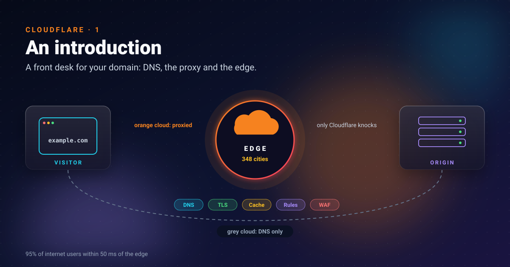


Think of a hotel. Guests never walk straight to a room: they talk to the front desk, which checks who they are,
answers what it can, and only calls up to the room when it has to. Cloudflare is a front desk for a website. This
series is about what that desk does, how it protected my two domains, and what you get from it for free.




I've used Cloudflare for a month now, for samarthya.me since
[the blog moved after the hack]() and for
[bhanuni.in](). Earlier posts showed single steps. This
series puts them together, starting with the basics.

## Words used in this post

| Term | Meaning here |
|---|---|
| **DNS** | The internet's phone book: turns a name such as `example.com` into the address of a machine |
| **Nameserver** | The server that answers DNS questions for a domain |
| **Origin** | The server that really holds the site's files |
| **Edge** | Cloudflare's servers close to the visitor, which answer first |
| **Proxy** | A middleman that receives a request and decides what to do with it, instead of the origin |
| **TLS** | The encryption behind `https://`, with a certificate proving who the server is |
| **CDN** | Content delivery network: copies of files kept near visitors so they load fast |

## What Cloudflare is

Cloudflare runs one large network and sells (or gives away) many services on top of it. The network is the
important part: its [network page](https://www.cloudflare.com/network/) lists data centres in **348 cities**, and
says 95% of the world's internet-connected population is within 50 milliseconds of one of them.

For a small site the services fall into four groups:

| Group | What it does | I use it for |
|---|---|---|
| **DNS** | Answers "where is this name?" | Both domains |
| **Proxy and CDN** | Answers *as* your site: TLS, cache, redirects | `www`, `about`, the old `blog` name, bhanuni.in |
| **Security** | DDoS protection, a firewall for web requests (WAF), bot detection | Whatever is proxied |
| **Zero Trust** | Logins in front of private apps, tunnels to machines with no open port | Next on my list (part 4) |

There are also developer products (Workers, Pages, storage). They're useful, but they're not the subject here.

## Step 1: Cloudflare becomes your phone book

Everything starts with DNS. You add your domain to Cloudflare, and Cloudflare gives you two nameservers. At your
registrar (the shop you rent the name from) you replace the old nameservers with those two. From then on, when
anyone asks "where is example.com?", Cloudflare answers.

That step alone changes nothing visible. The answers are the same; only who gives them has changed. That's why
it's the safe first step, and why I took it on its own
([Rebuilding, part 4]()).

## Step 2: orange cloud or grey cloud

Every address record in Cloudflare (A, AAAA, CNAME) has a switch with two positions, drawn as a cloud:

| | Grey cloud: **DNS only** | Orange cloud: **Proxied** |
|---|---|---|
| What a lookup returns | The origin's real address | Cloudflare's own addresses |
| Who the visitor talks to | The origin, directly | Cloudflare, which then talks to the origin (or doesn't) |
| Cloudflare's TLS, cache, rules, WAF | Not applied | Applied |
| Works for mail? | Yes | No: Cloudflare [proxies only A, AAAA and CNAME](https://developers.cloudflare.com/dns/proxy-status/) |

That switch is the whole idea. With the grey cloud, Cloudflare is a phone book. With the orange cloud, it's the
front desk: the visitor's browser connects to the nearest Cloudflare server, which decides whether to answer
from its cache, send a redirect, block the request, or forward it to the origin.

You can see which one you're getting:

```bash
# Who answered? A proxied name says "server: cloudflare" and carries a cf-ray id.
curl -sI https://www.example.com/ | grep -i "^server\|^cf-ray"
```

For my blog itself the answer is `Server: GitHub.com`: it's DNS only, on purpose (part 2 explains why). For
`www.samarthya.me` it's `Server: cloudflare`, because Cloudflare answers that name itself.

## Step 3: what the front desk does

Once a name is proxied, a request goes through a fixed set of stations at the edge. Simplified:

1. **DDoS protection** drops floods before they reach anything else. It's
   [on every plan, unmetered](https://developers.cloudflare.com/ddos-protection/).
2. **TLS.** Cloudflare presents a certificate to the visitor. [Universal SSL](https://developers.cloudflare.com/ssl/edge-certificates/universal-ssl/)
   gives a free one for the apex and first-level subdomains, renewed automatically.
3. **Rules and the WAF.** Redirects, blocks and challenges, written as small expressions such as
   `http.host eq "blog.example.com"`.
4. **Cache.** If a stored copy is fresh, it's served from the edge and the origin never hears about it.
5. **The origin**, only if none of the above answered. Cloudflare connects to it with its own TLS connection,
   which you can make it verify (*Full (strict)*, part 2).

The order is the point. Most of what reaches a small site is noise: scanners, old links, bots. Each station that
answers first is one request your server never sees.

## What it doesn't do

The proxy doesn't make a weak origin safe:

- **It doesn't hide a server that's public in other ways.** My `about` host also runs mail, and mail records have
  to point at the real machine. Anyone who looks can find it.
- **It doesn't fix the application.** A vulnerable plugin is still vulnerable when the request is allowed through.
- **It adds a dependency.** If Cloudflare has a bad day, so does every proxied site. And settings like strict TLS
  turn mistakes at the origin, such as an expired certificate, into an outage.

I treat it the way I'd treat a good receptionist: it cuts down the traffic and catches the obvious cases. Every
room still needs a lock.

## Where my two domains sit

| Name | Cloud | Why |
|---|---|---|
| `samarthya.me` (this blog) | Grey | GitHub Pages already serves it fast and renews its own certificate |
| `www`, the old `blog` name | Orange | Cloudflare answers with a redirect; GitHub is never asked |
| `about.samarthya.me` | Orange | The origin is the old host, so it gets a front desk |
| `mail` and friends | Grey | Mail can't be proxied |
| `bhanuni.in` | Orange | There's no server at all; Cloudflare answers every request with a redirect |

## Takeaways

- Cloudflare is DNS first. Moving the nameservers is the safe step that changes nothing visible.
- The orange/grey switch decides everything else: proxied names get Cloudflare's TLS, rules, cache and WAF,
  and DNS-only names get none of it.
- The edge answers in a fixed order (DDoS, TLS, rules, cache, origin), so every station that answers saves the
  origin a request.
- A proxy cuts the noise reaching a weak server. It doesn't make that server safe.

## References

- [Cloudflare's global network](https://www.cloudflare.com/network/): Cloudflare, the 348 cities and the 50 ms figure
- [Proxy status](https://developers.cloudflare.com/dns/proxy-status/): Cloudflare docs, proxied versus DNS-only, and which record types can be proxied
- [DDoS protection](https://developers.cloudflare.com/ddos-protection/): Cloudflare docs, unmetered DDoS protection on all plans
- [Universal SSL](https://developers.cloudflare.com/ssl/edge-certificates/universal-ssl/): Cloudflare docs, free edge certificates and what they cover

Next: part 2, what all this did for samarthya.me and bhanuni.in.
