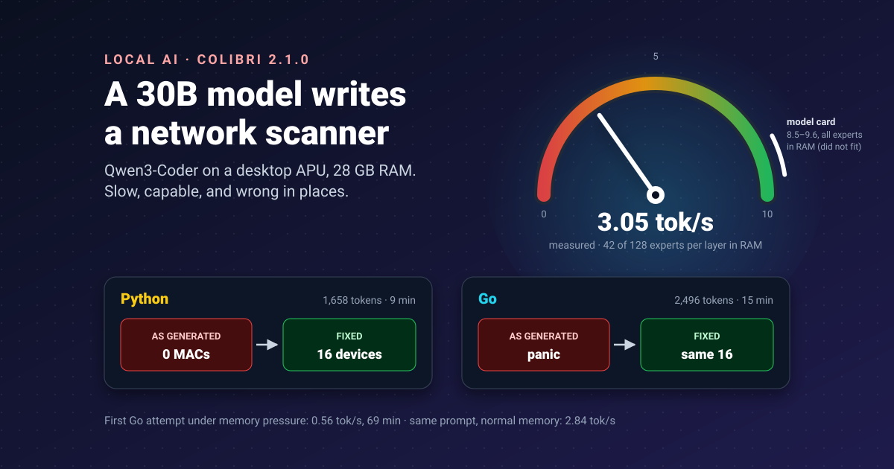


A new colleague who works slowly but knows a lot is still useful, as long as someone checks the work. I gave a
30-billion-parameter coding model, running entirely on my own desktop, one ordinary job and checked everything it
handed back.


[Colibri](https://github.com/JustVugg/colibri) is a small inference engine (the program that runs a model) built for
one trick: a mixture-of-experts model only uses a few of its sub-networks, called experts, for each token, so Colibri
keeps the busy experts in memory and reads the rest from disk. That lets a model that would not fit in RAM run on an
ordinary machine. I wanted to know what that feels like on a real task, not a benchmark.

Everything here is reproducible: the prompts, the timing script, every raw answer and every fix are in
[samarthya/colibri-lan-scout](https://github.com/samarthya/colibri-lan-scout).

## The setup

| | |
|---|---|
| Machine | AMD Ryzen 9 7940HS (8 cores), 28 GB RAM, integrated Radeon 780M, NVMe SSD, Windows 11 |
| Engine | Colibri 2.1.0, Vulkan backend on the integrated GPU |
| Model | [Qwen3-Coder-30B-A3B](https://huggingface.co/Qwen/Qwen3-Coder-30B-A3B-Instruct), 30.5B parameters, 3.3B used per token, in Colibri's [int4 build](https://huggingface.co/Justvugg/Qwen3-Coder-30B-A3B-colibri-int4) (19 GB on disk) |
| Memory plan | Chosen automatically: 42 of the 128 experts per layer held in RAM |

The model has 128 experts in each of its 48 layers and uses 8 of them per token, which is why this approach works at
all. Colibri's setup did the rest: it checked the hardware, downloaded the model and wrote a configuration.
`coli start --background` had the API answering in **11 seconds**, with the process holding under 3 GB. Its log
explained the plan: all 48 attention layers on the Radeon 780M, 428 frequently used experts in GPU memory, the rest
in RAM or on disk.

## The task

A standard, slightly fiddly job: **a program that lists the devices on my network**, with their MAC addresses and
names, marking the router and this machine. Standard library only, no administrator rights, Windows, Linux and macOS.
The same [prompt](https://github.com/samarthya/colibri-lan-scout/blob/main/prompts/python.md) for Python and for Go.

I chose it because it looks simple and is full of small traps: `ping` takes different flags on every OS, and every OS
prints its neighbour table (the ARP table, which maps IP addresses to hardware addresses) differently. A model that
has seen a lot of code should know these.

To measure speed honestly I wrote a [small script](https://github.com/samarthya/colibri-lan-scout/blob/main/bench/run_prompt.py)
that streams the answer and records two things: **time to first token**, which includes reading the prompt, and
**decode speed** in tokens per second, which is how fast the answer scrolls.

## How fast

| Run | Answer | First token | Speed | Total |
|---|---|---|---|---|
| Python | 1,658 tokens | 20.8 s | **3.05 tok/s** | 9 min 24 s |
| Go, first attempt | 2,289 tokens | 11.8 s | **0.56 tok/s** | 68 min 47 s |
| Short test straight afterwards | 50 tokens | 9.0 s | 3.34 tok/s | 24 s |
| Go, same prompt again | 2,496 tokens | 19.6 s | **2.84 tok/s** | 14 min 59 s |

About **3 tokens per second**: you watch the code being typed, roughly a line every few seconds. A complete program
takes ten to fifteen minutes. That is a coffee, not a conversation.

The first Go run is the interesting row. It was more than five times slower, and Go had nothing to do with it. While
it ran, Colibri's own memory grew from 3 GB to 11 GB, and free memory on the machine fell to about 2 GB. The
server's statistics showed similar disk reads in both runs but about **seven times longer per expert** on the CPU in
the slow one, which points at the operating system squeezing the engine's memory. A short test straight afterwards
was back to 3.34 tok/s, and the identical prompt re-run gave 2.84.

Then I tried the setting the [model card](https://huggingface.co/Justvugg/Qwen3-Coder-30B-A3B-colibri-int4)
recommends for speed: every expert in RAM, `--cap 128`, which it reports at **8.5 to 9.6 tok/s** with about 15–17 GB.
I gave it a smaller context to make room. Partway through the answer my machine ran critically low on memory and the
run was stopped. On 28 GB with a desktop running, the automatic plan is the one that fits.

**The lesson on speed:** with Colibri, memory is the speed dial. Leave it headroom, and do not trust any run you made
while something else was eating RAM, including the engine itself as it grew.

## What it wrote

Both answers looked professional: typed functions, a thread pool or goroutines, OS switches, help text, and a tidy
list of limitations at the end. Then I ran them.

| | Python | Go |
|---|---|---|
| As generated | Ran first time; found 7 devices and **0 MAC addresses** | Compiled, then **panicked** before printing anything |
| After my fixes | 16 devices, 15 MACs, 9 s | The same 16 devices, 15 MACs, 12 s |

The repository keeps the model's code as the first commit and my fixes as later ones, so `git diff` shows exactly
what a human had to change. Three bugs are worth telling.

**1. The parser that only read the header.** Python's Windows ARP parser kept lines starting with `Internet`. In
`arp -a` output the only such line is the column header, `Internet Address  Physical Address  Type`. Every MAC came
back empty. On Linux the same function took the third word as the MAC address, and the third word is `at`. The Go
version had the same idea from the other side: it assumed Windows prints `IP Type MAC` (it prints `IP MAC Type`),
indexed a field without checking the line was long enough, and crashed with `index out of range [2] with length 2`.

**2. The program that would have scanned the wrong network.** Go found "this machine" by taking the first
non-loopback address from the network interfaces. I checked on my machine: that is a second adapter, not the one
that carries traffic. Even without the crash, it would have swept a /24 with nothing useful on it. The Python
version, written from the same prompt, used the reliable method of asking the OS which address it would route from.

**3. The data race.** Go looked up names in parallel and wrote every answer into one ordinary map from many
goroutines at once. Go's own [FAQ](https://go.dev/doc/faq#atomic_maps) is blunt about this: "uncontrolled map access
can crash the program". The fix is a mutex. I could not run Go's race detector, which needs a C toolchain, so that one
is fixed from reading the code.

There was also plenty of smaller stuff: addresses sorted as text (so `.10` came before `.2`), a 100 ms default ping
timeout, a Linux timeout that rounded to zero, hand-written flag parsing, and a context that was created and never
used. The first Go answer, from the slow run, did not even compile: it imported a package it never used, which Go
refuses.

Two things surprised me. The same prompt at temperature 0 produced **two quite different Go programs**, so "set the
temperature to zero" does not make this repeatable. And each answer ended with a list of eight limitations, each
reasonable in general. The closest to the truth, Python's "the ARP table parsing is simplified and may not work
correctly on all systems", was right, except that it failed on every system, including the one it was written for.

## What no fix could solve: names

After the fixes, both programs found 16 devices. Only **one had a name**, and it was my own machine. Reverse DNS
returns a name only if your router publishes one, and mine publishes none. Between 6 and 8 of the 16 did not answer
ping either, depending on the run: phones and firewalled PCs ignore it, and the fixed versions find them in the ARP
table instead.

The names really live in the router's list of connected devices, behind a login. The model's code was not wrong about
this; the task, as I wrote it, asked for something the network does not give away for free.

## Would I use it again?

| For | Against |
|---|---|
| Runs entirely offline: my code and my network stay on my machine | About 3 tok/s: a program takes 10–15 minutes |
| A 30B coding model on a machine that could never hold it in RAM | Speed depends heavily on free memory; the fast setting did not fit |
| Started in seconds, set up with no compiler | Confident code with real bugs in both languages |
| An OpenAI-style API, so any tool can use it | Not repeatable even at temperature 0 |

Yes, for a particular kind of work: a first draft of something I would review anyway, on code I do not want to send
anywhere, when I can start it and come back. It is a capable, slow colleague. It is not something to type to and wait
for.

What I will do differently next time: give it more memory headroom, ask for tests alongside the code, and treat its
"limitations" section as decoration.

## Takeaways

- Colibri made a 30B coding model usable on a 28 GB desktop, at about **3 tokens per second**.
- **Memory is the speed dial.** The same prompt ran at 0.56 tok/s under memory pressure and 2.84 without it; keeping
  every expert in RAM did not fit.
- The generated code **looked right and was wrong**: no MAC addresses in Python, a crash in Go, a wrong network, a data
  race. Every one was found only by running it.
- Commit the model's version first and fix in separate commits: the diff is the honest review.
- Some problems are not code problems. Device names live in the router, not on the network.

## References

- [JustVugg/colibri](https://github.com/JustVugg/colibri): the engine, how it reads experts from disk, the OpenAI-compatible API, the warning that the disk sets the speed for large models
- [Qwen3-Coder-30B-A3B colibri int4](https://huggingface.co/Justvugg/Qwen3-Coder-30B-A3B-colibri-int4): Colibri's model card, 19 GB size, 8.5–9.6 tok/s with all experts in RAM, 15–17 GB at `--cap 128`
- [Qwen3-Coder-30B-A3B-Instruct](https://huggingface.co/Qwen/Qwen3-Coder-30B-A3B-Instruct): Qwen, 30.5B and 3.3B parameters, 128 experts with 8 active, 48 layers
- [Go FAQ: why are map operations not defined to be atomic?](https://go.dev/doc/faq#atomic_maps): the Go team, concurrent map writes can crash a program
- [ping](https://learn.microsoft.com/en-us/windows-server/administration/windows-commands/ping): Microsoft Learn, Windows `ping` flags (`-n`, `-w` in milliseconds)
- [RFC 5737](https://www.rfc-editor.org/rfc/rfc5737): IETF, the documentation address ranges used in the repository's examples
- [samarthya/colibri-lan-scout](https://github.com/samarthya/colibri-lan-scout): this experiment's prompts, timing script, raw answers, both programs and every fix
