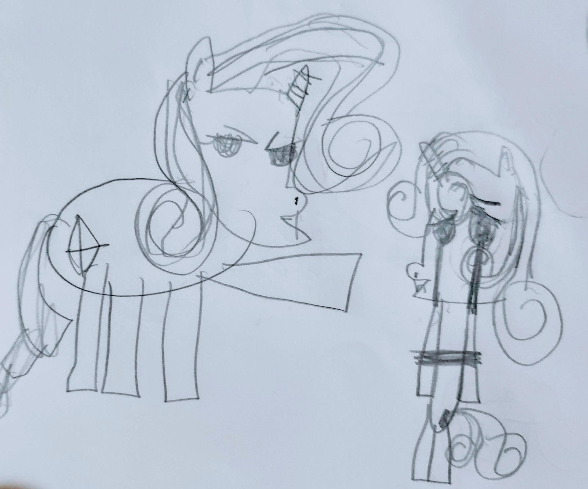
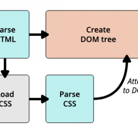

Happiness is not always straight lines.

Having worked on different technologies I never took HTML very seriously till a couple of years back. I started programming rather seriously programming when I was about 20 years old for a small startup then – FQSL. In those days, my primary responsibility was more around creating a middle – tier application which had a *management interface* and had the ability to spawn multiple threads to handle the incoming traffic and the main concern was to handle the load effectively and perform under pressure. This was all to be done in a native platform “Windows” and mostly in VC++ and MFC. Glad we are in *serverless* days now. 🙂

Jumping to today, and with the technology evolving every day; we have intelligent web-applications with very intuitive interface which makes it easier for the users (personas distinct) to manage their tasks in a smarter way. The things I used to do for native platforms is now effectively eased in a platform independent way (I like it so much).

Many of my directs have been doing this for few years and I have been learning the new ways ever so eagerly. The subject that intrigued me the most was how this transformation is done. Hey don’t give me that look. I am coming from the background of Coding, Compiling, Linking and then executing 😀

> How HTML is transformed from a markup language into this beautiful UI’s or DOM that the browser represents.

## What is CSS?

CSS is a language that allows the developer to define – how the document should be presented to the user.

A browser applies this set of rules as defined in the CSS to the document to transform them into that beautiful document the designer has designed.

## CSS Rule?

A rule is a simple condition like from left edge, I need my image to be few units away (Pixels, inches, or %)

## CSS Building blocks

1. Properties
2. Values
3. Selectors ( A bigger topic )

***Properties*** are the characteristic of the element you are specifying and the ***values*** denotes the value that is being set for the element. Each property has an acceptable value list and each value presents a unique result.

A property paired with a value is called **a CSS declaration.**

> **Ruleset**
>
> CSS Declaration inside CSS Block { } separated by a semicolon and paired with a selector

The ***CSS engine*** calculates which declarations apply to every single element of a page in order to appropriately lay it out and style it.

> Property and value are both case sensitive.
>
> US spelling are preferred properties semantics
>
> In case of error or misspelling it will be ignored by the browser



CSS has a convention that allows you give structure the rules you define.

## Selectors

Element that needs to be styled can be identified (distinctly or in bulk) by using these selectors. You target the HTML elements using selectors to style them.

e.g.

> ```text
p {
color: black;
}
```

### Categories of selectors

1. Simple selectors : Based on element type. (class or id)
2. Attribute selectors: Based on attribute or attribute value.
3. Pseudo classes: Based on the state
4. Pseudo elements: Based on position
5. Combinators: Combinations of selectos.
6. Multiple selectors: comma separated.

#### Category 1 – Simple selector

Type selector

> <p> Welcome </p>
>
> <div> I am a div </div>
>
> <p> Another Para </p>
>
> p {
>
> color: red;
>
> }

All p will be red here.

#### Class selector

> .myDiv {
>
> font-size: 2px;
>
> }

## How CSS works?

Browser is the window to the content the developer writes and the user consumes. When it displays the document (markup text file), it must combine the content with its style information.

1. Converts HTML and CSS into a in-memory tree representation called DOM. Document Object model.
2. Display the content.



HTMLCSStoDOM

# DOM

It is tree like structure where each element, attribute and the text in the markup becomes a DOM node in the structure.

So it starts with parsing the HTML creates the DOM tree parses Style and applies it to each of the selected element.

## How to apply CSS?

1. External Stylesheet. This is the most popular options that is recommended and is being used by the developers worldwide.

> <link rel=”stylesheet” href=”style.css”>

2. Internal stylesheet

> <head> <style> some style definitions </style> </head>

3. Inline style (This should be avoided)

> <h1 style=””>

We need to define how to tell our declaration blocks which elements they should be applied to and this is where we use the selectors.

CSS rules are the most common statement one can see in a stylesheet, but there are other that one can define.

1. @ rules : Used to convey the metadata or conditional information.

### Example:

#### Metadata

@charset

@import ‘mywebsite.css’ : Imports another CSS.

#### Conditional

@media: (Nested statements)

> @media (min-width: 810 px) {
>
> body {
>
> margin: 5 auto;
>
> }

@document

## Shorthand properties

Properties like font, margin are called shorthand properties, implying you can supply several values in a single line.

> ```text
padding: 10px 15px 15px 5px;
```

To be continued….
