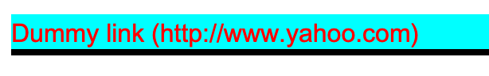

# Pseudo classes

State dependent styling, e.g Style a checkbox when it is in checked state. It is usually denoted by a preceding colon ‘:’ (without the quote).

> :active  
> :checked  
> :default  
> :dir  
> :disabled  
> :empty

E.g.

> 
 <a href=#> Dummy link</a> 

Styling

> 

## Pseudo elements

Keywords denoted by two colons (::) specified at the end of selector.

I am trying to add the URL information after the Anchor content.

> div id=”myDiv”> <a href=”http://www.yahoo.com”> Dummy link</a> 

Using the style and the pseudo element ::after

> a::after {  
> content: ” (” attr(href) “)”;  
> }

Brings the desired result

