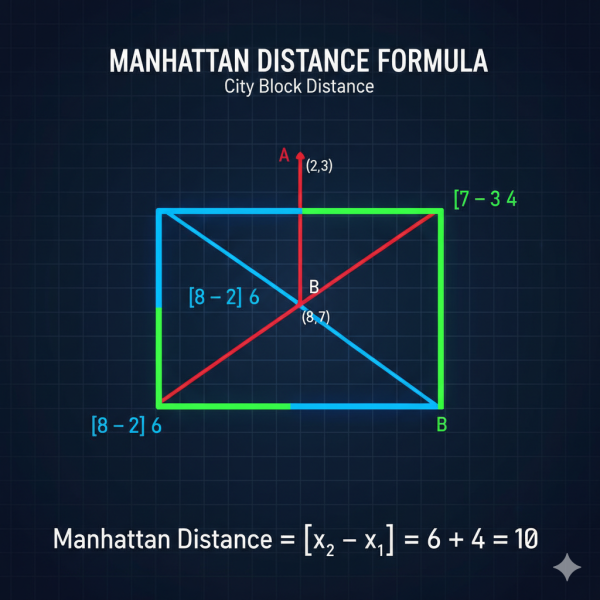

Whether you’re preparing for a quiz or just brushing up on fundamentals, this guide distills the key concepts from Data Mining into bite-sized, memorable chunks. Let’s dive in!

## Understanding Machine Learning Tasks

### **Regression vs. Classification: Know Your Output**

The fundamental distinction in supervised learning comes down to what you’re predicting:

- **Regression** tackles continuous outputs; think house prices, rainfall amounts, or quarterly revenue. If you can measure it on a scale with infinite precision, it’s `regression` territory.
- **Classification** handles categorical outcomes. This includes **binary classification** (yes/no, subscribe/don’t subscribe, spam/not spam) and **multiclass classification** (small/medium/large, or identifying flower species).

**Pro tip**: If someone asks “`how much?`” → regression. If they ask “`which category?`” → classification.

### **Unsupervised Learning: Finding Hidden Patterns**

Unlike supervised learning where we have labeled outcomes, unsupervised learning discovers structure in unlabeled data. **Clustering** is the star example; grouping customers into segments based on behavior without predefined labels. No one tells the algorithm what the “`right`” groups are; it finds natural patterns on its own.

## Data Preparation Fundamentals

### **Handling Missing Values**

Real-world data is messy. When you encounter missing values in numerical features, you have options:

- **Remove** rows (if only a few are missing) or columns (if many values are missing)
- **Impute** by replacing missing values with statistical estimates: mean, median, or mode

**Imputation** is generally preferred because it preserves your dataset size and captures reasonable estimates based on existing data.

### **Outliers: The Troublemakers**

An **outlier** is a data point that significantly deviates from other observations—think of a $50 million house in a neighborhood where most homes sell for $300,000. These points can disproportionately influence your model’s fit, especially in linear regression.

### **Feature Scaling: Leveling the Playing Field**

Imagine you’re building a model with two features: annual income ($20,000-$200,000) and age (18-80). Without scaling, income would dominate simply because its numbers are larger.

**Feature scaling** (through normalization or standardization) ensures all features contribute proportionally to the model. This is especially critical for distance-based algorithms like K-Nearest Neighbors, where unscaled features would completely skew distance calculations.

## Distance Metrics: Measure similarity

### **Manhattan Distance**

Picture yourself navigating city blocks. Manhattan distance sums the absolute differences across all dimensions:

For points A = (3, 8, 2) and B = (1, 4, 5): Manhattan Distance = |3-1| + |8-4| + |2-5| = 2 + 4 + 3 = **9**

### **Hamming Distance**

For categorical or binary data, Hamming distance counts mismatches. Comparing “10110” and “11101” gives us 3 differences (positions 2, 4, and 5), so Hamming Distance = **3**.

**Key Property**: Both Manhattan and Euclidean distances are always **non-negative**. Distance measures separation—it can be zero (identical points) or positive, but never negative.

## Model Training and Validation

### Train-Test split

Why split your data? **To evaluate the model’s ability to generalize to unseen data.**

- **Training set**: Teaches the model patterns
- **Test set**: Provides an honest assessment of performance on new data

Common splits are 80/20 or 70/30. This isn’t about increasing data or reducing computation—it’s about validation.

### **Underfitting vs. Overfitting**

Think Goldilocks and the Three Bears:

- **Underfitting**: Model is too simple, performing poorly on both training AND test data. It hasn’t captured the underlying patterns.
- **Overfitting**: Model is too complex, memorizing the training data (including noise) and performing well on training but poorly on test data.

The goal? A model that’s “`just right`” & complex enough to capture patterns but not so complex it memorizes noise.

### Hyperparameter tuning

**`Hyperparameters`** control the learning process (like the number of neighbors in KNN or regularization strength). **Hyperparameter tuning** is the systematic process of finding optimal values.

**Critical insight**: Never use your test set for tuning! This causes **data leakage**—where information inappropriately influences your model, leading to overly optimistic performance estimates.

**Best practice**: Split training data into a reduced training set and a validation set for tuning, then use the untouched test set for final evaluation.

## Data leakage

**Data leakage** occurs when information from outside the training dataset (like test set data, future information, or target-related data) is used to create features or train the model. This creates unrealistically good performance that won’t hold up in production.

Example from the notes: Using the test set to select hyperparameters “leaks” information and biases your generalization error estimate.

## Practical Algorithm?

### **When to Use What:**

- Predicting house prices based on size? → **Linear Regression**
- Determining if a customer will buy (Yes/No)? → **Binary Classification** (use Logistic Regression or similar)
- Forecasting quarterly revenue? → **Regression**
- Grouping customers without predefined labels? → **Clustering** (unsupervised)
- Predicting rainfall amount in mm? → **Regression**
- Output type determines task: Continuous = regression, Categorical = classification
- **Train-test split = generalization test**, not data augmentation
- **Poor on both sets = underfitting**; **Great on training, poor on test = overfitting**
- **Distances are always non-negative** (they measure separation)
- **Imputation fills missing values**; don’t confuse with one-hot encoding (for categories)
- **Feature scaling prevents large-value dominance**, especially in distance-based algorithms
- **Data leakage = inappropriate information flow** → ruins model validity
- **Hyperparameter tuning uses validation sets**, never the test set

---

**Final Thought**: Machine learning success isn’t just about fancy algorithms—it’s about understanding your problem type, preparing your data properly, and validating honestly. Master these fundamentals, and you’ve built a solid foundation for everything that follows.
