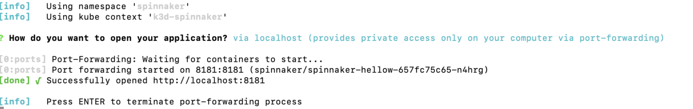
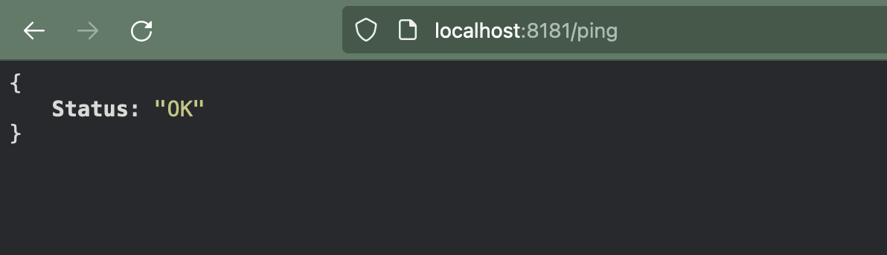
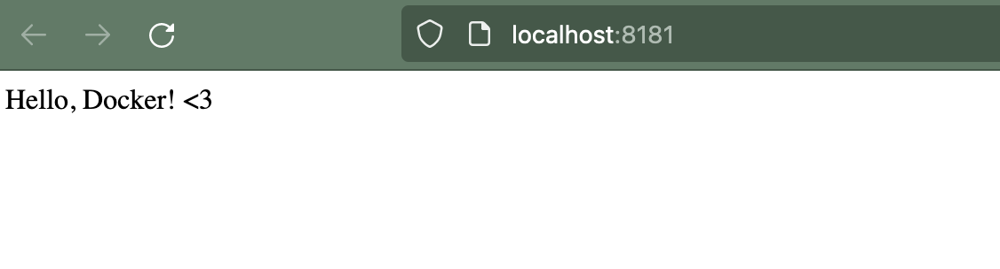

## What is `devspace`?

`devspace` is a CLI tool for kubernetes, which can help you configure, deploy, debug. and test your application inside Kubernetes.

DevSpace allows you to

1. Store all your workflows in one declarative config file: `devspace.yaml`
2. Standardize deployment and development workflows without requiring everyone on the team to become a Kubernetes expert.
3. DevSpace allows you to hot reload running containers while coding


Read more about devspace [here](https://devspace.sh/cli/docs/introduction)


Looking the official diagram from `devspace` which shows the benefits in detail


In this blog I will use `devspace`, `rancher-desktop` and k3d for quickly deploying a local application developed in previous blogs ([Spinnaker-Hellow](https://github.com/samarthya/spinnaker-hello)).

## Step 1: Create a local cluster

We will be using `k3d` to create cluster

### Options

`k3d cluster create -h`

```text
Create a new k3s cluster with containerized nodes (k3s in docker).
Every cluster will consist of one or more containers:
	- 1 (or more) server node container (k3s)
	- (optionally) 1 loadbalancer container as the entrypoint to the cluster (nginx)
	- (optionally) 1 (or more) agent node containers (k3s)

Usage:
  k3d cluster create NAME [flags]

Flags:
  -a, --agents int                                                     Specify how many agents you want to create
      --agents-memory string                                           Memory limit imposed on the agents nodes [From docker]
      --api-port [HOST:]HOSTPORT                                       Specify the Kubernetes API server port exposed on the LoadBalancer (Format: [HOST:]HOSTPORT)
                                                                        - Example: `k3d cluster create --servers 3 --api-port 0.0.0.0:6550`
  -c, --config string                                                  Path of a config file to use
  -e, --env KEY[=VALUE][@NODEFILTER[;NODEFILTER...]]                   Add environment variables to nodes (Format: KEY[=VALUE][@NODEFILTER[;NODEFILTER...]]
                                                                        - Example: `k3d cluster create --agents 2 -e "HTTP_PROXY=my.proxy.com@server:0" -e "SOME_KEY=SOME_VAL@server:0"`
      --gpus string                                                    GPU devices to add to the cluster node containers ('all' to pass all GPUs) [From docker]
  -h, --help                                                           help for create
      --host-alias ip:host[,host,...]                                  Add ip:host[,host,...] mappings
      --host-pid-mode                                                  Enable host pid mode of server(s) and agent(s)
  -i, --image string                                                   Specify k3s image that you want to use for the nodes
      --k3s-arg ARG@NODEFILTER[;@NODEFILTER]                           Additional args passed to k3s command (Format: ARG@NODEFILTER[;@NODEFILTER])
                                                                        - Example: `k3d cluster create --k3s-arg "--disable=traefik@server:0"
      --k3s-node-label KEY[=VALUE][@NODEFILTER[;NODEFILTER...]]        Add label to k3s node (Format: KEY[=VALUE][@NODEFILTER[;NODEFILTER...]]
                                                                        - Example: `k3d cluster create --agents 2 --k3s-node-label "my.label@agent:0,1" --k3s-node-label "other.label=somevalue@server:0"`
      --kubeconfig-switch-context                                      Directly switch the default kubeconfig's current-context to the new cluster's context (requires --kubeconfig-update-default) (default true)
      --kubeconfig-update-default                                      Directly update the default kubeconfig with the new cluster's context (default true)
      --lb-config-override strings                                     Use dotted YAML path syntax to override nginx loadbalancer settings
      --network string                                                 Join an existing network
      --no-image-volume                                                Disable the creation of a volume for importing images
      --no-lb                                                          Disable the creation of a LoadBalancer in front of the server nodes
      --no-rollback                                                    Disable the automatic rollback actions, if anything goes wrong
  -p, --port [HOST:][HOSTPORT:]CONTAINERPORT[/PROTOCOL][@NODEFILTER]   Map ports from the node containers (via the serverlb) to the host (Format: [HOST:][HOSTPORT:]CONTAINERPORT[/PROTOCOL][@NODEFILTER])
                                                                        - Example: `k3d cluster create --agents 2 -p 8080:80@agent:0 -p 8081@agent:1`
      --registry-config string                                         Specify path to an extra registries.yaml file
      --registry-create NAME[:HOST][:HOSTPORT]                         Create a k3d-managed registry and connect it to the cluster (Format: NAME[:HOST][:HOSTPORT]
                                                                        - Example: `k3d cluster create --registry-create mycluster-registry:0.0.0.0:5432`
      --registry-use stringArray                                       Connect to one or more k3d-managed registries running locally
      --runtime-label KEY[=VALUE][@NODEFILTER[;NODEFILTER...]]         Add label to container runtime (Format: KEY[=VALUE][@NODEFILTER[;NODEFILTER...]]
                                                                        - Example: `k3d cluster create --agents 2 --runtime-label "my.label@agent:0,1" --runtime-label "other.label=somevalue@server:0"`
  -s, --servers int                                                    Specify how many servers you want to create
      --servers-memory string                                          Memory limit imposed on the server nodes [From docker]
      --subnet 172.28.0.0/16                                           [Experimental: IPAM] Define a subnet for the newly created container network (Example: 172.28.0.0/16)
      --timeout duration                                               Rollback changes if cluster couldn't be created in specified duration.
      --token string                                                   Specify a cluster token. By default, we generate one.
  -v, --volume [SOURCE:]DEST[@NODEFILTER[;NODEFILTER...]]              Mount volumes into the nodes (Format: [SOURCE:]DEST[@NODEFILTER[;NODEFILTER...]]
                                                                        - Example: `k3d cluster create --agents 2 -v /my/path@agent:0,1 -v /tmp/test:/tmp/other@server:0`
      --wait                                                           Wait for the server(s) to be ready before returning. Use '--timeout DURATION' to not wait forever. (default true)

Global Flags:
      --timestamps   Enable Log timestamps
      --trace        Enable super verbose output (trace logging)
      --verbose      Enable verbose output (debug logging)
```

In our case we can simply say

```text
k3d cluster create spinnaker
```

```text
INFO[0000] Prep: Network                                
INFO[0000] Created network 'k3d-spinnaker'            
INFO[0000] Created image volume k3d-spinnaker-images  
INFO[0000] Starting new tools node...                   
INFO[0000] Starting Node 'k3d-spinnaker-tools'        
INFO[0001] Creating node 'k3d-spinnaker-server-0'     
INFO[0001] Creating LoadBalancer 'k3d-spinnaker-serverlb' 
INFO[0001] Using the k3d-tools node to gather environment information 
INFO[0001] HostIP: using network gateway 172.20.0.1 address 
INFO[0001] Starting cluster 'spinnaker-1'               
INFO[0001] Starting servers...                          
INFO[0001] Starting Node 'k3d-spinnaker-server-0'     
INFO[0008] All agents already running.                  
INFO[0008] Starting helpers...                          
INFO[0008] Starting Node 'k3d-spinnaker-serverlb'     
INFO[0015] Injecting records for hostAliases (incl. host.k3d.internal) and for 2 network members into CoreDNS configmap... 
INFO[0017] Cluster 'spinnaker' created successfully!  
INFO[0017] You can now use it like this:                
kubectl cluster-info
```

Eventually you will be able to list the cluster creation like below

```text
> k3d cluster list     
NAME        SERVERS   AGENTS   LOADBALANCER
spinnaker   1/1       0/0      true
```

Use the newly created cluster

```text
> kubectl config  get-contexts
```

```text
CURRENT   NAME                                                 CLUSTER                                              AUTHINFO                                             NAMESPACE   
          k3d-spinnaker                                        k3d-spinnaker                                        admin@k3d-spinnaker                                  spinnaker
*         k3d-spinnaker-1                                      k3d-spinnaker-1                                      admin@k3d-spinnaker-1                                
          rancher-desktop                                      rancher-desktop                                      rancher-desktop
```

```text
> k config use-context k3d-spinnaker
Switched to context "k3d-spinnaker".
```


It is recommended to avoid default namespace so I will be using Namespace : `spinnaker`


## Step 2: `devspace init`

Init allows your configure as per your need and will generate devspace.yaml that will be eventually used for subsequent steps

```text
devspace init -h
```

```text
#######################################################
#################### devspace init ####################
#######################################################
Initializes a new devspace project within the current
folder. Creates a devspace.yaml with all configuration.
#######################################################

Usage:
  devspace init [flags]
  
Flags:
      --context string      Context path to use for intialization
      --dockerfile string   Dockerfile to use for initialization (default "./Dockerfile")
  -h, --help                help for init
      --provider string     The cloud provider to use
  -r, --reconfigure         Change existing configuration
  
Global Flags:
      --config string                The devspace config file to use
      --debug                        Prints the stack trace if an error occurs
      --disable-profile-activation   If true will ignore all profile activations
      --inactivity-timeout int       Minutes the current user is inactive (no mouse or keyboard interaction) until DevSpace will exit automatically. 0 to disable. Only supported on windows and mac operating systems (default 180)
      --kube-context string          The kubernetes context to use
  -n, --namespace string             The kubernetes namespace to use
      --no-warn                      If true does not show any warning when deploying into a different namespace or kube-context than before
  -p, --profile strings              The DevSpace profiles to apply. Multiple profiles are applied in the order they are specified
      --profile-parent strings       One or more profiles that should be applied before the specified profile (e.g. devspace dev --profile-parent=base1 --profile-parent=base2 --profile=my-profile)
      --profile-refresh              If true will pull and re-download profile parent sources
      --restore-vars                 If true will restore the variables from kubernetes before loading the config
      --save-vars                    If true will save the variables to kubernetes after loading the config
      --silent                       Run in silent mode and prevents any devspace log output except panics & fatals
  -s, --switch-context               DEPRECATED: Switches and uses the last kube context and namespace that was used to deploy the DevSpace project
      --var strings                  Variables to override during execution (e.g. --var=MYVAR=MYVALUE)
      --vars-secret string           The secret to restore/save the variables from/to, if --restore-vars or --save-vars is enabled (default "devspace-vars")
```

For my `spinnaker-hellow` app, I chose the following values

```text
devspace init --debug
```

```text
         
     ____              ____                       
    |  _ \  _____   __/ ___| _ __   __ _  ___ ___ 
    | | | |/ _ \ \ / /\___ \| '_ \ / _` |/ __/ _ \
    | |_| |  __/\ V /  ___) | |_) | (_| | (_|  __/
    |____/ \___| \_/  |____/| .__/ \__,_|\___\___|
                            |_|

? How do you want to deploy this project? helm: Use my own Helm chart (e.g. local via ./chart/ or any remote chart)

? Which Helm chart do you want to use? 

? Please enter the relative path to your local Helm chart (e.g. ./chart) hellow

? What is the main container image of this project which is deployed by this Helm chart? (e.g. ecr.io/project/image) bhanuni/spinnaker-hellow

? How should DevSpace build the container image for this project? Based on this existing Dockerfile: ./Dockerfile

19:10:41 [info]   DevSpace does *not* require pushing your images to a registry but let's check your registry credentials for this image (optional)
[wait] ⠇ Checking registry authentication for hub.docker.com (25s)
                                                                       
19:11:08 [warn]   Unable to find registry credentials for hub.docker.com
19:11:08 [warn]   Running `docker login` for you to authenticate with the registry (optional)

? What is your username for hub.docker.com? (optional, Enter to skip) 

19:11:08 [warn]   Skipping image registry authentication.
19:11:08 [warn]   You may ignore this warning. Pushing images to a registry is *not* required.

? Which port is your application listening on? (Enter to skip) 8181

19:11:44 [info]   Configuration saved in devspace.yaml - you can make adjustments as needed
19:11:44 [done] √ Project successfully initialized
         [info]   
You can now run:
- `devspace use namespace` to pick which Kubernetes namespace to work in
- `devspace dev` to start developing your project in Kubernetes
- `devspace deploy -p production` to deploy your project to Kubernetes
- `devspace -h` to get a list of available commands
```

This will generate a `devspace.yaml` file which we will edit for custom values.


I have configured a secret docker-registry `samarthya-docker` for the credentials for the docker hub.


```text
> k get secrets

NAME                  TYPE                                  DATA   AGE
samarthya-docker      kubernetes.io/dockerconfigjson        1      3h11m
```

Edit the `devspace.yaml` for the secrets

```text
pullSecrets:
- registry: "samarthya-docker"
  username: ${REGISTRY_USERNAME}
  password: ${REGISTRY_PASSWORD}
```

## Use Namespace: `Spinnaker`

```text
> devspace use namespace spinnaker
[done] √ Successfully set default namespace to 'spinnaker'
```

## Configure the Values.yaml to override

```text
deployments:
    values:
      image:
        repository: ${IMAGE}
        tag: "189"
```

## Step 3: `devspace deploy`

```text
devspace deploy
```

```text
[info]   Using namespace 'spinnaker'
[info]   Using kube context 'k3d-spinnaker'
[info]   Skipping deployment spinnaker-hellow                                
[done] √ Successfully deployed!
         
Run: 
- `devspace open` to create an ingress for the app and open it in the browser 
- `devspace enter` to open a shell into the container 
- `devspace logs` to show the container logs
- `devspace analyze` to analyze the space for potential issues
```

## Step 4: `devspace open`

Issue the open command to view the application



Look at the namespace used and the context used

```text
[info]   Using namespace 'spinnaker'
[info]   Using kube context 'k3d-spinnaker'
```

Browse and check the two end points `'/ping'` and the ‘`/'`





```text
devspace list deployments

[info]   Using namespace 'spinnaker'
[info]   Using kube context 'k3d-spinnaker'

 NAME               TYPE   DEPLOY   STATUS        
 spinnaker-hellow   Helm   hellow   Status:Deployed
```

Once the helm deployment has been success you can even check the service deployment via CURL

```text
> devspace deploy
[info]   Using namespace 'spinnaker'
[info]   Using kube context 'k3d-spinnaker'
[info]   Execute 'helm upgrade spinnaker-hellow --namespace spinnaker --values /var/folders/p5/rfwqvcnj1zz9k3vxwq0vf9br0000gp/T/2512541306 --install hellow --kube-context k3d-spinnaker'
[done] √ Deployed helm chart (Release revision: 1)                     
[done] √ Successfully deployed spinnaker-hellow with helm              
[done] √ Successfully deployed!
         
Run: 
- `devspace open` to create an ingress for the app and open it in the browser 
- `devspace enter` to open a shell into the container 
- `devspace logs` to show the container logs
- `devspace analyze` to analyze the space for potential issues
```

Get Service

```text
> k get svc
NAME                                         TYPE        CLUSTER-IP      EXTERNAL-IP   PORT(S)                                     AGE
haproxy-kubernetes-ingress-default-backend   ClusterIP   None            <none>        8080/TCP                                    16h
haproxy-kubernetes-ingress                   NodePort    10.43.114.107   <none>        80:31622/TCP,443:32274/TCP,1024:31072/TCP   16h
spinnaker-hellow                             ClusterIP   10.43.153.162   <none>        8181/TCP                                    5s
```

Run the curl command from the cluster

```text
/bin # curl http://10.43.153.162:8181/ping
{"Status":"OK"}
/bin # curl http://10.43.153.162:8181/
Hello, Docker! <3/bin #
```

## Check logs: `devspace logs`

```text
> devspace logs

? Select a container spinnaker-hellow-657fc75c65-n4hrg:hellow
[info]   Printing logs of pod:container spinnaker-hellow-657fc75c65-n4hrg:hellow

2022/02/16 07:06:42  initializing the application FN:init 
   ____    __
  / __/___/ /  ___
 / _// __/ _ \/ _ \
/___/\__/_//_/\___/ v4.6.3
High performance, minimalist Go web framework
https://echo.labstack.com
____________________________________O/_______
                                    O\
⇨ http server started on [::]:8181
{"time":"2022-02-16T07:06:58.638811863Z","id":"","remote_ip":"10.42.0.55","host":"10.43.153.162:8181","method":"GET","uri":"/","user_agent":"curl/7.80.0","status":200,"error":"","latency":18000,"latency_human":"18µs","bytes_in":0,"bytes_out":17}
{"time":"2022-02-16T07:07:01.311488863Z","id":"","remote_ip":"10.42.0.55","host":"10.43.153.162:8181","method":"GET","uri":"/ping","user_agent":"curl/7.80.0","status":200,"error":"","latency":180000,"latency_human":"180µs","bytes_in":0,"bytes_out":16}
{"time":"2022-02-16T07:09:18.921986863Z","id":"","remote_ip":"10.42.0.55","host":"10.43.153.162:8181","method":"GET","uri":"/","user_agent":"curl/7.80.0","status":200,"error":"","latency":212000,"latency_human":"212µs","bytes_in":0,"bytes_out":17}
```

In the next blog I will try and configure it via ingress
