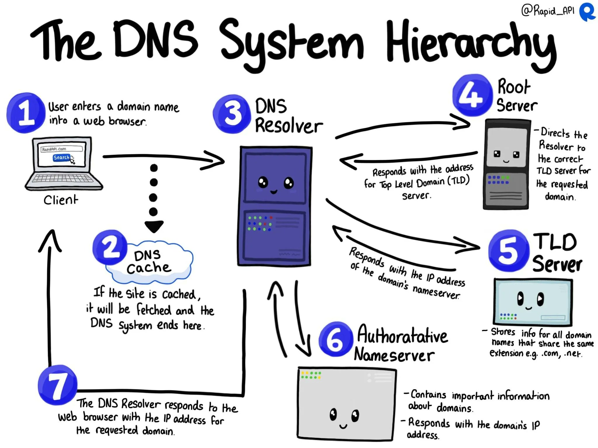

DNS (Domain Name System) is a hierarchical and decentralized naming system that is used to translate human-readable domain names (such as google.com) into IP addresses that can be understood by machines. This process is called DNS name resolution, and it involves several steps.

## Step 1: Query the Local DNS Cache

When you enter a domain name into your browser, the first place it looks for the IP address is in your local DNS cache. This is a temporary storage area on your computer that holds recently looked up DNS records. If the IP address is found in the cache, the resolution process is complete and your browser can make a connection to the web server.

## Step 2: Query the Recursive DNS Servers

If the IP address is not found in the local DNS cache, your computer queries the recursive DNS servers of your Internet Service Provider (ISP). Recursive DNS servers are responsible for resolving DNS queries on behalf of the client. They have a large database of DNS records and can quickly provide the IP address for the requested domain name. If the IP address is found in the recursive DNS server’s cache, it is returned to your computer, and the resolution process is complete.

## Step 3: Query the Authoritative DNS Servers

If the IP address is not found in the recursive DNS server’s cache, it queries the authoritative DNS servers for the domain. Authoritative DNS servers are responsible for storing the DNS records for a specific domain. These servers hold the master copy of the DNS records, and they are the final authority on the IP address for a domain name.

When the recursive DNS server receives a query for a domain name, it first queries the root DNS servers, which are responsible for directing the query to the appropriate TLD (Top-Level Domain) DNS servers. The TLD DNS servers are responsible for directing the query to the authoritative DNS servers for the domain.

Once the authoritative DNS server receives the query, it checks its database for the IP address associated with the requested domain name. If it finds a match, it returns the IP address to the recursive DNS server, which then caches the result and returns it to your computer.

## Step 4: Return the IP Address

Once your computer receives the IP address from the recursive DNS server, it stores the result in its local DNS cache and uses it to make a connection to the web server hosting the requested domain.

In summary, DNS name resolution is a complex process that involves multiple steps and multiple servers. However, it happens quickly and transparently to the end-user, allowing us to access websites and other internet resources by simply typing in a human-readable domain name.

A very intuitive diagram thanks to @rapi\_api (twitter handle) is as under

