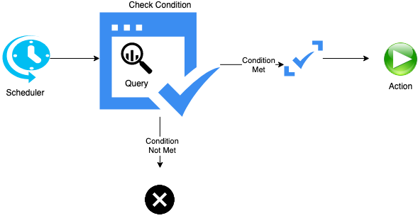

## Watcher

Watcher is an Elasticsearch feature that facilitates alerting and can be used to create actions based on conditions, which are periodically evaluated using queries on your data. There are two ways of creating a watcher

1. Watcher API
2. Kibana Watcher UI

Elastic Alerting is one of what are called stack features that are available as part of Gold subscription or higher. Elastic watcher has typically four components

## Trigger - Schedule

A typically periodic trigger for data already available in Elasticsearch on a schedule basis.

## Query

## Condition

## Action

## Helpful links

- https://www.elastic.co/guide/en/kibana/current/watcher-ui.html
