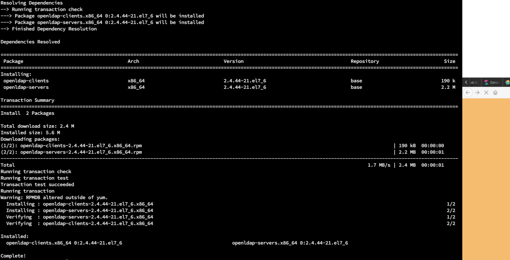
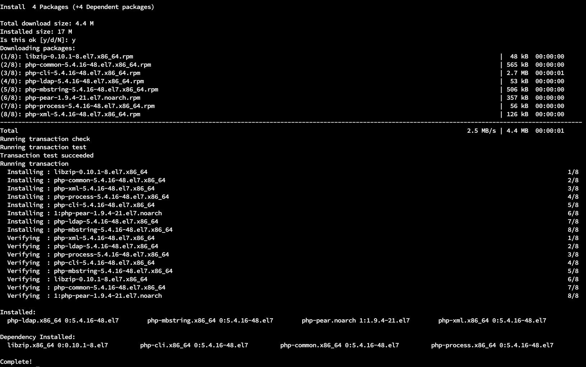

In this blog we will try to setup a realm for elastic authentication.

`yum -y install openldap-clients openldap-servers`



```text
mymachine>systemctl start slapd
mymachine>systemctl enable slapd
Created symlink from /etc/systemd/system/multi-user.target.wants/slapd.service to /usr/lib/systemd/system/slapd.service.
```

```text
mymachine>slappasswd
New password: 
Re-enter new password: 
{SSHA}R5nPS+zItZsQrfsw+PIQSNnEiMpLcwLs
```

```text
mymachine>vi /etc/openldap/slapd.d/cn=config/olcDatabase={2}hdb.ldif
```

```text
# AUTO-GENERATED FILE - DO NOT EDIT!! Use ldapmodify.
# CRC32 975a66fa
dn: olcDatabase={2}hdb
objectClass: olcDatabaseConfig
objectClass: olcHdbConfig
olcDatabase: {2}hdb
olcDbDirectory: /var/lib/ldap
olcSuffix: dc=my-domain,dc=com
olcRootDN: cn=Manager,dc=my-domain,dc=com
olcDbIndex: objectClass eq,pres
olcDbIndex: ou,cn,mail,surname,givenname eq,pres,sub
structuralObjectClass: olcHdbConfig
entryUUID: 64a2a5de-3438-103a-8e85-c1c4cc3ef35f
creatorsName: cn=config
createTimestamp: 20200527073533Z
entryCSN: 20200527073533.541185Z#000000#000#000000
modifiersName: cn=config
modifyTimestamp: 20200527073533Z
```

```text
mymachine>firewall-cmd --add-service=ldap
success
```

```text
mymachine>vi ldaproot.ldif
```

```text
dn: olcDatabase={0}config,cn=config
changetype: modify
add: olcRootPW
olcRootPW: {SSHA}R5nPS+zItZsQrfsw+PIQSNnEiMpLcwLs
```

```text
mymachine>ldapadd -Y EXTERNAL -H ldapi:/// -f ldaproot.ldif 
SASL/EXTERNAL authentication started
SASL username: gidNumber=0+uidNumber=0,cn=peercred,cn=external,cn=auth
SASL SSF: 0
modifying entry "olcDatabase={0}config,cn=config"
```

```text
mymachine>cp /usr/share/openldap-servers/DB_CONFIG.example /var/lib/ldap/DB_CONFIG
mymachine>chown -R ldap:ldap /var/lib/ldap/DB_CONFIG
mymachine>systemctl restart slapd
mymachine>ldapadd -Y EXTERNAL -H ldapi:/// -f /etc/openldap/schema/cosine.ldif
SASL/EXTERNAL authentication started
SASL username: gidNumber=0+uidNumber=0,cn=peercred,cn=external,cn=auth
SASL SSF: 0
adding new entry "cn=cosine,cn=schema,cn=config"

mymachine>ldapadd -Y EXTERNAL -H ldapi:/// -f /etc/openldap/schema/nis.ldif
SASL/EXTERNAL authentication started
SASL username: gidNumber=0+uidNumber=0,cn=peercred,cn=external,cn=auth
SASL SSF: 0
adding new entry "cn=nis,cn=schema,cn=config"

mymachine>ldapadd -Y EXTERNAL -H ldapi:/// -f /etc/openldap/schema/inetorgperson.ldif
SASL/EXTERNAL authentication started
SASL username: gidNumber=0+uidNumber=0,cn=peercred,cn=external,cn=auth
SASL SSF: 0
adding new entry "cn=inetorgperson,cn=schema,cn=config"
```

```text
vi ldapdomain.ldif
```

```text
dn: olcDatabase={1}monitor,cn=config
changetype: modify
replace: olcAccess
olcAccess: {0}to * by dn.base="gidNumber=0+uidNumber=0,cn=peercred,cn=external,cn=auth"
  read by dn.base="cn=Manager,dc=samarthya,dc=com" read by * none

dn: olcDatabase={2}hdb,cn=config
changetype: modify
replace: olcSuffix
olcSuffix: dc=samarthya,dc=com

dn: olcDatabase={2}hdb,cn=config
changetype: modify
replace: olcRootDN
olcRootDN: cn=Manager,dc=samarthya,dc=com

dn: olcDatabase={2}hdb,cn=config
changetype: modify
add: olcRootPW
olcRootPW: {SSHA}R5nPS+zItZsQrfsw+PIQSNnEiMpLcwLs

dn: olcDatabase={2}hdb,cn=config
changetype: modify
add: olcAccess
olcAccess: {0}to attrs=userPassword,shadowLastChange by
  dn="cn=Manager,dc=samarthya,dc=com" write by anonymous auth by self write by * none
olcAccess: {1}to dn.base="" by * read
olcAccess: {2}to * by dn="cn=Manager,dc=samarthya,dc=com" write by * read
```

```text
mymachine>ldapmodify -Y EXTERNAL -H ldapi:/// -f ldapdomain.ldif
SASL/EXTERNAL authentication started
SASL username: gidNumber=0+uidNumber=0,cn=peercred,cn=external,cn=auth
SASL SSF: 0
modifying entry "olcDatabase={1}monitor,cn=config"

modifying entry "olcDatabase={2}hdb,cn=config"

modifying entry "olcDatabase={2}hdb,cn=config"

modifying entry "olcDatabase={2}hdb,cn=config"

modifying entry "olcDatabase={2}hdb,cn=config"
```

```text
mymachine>vi baseldapdomain.ldif
```

```text
dn: dc=samarthya,dc=com
objectClass: top
objectClass: dcObject
objectclass: organization
o: samarthya com
dc: samarthya

dn: cn=Manager,dc=samarthya,dc=com
objectClass: organizationalRole
cn: Manager
description: Directory Manager

dn: ou=People,dc=samarthya,dc=com
objectClass: organizationalUnit
ou: People

dn: ou=Group,dc=samarthya,dc=com
objectClass: organizationalUnit
ou: Group
```

```text
mymachine>ldapadd -x -D cn=Manager,dc=samarthya,dc=com -W -f baseldapdomain.ldif
Enter LDAP Password: 
adding new entry "dc=samarthya,dc=com"

adding new entry "cn=Manager,dc=samarthya,dc=com"

adding new entry "ou=People,dc=samarthya,dc=com"

adding new entry "ou=Group,dc=samarthya,dc=com"
```

```text
dn: cn=Manager,ou=Group,dc=samarthya,dc=com
objectClass: top
objectClass: posixGroup
gidNumber: 1009
```

```text
ldapadd  -x  -W -D "cn=Manager,dc=samarthya,dc=com" -f ldapgroup.ldif
Enter LDAP Password: 
adding new entry "cn=Manager,ou=Group,dc=samarthya,dc=com"
```

```text
mymachine>useradd samarthya
mymachine>passwd samarthya
Changing password for user samarthya.
```

```text
mymachine>ldapadd -x -D cn=Manager,dc=samarthya,dc=com -W -f  ldauser.ldif
Enter LDAP Password: 
adding new entry "uid=samarthya,ou=People,dc=samarthya,dc=com"
```

```text
dn: uid=samarthya,ou=People,dc=samarthya,dc=com
objectClass: top
objectClass: account
objectClass: posixAccount
objectClass: shadowAccount
cn: samarthya
uid: samarthya
uidNumber: 1005
gidNumber: 1005
homeDirectory: /home/samarthya
userPassword: {SSHA}R5nPS+zItZsQrfsw+PIQSNnEiMpLcwLs
loginShell: /bin/bash
gecos: samarthya
shadowLastChange: 0
shadowMax: 0
shadowWarning: 0
```

## Installing phpLdap

```text
yum install php-ldap php-mbstring php-pear php-xml
```



<https://www.digitalocean.com/community/tutorials/how-to-install-linux-nginx-mysql-php-lemp-stack-on-centos-7>
