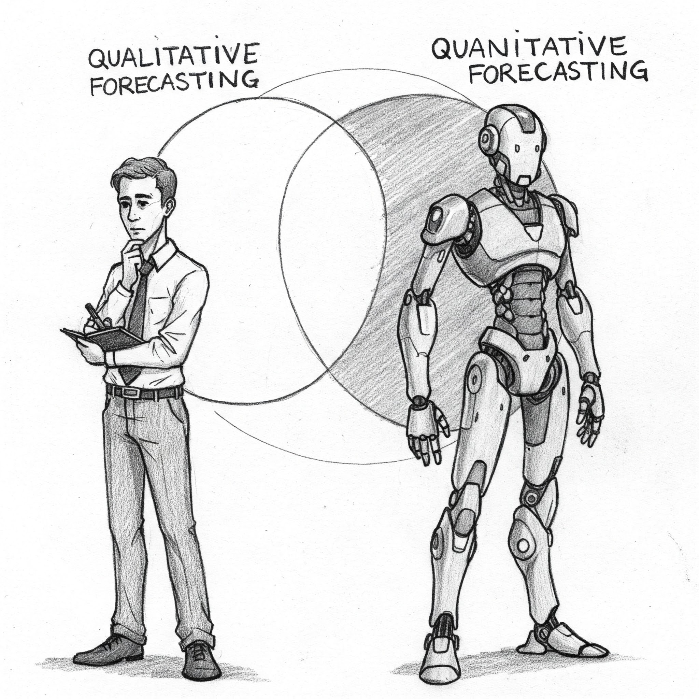

Forecasting methods are the techniques used to predict future outcomes based on past data and trends. They’re like having a crystal ball, but instead of magic, they use data and statistics!

Here’s a breakdown of some common forecasting methods:

### **1. Qualitative Methods**

These methods rely on human judgment, intuition, and experience. They’re often used when historical data is scarce or when future events are difficult to quantify.

- **Expert Opinion:** Gathering insights from experts in the field. Think of it like asking experienced chefs to predict the next big food trend.
- **Market Research:** Studying consumer behavior and preferences to anticipate demand. It’s like asking people what kind of food they’d like to see in restaurants.
- **Delphi Method:** A structured communication technique involving a panel of experts who provide anonymous forecasts, which are then shared and refined until a consensus is reached.

### **2. Quantitative Methods**

These methods use historical data and statistical techniques to make forecasts. T**hey’re best suited when you have reliable data and can identify patterns.**

- **Time Series Analysis:** Analyzing data points collected over time to identify trends, seasonality, and cycles. It’s like looking at a graph of past sales to predict future sales.
  - **Moving Average:** Smoothing out fluctuations in data by averaging a set number of past data points.
  - **Exponential Smoothing:** Giving more weight to recent data points, recognizing that they’re often more relevant for forecasting.
  - **ARIMA Models:** Complex statistical models that can capture intricate patterns in time series data.
- **Causal Models:** Identifying cause-and-effect relationships between variables to make forecasts.
  - **Regression Analysis:** Using statistical techniques to model the relationship between a dependent variable (what you want to forecast) and one or more independent variables (factors that might influence it). For example, you might use regression to predict house prices based on factors like size, location, and age.
- **Machine Learning:** Using algorithms to learn from data and make predictions. Machine learning models can be very powerful, but they often require large amounts of data.

### **Choosing the Right Method**

The best forecasting method depends on several factors:

- **Availability of Data:** Do you have historical data, or are you relying on expert opinions?
- **Forecast Horizon:** Are you forecasting short-term or long-term?
- **Accuracy Requirements:** How important is it to have a very precise forecast?
- **Resources:** Do you have the tools and expertise to use complex statistical models?

**Key Takeaways**

- Forecasting methods help businesses and individuals make informed decisions about the future.
- There are many different forecasting methods, each with its strengths and weaknesses.
- The best method depends on the specific situation and the goals of the forecast.

Whether you’re trying to predict the weather, plan your company’s budget, or decide what to cook for dinner, forecasting methods can help you make better decisions.
