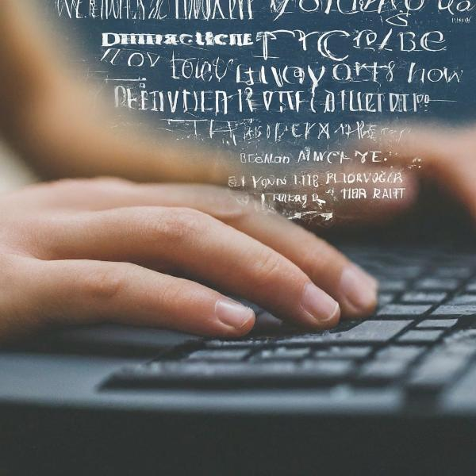

Ever wished you could effortlessly convert your spoken words into written text? Look no further! This blog post will guide you through building a simple yet powerful speech-to-text application using Python. We’ll break down the code step-by-step, explaining the logic behind each stage, and even show you how to run the application yourself.

## Setting the Stage: Libraries and Setup

Before we begin, ensure you have the necessary Python libraries installed. You can easily install them using pip:

```text
pip install speech_recognition docx spellchecker
```



These libraries are our tools of the trade:

- **speech\_recognition:** The powerhouse behind capturing audio and converting it into text.
- **docx:** Allows us to interact with Microsoft Word documents, perfect for saving our transcribed text.
- **spellchecker:** Ensures our output is polished and error-free by correcting any spelling mistakes.

## Building the Engine: The `SpeechToText` Class

At the heart of our application lies the `SpeechToText` class, meticulously crafted to handle the entire process. Let’s dissect it:


Source code is available [here](https://github.com/samarthya/py-speech)
— Samarthya


```text
import logging

import speech_recognition as sr
from docx import Document
from spellchecker import SpellChecker

# Create and configure logger
logging.basicConfig(filename='speech_to_text.log',
                    level=logging.DEBUG,
                    format='%(asctime)s - %(levelname)s - %(message)s')

class SpeechToText:
    # ... (rest of the class code)
```

- **Initialization (`__init__`)**:

```text
def __init__(self, language="en-US"):
    self.recognizer = sr.Recognizer()
    self.microphone = sr.Microphone()
    self.language = language
    logging.debug(
        'SpeechToText object initialized with language: %s', language)
```

- Here, we initialize our speech recognizer (`self.recognizer`), set up the microphone (`self.microphone`) as our audio source, and specify the language (`self.language`) for recognition (defaulting to US English).
- **Listening and Transcribing (`listen_and_transcribe`)**:

```text
def listen_and_transcribe(self):
    logging.info("Starting listening session...")
    print("Listening... Say 'program stop' to end the session.")

    full_text = []

    with self.microphone as source:
        self.recognizer.adjust_for_ambient_noise(source)

        while True:
            try:
                audio = self.recognizer.listen(source)
                text = self.recognizer.recognize_google(
                    audio, language=self.language).lower()

                print(f"Recognized: {text}")
                logging.debug('Recognized text: %s', text)

                if "program stop" in text:
                    print("Stopping the program...")
                    break

                full_text.append(text)
            except sr.UnknownValueError:
                print("Could not understand audio")
                logging.warning("Could not understand audio")
            except sr.RequestError as request_error:
                print(f"Could not request results; {request_error}")
                logging.error("Could not request results: %s", request_error)

    return " ".join(full_text)
```

- This function captures audio from your microphone, transcribes it using Google Speech Recognition, and neatly stores the recognized text. The loop continues until you say “program stop.”
- **Spell Checking (`spell_check`)**:

```text
def spell_check(self, text):
    logging.debug('Spell checking text: %s', text)
    spell = SpellChecker()
    words = text.split()
    corrected_words = []

    for word in words:
        if "." in word and any(c.isalpha() for c in word):
            corrected_words.append(word)  # Don't try to correct URLs
        else:
            corrected_word = spell.correction(word)
            corrected_words.append(corrected_word)

    logging.debug('Corrected text: %s', " ".join(corrected_words))
    return " ".join(corrected_words)
```

- Our application ensures accuracy by spell-checking the transcribed text. It intelligently identifies and ignores potential URLs to avoid incorrect corrections.
- **Saving to Word Document (`save_to_word`)**:

```text
def save_to_word(self, text, filename="output.docx"):
    logging.info('Saving text to file: %s', filename)
    doc = Document()
    doc.add_paragraph(text)
    doc.save(filename)
    print(f"Text saved to {filename}")
```

- Finally, this function saves the polished, transcribed text into a Word document, ready for you to access and use.

### Putting It All Together: The `main` Function

The `main` function acts as the conductor, orchestrating the entire process:

```text
def main():
    speech_to_text = SpeechToText() 
    transcribed_text = speech_to_text.listen_and_transcribe()
    corrected_text = speech_to_text.spell_check(transcribed_text)
    speech_to_text.save_to_word(corrected_text)

if __name__ == "__main__":
    main()
```

It creates a `SpeechToText` object, initiates the listening and transcription process, spell-checks the result, and finally saves it to a Word document.

## Running the Application

1. **Save the code:** Save the `SpeechToText` class code as `sp.py` and the `main` function code as `main.py` in the same directory.
2. **Execute:** Open your terminal or command prompt, navigate to the directory where you saved the files, and run the command: `python main.py`

## Sample Output

After running the application, speak clearly into your microphone. Once you say “program stop,” the transcribed and corrected text will be saved in a Word document named “output.docx” in the same directory.

## Conclusion

Congratulations! You’ve successfully built a basic yet functional speech-to-text application using Python. This simple example demonstrates the power and flexibility of Python for tackling real-world tasks. Feel free to experiment with different languages, explore advanced speech recognition features, or even integrate this into a larger project. The possibilities are endless!
