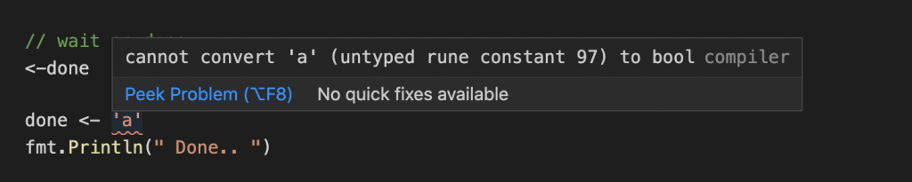

Channels are way of communication between multiple `goroutines`

You can declare a channel and the type of content the channel will receive like below.

```text
var myChannel chan int
```

The `int` above is the type of data it can receive and the data can be send using

```text
// Send 10 through channel
myChannel <- 10
```

```text
//Receive the channel content
val := <- myChannel
```

In this blog I will just play out some sample scenarios of sending valid information and waiting for the `goroutine` to sed/receive the data.

### Send

`func send` will send data `[1..10]` to `ch` and sleep ever time it is send

```text
func send(ch chan int) {
	for i := 0; i < 10; i++ {
		time.Sleep(1 * time.Second)
		ch <- i
	}
	fmt.Println(" Sender done...")
	return
}
```

### Receive

`func receive` will receive all the information sent to the channel till the last info.

```text
func receive(ch chan int) {
	var val int

	for {
		val = <-ch
		fmt.Printf(" > %d\n", val)
		if val >= 10 {
			close(ch)
			done <- true
		}
	}
}
```

### Term

```text
func term() {
	done <- true
}
```

### Main

Playing out the entry point to call the send and receive

```text
func main() {
	fmt.Println(" --- Main ---")
	ch := make(chan int)

	go send(ch)
	go receive(ch)

	// wait on done
	<-done
	fmt.Println(" Done.. ")
}
```

### Output

```text
 > 0
 > 1
 > 2
 > 3
 > 4
 > 5
 > 6
 > 7
 > 8
 Sender done...
 Closing reciever...
 > 9
 Receiver done...
 Done..
```

Source repository is available [here](https://github.com/samarthya/gofun).

### What If?

If you try sending a different type to the channel type defined - what shall happen?

- Will it throw runtime error?
- Will it ignore?
- Will it throw compile time error?


Easier to try


```text
var done chan bool = make(chan bool)
done <- 'a'
```



It just does throws compile time error

```text
# command-line-arguments
src/main.go:57:7: cannot use 'a' (type untyped rune) as type bool in send
```
