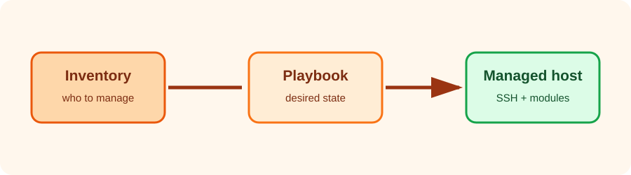

I had been writing shell commands for every small infrastructure change. It worked, until I needed to repeat the same change on another machine and could no longer remember which command I had run first. That was my reason for starting with Ansible.

I did not start with a large role or a complicated deployment. I picked one host, made one change, and tried to make it repeatable.


Written up in October 2026 from my notes at the time. The command output below is illustrative rather than a live capture.




## The basic model

Ansible has three useful building blocks:

- **Inventory**: the machines Ansible can contact.
- **Modules**: small units of work such as `package`, `service`, `copy`, and `command`.
- **Playbooks**: YAML files that describe the desired state.

Ansible normally connects over SSH and does not require an agent on the managed machine. The control node needs Ansible, SSH access, and Python on the target for most built-in modules.

## A first inventory

I started with a tiny `inventory.ini`:

```ini
[web]
web01 ansible_host=192.0.2.10
```

The address uses the documentation-only `192.0.2.0/24` range. Replace it with a host you control.

Check connectivity before changing anything:

```bash
ansible -i inventory.ini web -m ping
```

Illustrative output from the small test:

```text
web01 | SUCCESS => {
    "changed": false,
    "ping": "pong"
}
```

The `ping` module does not test ICMP. It verifies that Ansible can connect and execute a small Python module.

## An ad-hoc command

Ad-hoc commands are useful for exploration:

```bash
ansible -i inventory.ini web -m command -a "uname -a"
```

They are not a replacement for a playbook. Once a command matters, capture the intent in version-controlled YAML.

## The first playbook

Create `site.yml`:

```yaml
---
- name: Prepare web servers
  hosts: web
  become: true
  tasks:
    - name: Install nginx
      ansible.builtin.package:
        name: nginx
        state: present

    - name: Ensure nginx is enabled and running
      ansible.builtin.service:
        name: nginx
        state: started
        enabled: true
```

Run it with:

```bash
ansible-playbook -i inventory.ini site.yml
```

The important word here is **state**. `state: present` says what should be true, not which installation command should be run. The first run changed the machine; the second run should mostly tell me that there was nothing left to do. This property is called idempotence, and it was the part that made Ansible useful to me.

## A practical progression

For a small project, this sequence works well:

1. Prove SSH access with `ansible ... -m ping`.
2. Explore with a read-only ad-hoc command.
3. Write a task using a purpose-built module.
4. Run with `--check` where the module supports check mode.
5. Add the playbook to source control.
6. Split repeated work into a role when the playbook grows.

Ansible becomes valuable when the playbook describes the desired result clearly enough that another person can review it. The goal is not to hide shell commands behind YAML; it is to make operational intent visible, repeatable, and safe to rerun.
