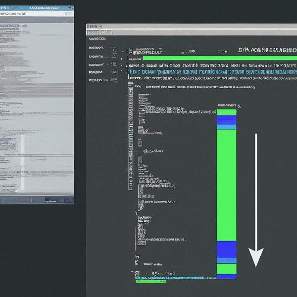

Every project has a story, and in the world of software development, that story is often told through commit logs. For those unfamiliar, Git is a version control system used for tracking changes in code. Commit logs are the detailed record of those changes, providing a crucial window into a project’s history.

In this blog, we’ll delve into the world of Git commit logs, exploring how they work and how you can maintain them effectively.

## **What’s in a Commit Log?**

When you make changes to your code and commit them using Git, you’re essentially creating a snapshot of your project at that specific point in time. Each commit includes several key pieces of information:

- **Commit Hash:** A unique identifier for the commit, like a fingerprint for your code.
- **Author:** Who made the changes (usually includes name and email address).
- **Date:** When the changes were committed.
- **Commit Message:** A brief description of the changes made.

This commit message is the heart of a good commit log. It should be clear, concise, and informative, explaining what was changed and why.

**Maintaining Clear Commit Logs**

### Here are some tips for keeping your commit logs clean and informative:

- **Write Descriptive Messages:** Avoid vague messages like “Fixed stuff.” Instead, explain what was fixed and how it benefits the project.
- **Focus on Functionality:** The message should describe the changes made to the code’s functionality, not the specific lines of code edited.
- **Use Proper Tense:** Commit messages are written in the past tense, as they represent a completed action.
- **Keep it Consistent:** Develop a convention for formatting your commit messages, ensuring a uniform look and feel throughout the log.

### **Benefits of Clean Commit Logs**

Clear commit logs provide a multitude of benefits for developers:

- **Improved Collaboration:** Team members can easily understand the project’s history and the rationale behind changes.
- **Easier Debugging:** When issues arise, clear commit messages help pinpoint the exact change that might have introduced the problem.
- **Project Tracking:** Commit logs act as a roadmap, allowing developers to track the evolution of the project over time.

### **Tools for Effective Log Management**

While Git itself provides the `git log` command for viewing commit history, several helpful tools can enhance log management:

- **Git Graphical Interfaces:** Many Git GUI clients offer a visual representation of commit history, making it easier to navigate and understand.
- **Commit Message Linters:** These tools enforce best practices for writing commit messages, ensuring consistency and clarity.

### Modifying a commit log?



Ever made a commit message that could use some improvement? Thankfully, Git offers ways to modify existing commit messages. Here’s a breakdown of the steps depending on the commit you want to change:

### **Recent Commit (not yet pushed):**

This is the simplest scenario. Use the `git commit --amend` command:

1. Navigate to your Git repository using your terminal.
2. Run the command `git commit --amend`. This opens your default text editor with the current commit message.
3. Edit the message to your liking, ensuring clarity and conciseness.
4. Save and close the editor. Git will create a new commit with the updated message, replacing the previous one.

### **Older Commit (or Pushed Commit):**

Here, things get a bit more involved. We’ll use interactive rebasing:

1. Navigate to your Git repository.
2. Run the command `git rebase -i HEAD~n`, where `n` is the number of commits you want to go back and edit (usually around 3-5 is manageable). This opens a list of the specified commits in your editor.
3. Locate the commit with the message you want to change. In front of the commit line, replace `pick` with `reword`.
4. Save and close the editor. Git will walk you through each commit on the list you selected for rebasing.
5. When prompted for the specific commit you want to modify, edit the commit message using your preferred editor.
6. After modifying the message, save and close the editor.
7. Git will automatically create a new commit with the updated message.
8. When you are ready you need to push the changes

```text
git push --force origin <your branch>
```

### Reverting to a last commit?

There are two main approaches to revert to the last `nth` `commit` that was *pushed*, depending on your situation and comfort level with rewriting Git history:

#### **Option 1: Using Git Revert (Recommended for Un-pushed or Private Branches)**

This method is ideal if you haven’t pushed your commits to a remote repository (like GitHub) or if you’re working on a private branch. It creates a new commit that effectively undoes the changes introduced in the last nth commit(s).

Here’s how to do it:

1. Navigate to your Git repository using your terminal.
2. Run the command `git revert HEAD~n`, where `n` is the number of commits you want to revert.

**Example:** To revert the last 2 commits: `git revert HEAD~2`

3. This will create a new commit with a message indicating it’s a revert. You can edit this message if needed.
4. Once you’re happy with the revert commit, stage and commit it using:

```text
git add .
git commit -m "Revert of the last n commits (your explanation)"
```

### **Option 2: Using Git Reset –hard (Advanced Users, Caution Advised)**

This approach is more aggressive and rewrites Git history. It’s recommended for experienced users and only if you haven’t pushed your commits to a shared repository.


**Using this on a pushed branch can cause issues for collaborators.**
— git-documentation


Here’s how to do it (use with caution):

1. Navigate to your Git repository using your terminal.
2. Run the command `git log` to identify the commit hash of the commit you want to go back to (the good state before the last nth commits).
3. Use the command `git reset --hard <commit_hash>`, replacing `<commit_hash>` with the actual hash you identified in step 2.

**Warning:** This detached your HEAD from the current branch, meaning you’re no longer pointing to the latest commit history.

4. To fix this and create a new branch pointing to the commit you reset to, run:

```text
git checkout -b new_branch_name <commit_hash>
```

**Remember:** Always double-check before using `git reset --hard` and ensure you understand the implications of rewriting history.


### **Additional Notes:**

- These commands only affect your local repository. If you’ve already pushed the commits you want to revert, you’ll need to push the new revert commit(s) as well.
- Consider the impact on your team if you’re working on a shared branch. Communicate any changes to the commit history clearly.
