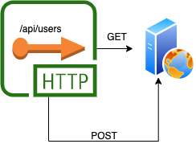
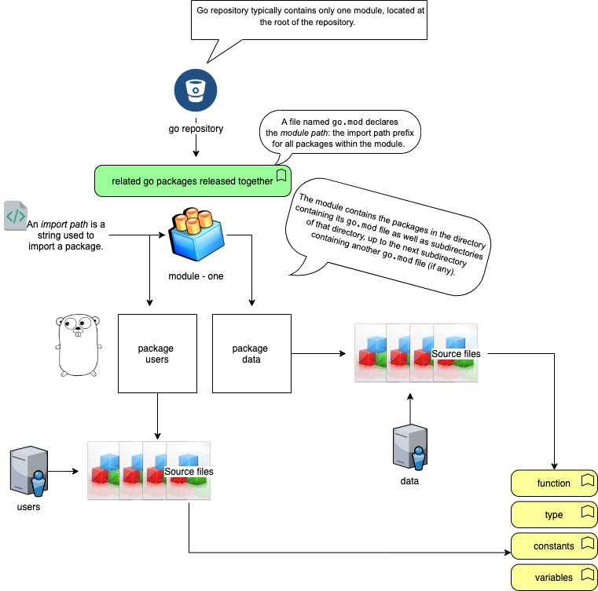

## GOLANG

Go is a powerful yet simple language. The nuances of assembling a **workspace**, sometimes are overwhelming, yet when it comes to simplicity it is very powerful.

In this blog, I will walk you through simple steps of writing a simple Webservice '**/users**' which will entertain GET & POST. It will respond to every other HTTP Method with a not supported error.



## Entity: User

The web service will expose an object {User} or [{List of Users}]

## Code Organization

Code packaging, Modules; is a tricky subject in Go. I learned from my mistakes, and even after you think you have got the hang of it, you still might get few surprises.



> A module is a collection of packages in go that are stored in a file tree with a `go.mod` file at its root.

## Setting up the repository

Let's create an empty directory `gws` in my home directory and create a directory ***`src`*** under it which should contain all the source code and sub-packages.

Please note the information I am assembling is available in multitudes of blogs which leverage the official go lang documentation & blogs (like [this](https://golang.org/doc/code.html#GOPATH) one).

### Some considerations

- You don't need to publish your code to a remote repository before you can build it.
- A module can be defined locally without belonging to a repository.
- An import path is a string used to import a package.

```text
mkdir -p gws/src
cd gws/src
go mod init github.com/gws
```

> I have a habit of creating `src` folder, probably because of my maven days, but that is how I usually organize my code.

```text
> cat go.mod

module github.com/gws

go 1.14
```

### Implementation

The main package is where the entry point for execution is defined.

#### user.go

This file stores the definition of the entity that will be exposed via the rest end point

```text
package user

import "encoding/json"

//User Stores the information about a user
type User struct {
	ID         int    `json:"id"`
	Name       string `json:"firstName"`
	Middlename string `json:"middleName,omitempty"`
	Surname    string `json:"lastName"`
	Email      string `json:"userName"`
	Address    string `json:"address"`
}

//JSONUser marshal the User to a json structure
func JSONUser(user User) []byte {
	b, err := json.Marshal(user)
	if err != nil {
		// Error while unmarshaling
		return []byte("")
	}
	return b
}
```

#### [encoding/json](https://golang.org/pkg/encoding/json/#pkg-overview)

It exposes method **Marshal** and **Unmarshal** to do JSON translations in either direction.

> The interface{} (empty interface) type describes an interface with zero methods. **Every Go type** implements at least zero methods and therefore satisfies the empty interface.

#### server.go

The server.go is created inside the `/src` folder.

```text
package main

import (
    "fmt"
)

// main Entry point for our code.
func main() {
    fmt.Printf(" Webservice.\n")
}
```

The outline of the web application is

- One end point called **/api/users**which will address GET and POST request for getting & adding a user respectively (defined as under)

#### user.data.go

This is a physical grouping of all functions that will provide interface to the available users for the server.

```text
package user

import (
	"encoding/json"
	"fmt"
	"io/ioutil"
	"log"
	"os"
	"sort"
	"sync"
)

// FileName filename
const FileName = "users.json"

// usersMap Stores the user information in memory.
var usersMap = struct {
	sync.RWMutex
	u map[int]User // map of users, which can be easily picked with the index
}{u: make(map[int]User)}

//init Initializes the usermap
func init() {
	fmt.Println(" loading users....")
	uM, err := loadUsersMap()

	usersMap.u = uM

	if err != nil {
		log.Fatal(err)
	}

	log.Printf(" Loaded %d users...", len(usersMap.u))
}

// loadUsersMap Utility function to load the users from a file.
func loadUsersMap() (map[int]User, error) {
	// os.Stat returns the FileInfo structure describing file.
	if _, err := os.Stat(FileName); os.IsNotExist(err) {
		return nil, fmt.Errorf("[%s] does not exist", FileName)
	}
	userList := make([]User, 0)
	file, _ := ioutil.ReadFile(FileName)

	// Unmarshal the data from the JSON file
	err := json.Unmarshal([]byte(file), &userList)

	if err != nil {
		log.Fatal(err)
	}

	userMap := make(map[int]User)

	// for i := 0; i < len(userList); i++ {
	// 	userMap[userList[i].ID] = userList[i]
	// }

	for _, u := range userList {
		userMap[u.ID] = u
	}
	return userMap, nil
}

// getUser Returns a user.
func getUser(i int) *User {
	usersMap.RLock()
	defer usersMap.RUnlock()

	for user, ok := usersMap.u[i]; ok; {
		return &user
	}

	return nil
}

//getUserList returns a user
func getUserList() []User {
	usersMap.RLock()
	defer usersMap.RUnlock()
	users := make([]User, 0)
	for _, value := range usersMap.u {
		users = append(users, value)
	}
	return users
}

//getUserIDs Sort and return the ID's
func getUserIDs() []int {
	usersMap.RLock()
	userIds := []int{}
	for key := range usersMap.u {
		userIds = append(userIds, key)
	}
	usersMap.RUnlock()
	sort.Ints(userIds)
	return userIds
}

//getNextID returns the next available ID
func getNextID() int {
	userIds := getUserIDs()
	return userIds[len(userIds)-1] + 1
}

//addOrUpdateUser handles the POST or PUT request of add or update
func addOrUpdateUser(user User) (int, error) {
	addOrUpdateID := -1
	if user.ID > 0 {
		oldUser := getUser(user.ID)
		// if it exists, replace it, otherwise return error
		if oldUser == nil {
			return 0, fmt.Errorf("User-ID [%d] doesn't exist", user.ID)
		}
		addOrUpdateID = user.ID
	} else {
		addOrUpdateID = getNextID()
		user.ID = addOrUpdateID
	}

	usersMap.Lock()
	usersMap.u[addOrUpdateID] = user
	usersMap.Unlock()
	return addOrUpdateID, nil
}
```

I am not using any database, so will be using in memory object to store few users that will respond appropriately to the HTTP methods when invoked.

```text
// usersMap Stores the user information in memory.
var usersMap = struct {
	sync.RWMutex
	u map[int]User // map of users, which can be easily picked with the index
}{u: make(map[int]User)}
```

#### user.service.go

It uses the ["net/http"](https://golang.org/pkg/net/http/) package which provides the client and the server configurations.

```text
package user

import (
	"encoding/json"
	"fmt"
	"io/ioutil"
	"log"
	"net/http"
	"strconv"
	"strings"
)

const userPath string = "users"

// SetupService Service end point
func SetupService(basePath string) {
	// The HandlerFunc type is an adapter to allow the use of ordinary functions as HTTP handlers.
	usersHandler := http.HandlerFunc(HandleUsers)
	userHandler := http.HandlerFunc(HandleUser)
	http.Handle(fmt.Sprintf("%s/%s", basePath, userPath), usersHandler)
	http.Handle(fmt.Sprintf("%s/%s/", basePath, userPath), userHandler)
}

// HandleUsers Will expose this API to handle user commands
func HandleUsers(w http.ResponseWriter, r *http.Request) {
	// Handlers can handle request with multiple request methods.
	// Every request has a method a simple string
	switch r.Method {
	case http.MethodGet:
		log.Println(" GET: called")

		// Get the list of users.
		users := getUserList()

		//Marshal the userlist
		b, err := json.Marshal(users)
		if err != nil {
			// Error while unmarshaling
			w.WriteHeader(http.StatusInternalServerError)
			return
		}
		w.WriteHeader(http.StatusOK)
		w.Header().Add("Content-Type", "application/json")
		w.Write(b)

	case http.MethodPost:
		log.Println(" POST: called")
		var newUser User
		e, er := ioutil.ReadAll(r.Body)
		if er != nil {
			w.WriteHeader(http.StatusBadRequest)
			return
		}

		er = json.Unmarshal(e, &newUser)
		if er != nil {
			// Error unmarsheling the data
			w.WriteHeader(http.StatusBadRequest)
		}

		fmt.Printf(" User : %s", newUser.Email)

		_, err := addOrUpdateUser(newUser)

		if err != nil {
			log.Print(err)
			w.WriteHeader(http.StatusBadRequest)
			return
		}
		w.WriteHeader(http.StatusCreated)
		w.Header().Add("Content-Type", "application/json")
		w.Write(JSONUser(newUser))

	case http.MethodOptions:
		return

	default:
		log.Printf(" Method: %s\n", r.Method)
		w.WriteHeader(http.StatusMethodNotAllowed)
		w.Header().Add("Content-Type", "application/json")
		w.Write([]byte("{msg: method not supported}"))
	}

}

// HandleUser For a single user request
func HandleUser(w http.ResponseWriter, r *http.Request) {
	// URL specifies either the URI being requested (for server
	// requests) or the URL to access (for client requests).
	urlPathSegments := strings.Split(r.URL.Path, fmt.Sprintf("%s/", userPath))

	if len(urlPathSegments[1:]) > 1 {
		w.WriteHeader(http.StatusBadRequest)
		return
	}

	//Convert the last element of the slice (should be an int)
	userID, err := strconv.Atoi(urlPathSegments[len(urlPathSegments)-1])
	if err != nil {
		log.Print(err)
		w.WriteHeader(http.StatusNotFound)
		return
	}

	//userID will be used in the switch below based on the HTTP method
	switch r.Method {
	case http.MethodGet:
		user := getUser(userID)
		if user == nil {
			w.WriteHeader(http.StatusNotFound)
			return
		}

		j, err := json.Marshal(user)
		if err != nil {
			log.Print(err)
			w.WriteHeader(http.StatusBadRequest)
			return
		}
		_, err = w.Write(j)
		if err != nil {
			log.Fatal(err)
		}

	case http.MethodPut:
		var user User
		err := json.NewDecoder(r.Body).Decode(&user)
		if err != nil {
			log.Print(err)
			w.WriteHeader(http.StatusBadRequest)
			return
		}
		if user.ID != userID {
			w.WriteHeader(http.StatusBadRequest)
			w.Write([]byte("{ msg: id supplied in request and in body mismatch}"))
			return
		}
		_, err = addOrUpdateUser(user)
		if err != nil {
			log.Print(err)
			w.WriteHeader(http.StatusBadRequest)
			return
		}
	case http.MethodDelete:
		//deleteUser(userID)

	case http.MethodOptions:
		return
	default:
		w.WriteHeader(http.StatusMethodNotAllowed)
	}
}
```

Time to modify the `server.go` to use the `/users` service.

```text
package main

import (
	"fmt"
	"log"
	"net/http"

	u "github.com/gws/user"
)

// PathAPI API path to be used as base
const PathAPI string = "/api"

// main Entry point for our code.
func main() {
	fmt.Printf(" Webservice.\n")
	//hell.SetupService(PathAPI)
	u.SetupService(PathAPI)
	log.Fatal(http.ListenAndServe(":8090", nil))
}
```

### Points to remember

- Import the package **user** defined

```text
import ( 
    u "github.com/gws/user"
)
```

- **u.SetupService** : It allows adding a base path for the endpoint exposed. In our example we are using '/api/users'
- http.ListenAndServer : It starts an HTTP server with a given address and handler. In our case the handler are setup in the **SetupService** method of package.

All the code is available in my [gitrepo](https://github.com/samarthya/gws).

## References

- <https://golang.org/cmd/go/#hdr-Preliminary_module_support>
- https://golang.org/pkg/sync/
- https://golang.org/pkg/sync/#RWMutex
- For more links visit [here]()
