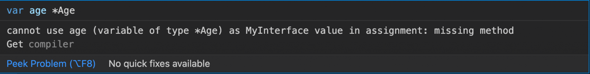

Interfaces are an interesting concept to learn in GOLANG. There are a tonne of informative articles and here is my contribution to it.

In classical Object Oriented everything is treated in parlance of `Object` or `Class` like in `Java` or `C++`. In Go there is no class or inheritance.

## Learn by doing

I started of by defining an interface

```text
type MyInterface interface {
	Set(int)
	Get() int
}
```

Which exposes two methods `Get` and `Set` and any user defined object that implements it (as shown below) can be assigned.

## What it represents?

Let's try and print the value and type for a var of type `MyInterface`

```text
%#v	a Go-syntax representation of the value
%T	a Go-syntax representation of the type of the value
```

```text
var myIntf MyInterface
fmt.Printf(" Before assigning the object %T %#v\n", myIntf, myIntf)
```

The output might surprise you - for those coming from the Java background.

```text
Before assigning the object <nil> <nil>
```

The `var myIntf` is essentially a pointer with a value of `nil`.

- There is no explicit `implements` like verb in `go`
- The interface can be implemented by any number of `types`
- Multiple interfaces can be implemented by the same `type`

## Full Program

```text
package main

import "fmt"

// MyInterface defines simple set and get
type MyInterface interface {
	Set(int)
	Get() int
}

// Simple Struct that has only a single Value
type Simple struct {
	u int
}

// Set the value for Simple struct
func (p *Simple) Set(u int) {
	p.u = u
}

//Get returns the value in struct
func (p Simple) Get() int {
	return p.u
}

func main() {
	simple := &Simple{u: 20}
	simple2 := Simple{u: 21}

	fmt.Printf(" Value: %T %#v\n", simple, simple)
	fmt.Printf(" Value: %d\n", simple.Get())

	var myIntf MyInterface
	fmt.Printf(" Before assigning the object %T %#v\n", myIntf, myIntf)

	myIntf = simple
	myIntf.Set(22)
	fmt.Printf(" Value: %T %#v\n", myIntf, myIntf)
	fmt.Printf(" Value: %d\n", myIntf.Get())

	myIntf = &simple2
	myIntf.Set(24)
	fmt.Printf(" Value: %T %#v\n", myIntf, myIntf)
	fmt.Printf(" Value: %d\n", myIntf.Get())
}
```

## Output

```text
API server listening at: 127.0.0.1:19141
 Value: *main.Simple &main.Simple{u:20}
 Value: 20
 Before assigning the object <nil> <nil>
 Value: *main.Simple &main.Simple{u:22}
 Value: 22
 Value: *main.Simple &main.Simple{u:24}
 Value: 24
```

## Multiple Interfaces

How about adding another interface

```text
//Print can do anything
type Print interface {
	Print()
}
```

```text
//Print Wildcard print
func (p *Simple) Print() {
	fmt.Printf("Type: %T\nValue: %+v\n", p, p)
}
```

I modified the main code like below to invoke print.

```text
func main() {
	simple := &Simple{u: 20}
	simple2 := Simple{u: 21}

	fmt.Printf(" Value: %T %#v\n", simple, simple)
	fmt.Printf(" Value: %d\n", simple.Get())
	simple.Print()

	var myIntf MyInterface
	fmt.Printf(" Before assigning the object %T %#v\n", myIntf, myIntf)

	myIntf = simple
	myIntf.Set(22)
	fmt.Printf(" Value: %T %#v\n", myIntf, myIntf)
	fmt.Printf(" Value: %d\n", myIntf.Get())
	var print Print
	print = simple
	print.Print()

	myIntf = &simple2
	myIntf.Set(24)
	fmt.Printf(" Value: %T %#v\n", myIntf, myIntf)
	fmt.Printf(" Value: %d\n", myIntf.Get())

	print = &simple2
	print.Print()
}
```

### Output

```text
API server listening at: 127.0.0.1:36898
 Value: *main.Simple &main.Simple{u:20}
 Value: 20
Type: *main.Simple
Value: &{u:20}
 Before assigning the object <nil> <nil>
 Value: *main.Simple &main.Simple{u:22}
 Value: 22
Type: *main.Simple
Value: &{u:22}
 Value: *main.Simple &main.Simple{u:24}
 Value: 24
Type: *main.Simple
Value: &{u:24}
```

Or, adding another type

```text
//Age struct a siple numberic holder
type Age struct {
	a myInt
}

//Print Wildcard print
func (p *Age) Print() {
	fmt.Printf("Type: %T\nValue: %+v\n", p, p)
}
```

```text
age := &Age{a: 40}
age.Print()
print = age
print.Print()
```

Age only implements `Print`, so in case if we try to use it with the type `MyInterface`



```text
Value: &{u:24}
Type: *main.Age
Value: &{a:40}
Type: *main.Age
Value: &{a:40}
```
