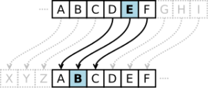

So continuing from the last [blog]() where I wrote a crude version of SimpleCipher and was inclined on removing the duplicate code, here I am with the improved version.



### Handy links

- `[fmt`](https://golang.org/pkg/fmt/) package
- `[strings](https://golang.org/pkg/strings/)` package.

## Defining `types`

While I compiled and unit tested code the general feeling was what can be optimized.

The obvious choice was to move away from the distance & key and use something common to have reduced code.

- transformWithDistance
- transformWithString

These functions had to go.

```text
// Vigenere Stores the key
type Vigenere struct {
	key string
}
```

The new struct I defined was intended to store only key, and when the distance (for int) is being supplied I will use this to find the `char` that I can use as key.

> Example:
>
> If distance is 3 the key becomes `d` and if it 2 it is `b`

Using this as the building block I defined the new rotation function that will manage the encode/decode logic.

```text
func mapChar(s rune, r int32) (e rune) {
	switch {
	case s < 'a'-r:
		e = s + 26 + r
	case s > 'z'-r:
		e = (s - 26 + r)
	default:
		e = s + r
	}
	return e
}
```

The flow was simple

- You input the char/rune to encode or decode
- Use the key rune that will be used to displace the original rune.
- Get the resulting rune

Accordingly the other structs also changed

```text
// NewCaesar Object that implements the interface Cipher
func NewCaesar() Cipher {
	return Vigenere{key: "d"}
}

// NewShift Object that implements the interface Cipher
func NewShift(distance int) Cipher {
	// Corner case when of 0, 26, -26
	if distance <= -26 || distance >= 26 {
		return nil
	}
	return NewVigenere(string(mapChar('a', int32(distance))))
}

// NewVigenere Object that implements the interface Cipher
func NewVigenere(k string) Cipher {

	if regexp.MustCompile(`[^a-z]`).MatchString(k) || regexp.MustCompile(`^a*$`).MatchString(k) {
		return nil
	}

	return Vigenere{key: k}
}
```

As evident now it is just key that is used for default case the char - `d` is being used and in other cases we map the input distance to the appropriate single letter key using the function `mapChar`.

The strip string function remained the same (just a new and fancy name)

```text
// stripString replace all the other elements
func stripString(s string) (o string) {
	o = RegularExp.ReplaceAllString(s, "")
	log.Printf(" String: %s", o)
	o = strings.ToLower(o)
	return
}
```

and the Encode & Decode became as under.

```text
// Encode Implements the interface Cipher
func (e Vigenere) Encode(s string) (o string) {

	var sb strings.Builder

	o = ""
	s = stripString(s)

	if s == "" || len(s) <= 0 {
		return
	}

	log.Printf(" Encode: %s", s)
	// Iterate throught the runes

	for i, m := range s {
		newChar := mapChar(m, int32(e.key[i%len(e.key)]-'a'))
		fmt.Fprintf(&sb, "%c", newChar)
	}

	o = sb.String()
	log.Printf(" Encoded: %s", o)
	return
}
```

```text
// Decode decides the encrypted string
func (e Vigenere) Decode(s string) (o string) {
	var sb strings.Builder

	o = ""

	log.Printf(" Decode: %s", s)

	if s == "" || len(s) <= 0 {
		return
	}

	for i, m := range s {
		newChar := mapChar(m, -int32(e.key[i%len(e.key)]-'a'))
		fmt.Fprintf(&sb, "%c", newChar)
	}

	o = sb.String()
	log.Printf(" Decoded: %s", o)

	return
}
```

I have used few packages as evident from the code.

- fmt
- log
- strings

A sample go test results in

```text
go test
2020/05/12 16:30:23  String: iamapandabear
2020/05/12 16:30:23  Encode: iamapandabear
2020/05/12 16:30:23  Encoded: ldpdsdqgdehdu
2020/05/12 16:30:23  String: programmingisawesome
2020/05/12 16:30:23  Encode: programmingisawesome
2020/05/12 16:30:23  Encoded: surjudpplqjlvdzhvrph
2020/05/12 16:30:23  String: todayisholiday
2020/05/12 16:30:23  Encode: todayisholiday
2020/05/12 16:30:23  Encoded: wrgdblvkrolgdb
2020/05/12 16:30:23  String: venividivici
2020/05/12 16:30:23  Encode: venividivici
2020/05/12 16:30:23  Encoded: yhqlylglylfl
2020/05/12 16:30:23  String: Gogogophers
2020/05/12 16:30:23  Encode: gogogophers
2020/05/12 16:30:23  Encoded: jrjrjrskhuv
2020/05/12 16:30:23  Decode: jrjrjrskhuv
2020/05/12 16:30:23  Decoded: gogogophers
2020/05/12 16:30:23  String: Iamapandabear
2020/05/12 16:30:23  Encode: iamapandabear
2020/05/12 16:30:23  Encoded: ldpdsdqgdehdu
2020/05/12 16:30:23  Decode: ldpdsdqgdehdu
2020/05/12 16:30:23  Decoded: iamapandabear
2020/05/12 16:30:23  String: ProgrammingisAWESOME
2020/05/12 16:30:23  Encode: programmingisawesome
2020/05/12 16:30:23  Encoded: surjudpplqjlvdzhvrph
2020/05/12 16:30:23  Decode: surjudpplqjlvdzhvrph
2020/05/12 16:30:23  Decoded: programmingisawesome
2020/05/12 16:30:23  String: todayisholiday
2020/05/12 16:30:23  Encode: todayisholiday
2020/05/12 16:30:23  Encoded: wrgdblvkrolgdb
2020/05/12 16:30:23  Decode: wrgdblvkrolgdb
2020/05/12 16:30:23  Decoded: todayisholiday
2020/05/12 16:30:23  String: TwasthenightbeforeChristmas
2020/05/12 16:30:23  Encode: twasthenightbeforechristmas
2020/05/12 16:30:23  Encoded: wzdvwkhqljkwehiruhfkulvwpdv
2020/05/12 16:30:23  Decode: wzdvwkhqljkwehiruhfkulvwpdv
2020/05/12 16:30:23  Decoded: twasthenightbeforechristmas
2020/05/12 16:30:23  String: venividivici
2020/05/12 16:30:23  Encode: venividivici
2020/05/12 16:30:23  Encoded: yhqlylglylfl
2020/05/12 16:30:23  Decode: yhqlylglylfl
2020/05/12 16:30:23  Decoded: venividivici
2020/05/12 16:30:23  String: 
2020/05/12 16:30:23  Decode: 
2020/05/12 16:30:23  String: 
2020/05/12 16:30:23  Decode: 
2020/05/12 16:30:23  String: Gogogophers
2020/05/12 16:30:23  Encode: gogogophers
2020/05/12 16:30:23  Encoded: jrjrjrskhuv
2020/05/12 16:30:23  Decode: jrjrjrskhuv
2020/05/12 16:30:23  Decoded: gogogophers
2020/05/12 16:30:23  String: Iamapandabear
2020/05/12 16:30:23  Encode: iamapandabear
2020/05/12 16:30:23  Encoded: ldpdsdqgdehdu
2020/05/12 16:30:23  Decode: ldpdsdqgdehdu
2020/05/12 16:30:23  Decoded: iamapandabear
2020/05/12 16:30:23  String: ProgrammingisAWESOME
2020/05/12 16:30:23  Encode: programmingisawesome
2020/05/12 16:30:23  Encoded: surjudpplqjlvdzhvrph
2020/05/12 16:30:23  Decode: surjudpplqjlvdzhvrph
2020/05/12 16:30:23  Decoded: programmingisawesome
2020/05/12 16:30:23  String: todayisholiday
2020/05/12 16:30:23  Encode: todayisholiday
2020/05/12 16:30:23  Encoded: wrgdblvkrolgdb
2020/05/12 16:30:23  Decode: wrgdblvkrolgdb
2020/05/12 16:30:23  Decoded: todayisholiday
2020/05/12 16:30:23  String: TwasthenightbeforeChristmas
2020/05/12 16:30:23  Encode: twasthenightbeforechristmas
2020/05/12 16:30:23  Encoded: wzdvwkhqljkwehiruhfkulvwpdv
2020/05/12 16:30:23  Decode: wzdvwkhqljkwehiruhfkulvwpdv
2020/05/12 16:30:23  Decoded: twasthenightbeforechristmas
2020/05/12 16:30:23  String: venividivici
2020/05/12 16:30:23  Encode: venividivici
2020/05/12 16:30:23  Encoded: yhqlylglylfl
2020/05/12 16:30:23  Decode: yhqlylglylfl
2020/05/12 16:30:23  Decoded: venividivici
2020/05/12 16:30:23  String: 
2020/05/12 16:30:23  Decode: 
2020/05/12 16:30:23  String: 
2020/05/12 16:30:23  Decode: 
2020/05/12 16:30:23  String: THEENEMYISNEAR
2020/05/12 16:30:23  Encode: theenemyisnear
2020/05/12 16:30:23  Encoded: qebbkbjvfpkbxo
2020/05/12 16:30:23  Decode: qebbkbjvfpkbxo
2020/05/12 16:30:23  Decoded: theenemyisnear
2020/05/12 16:30:23  String: SPIESSENDSECRETMESSAGES
2020/05/12 16:30:23  Encode: spiessendsecretmessages
2020/05/12 16:30:23  Encoded: pmfbppbkapbzobqjbppxdbp
2020/05/12 16:30:23  Decode: pmfbppbkapbzobqjbppxdbp
2020/05/12 16:30:23  Decoded: spiessendsecretmessages
2020/05/12 16:30:23  String: THOMASJEFFERSONDESIGNEDASUBSTITUTIONCIPHER
2020/05/12 16:30:23  Encode: thomasjeffersondesignedasubstitutioncipher
2020/05/12 16:30:23  Encoded: qeljxpgbccboplkabpfdkbaxprypqfqrqflkzfmebo
2020/05/12 16:30:23  Decode: qeljxpgbccboplkabpfdkbaxprypqfqrqflkzfmebo
2020/05/12 16:30:23  Decoded: thomasjeffersondesignedasubstitutioncipher
2020/05/12 16:30:23  String: thequickbrownfoxjumpsoverthelazydog
2020/05/12 16:30:23  Encode: thequickbrownfoxjumpsoverthelazydog
2020/05/12 16:30:23  Encoded: qebnrfzhyoltkclugrjmplsboqebixwvald
2020/05/12 16:30:23  Decode: qebnrfzhyoltkclugrjmplsboqebixwvald
2020/05/12 16:30:23  Decoded: thequickbrownfoxjumpsoverthelazydog
2020/05/12 16:30:23  String: ATTACKATDAWN
2020/05/12 16:30:23  Encode: attackatdawn
2020/05/12 16:30:23  Encoded: lxfopvefrnhr
2020/05/12 16:30:23  Decode: lxfopvefrnhr
2020/05/12 16:30:23  Decoded: attackatdawn
2020/05/12 16:30:23  String: aaaaaaaaaa
2020/05/12 16:30:23  Encode: aaaaaaaaaa
2020/05/12 16:30:23  Encoded: abcdefghij
2020/05/12 16:30:23  Decode: abcdefghij
2020/05/12 16:30:23  Decoded: aaaaaaaaaa
2020/05/12 16:30:23  String: zzzzzzzzzz
2020/05/12 16:30:23  Encode: zzzzzzzzzz
2020/05/12 16:30:23  Encoded: zabcdefghi
C02Z45LYLVDR:Samarthya:simple-cipher> go test
2020/05/12 16:46:26  String: iamapandabear
2020/05/12 16:46:26  Encode: iamapandabear
2020/05/12 16:46:26  Encoded: ldpdsdqgdehdu
2020/05/12 16:46:26  String: programmingisawesome
2020/05/12 16:46:26  Encode: programmingisawesome
2020/05/12 16:46:26  Encoded: surjudpplqjlvdzhvrph
2020/05/12 16:46:26  String: todayisholiday
2020/05/12 16:46:26  Encode: todayisholiday
2020/05/12 16:46:26  Encoded: wrgdblvkrolgdb
2020/05/12 16:46:26  String: venividivici
2020/05/12 16:46:26  Encode: venividivici
2020/05/12 16:46:26  Encoded: yhqlylglylfl
2020/05/12 16:46:26  String: Gogogophers
2020/05/12 16:46:26  Encode: gogogophers
2020/05/12 16:46:26  Encoded: jrjrjrskhuv
2020/05/12 16:46:26  Decode: jrjrjrskhuv
2020/05/12 16:46:26  Decoded: gogogophers
2020/05/12 16:46:26  String: Iamapandabear
2020/05/12 16:46:26  Encode: iamapandabear
2020/05/12 16:46:26  Encoded: ldpdsdqgdehdu
2020/05/12 16:46:26  Decode: ldpdsdqgdehdu
2020/05/12 16:46:26  Decoded: iamapandabear
2020/05/12 16:46:26  String: ProgrammingisAWESOME
2020/05/12 16:46:26  Encode: programmingisawesome
2020/05/12 16:46:26  Encoded: surjudpplqjlvdzhvrph
2020/05/12 16:46:26  Decode: surjudpplqjlvdzhvrph
2020/05/12 16:46:26  Decoded: programmingisawesome
2020/05/12 16:46:26  String: todayisholiday
2020/05/12 16:46:26  Encode: todayisholiday
2020/05/12 16:46:26  Encoded: wrgdblvkrolgdb
2020/05/12 16:46:26  Decode: wrgdblvkrolgdb
2020/05/12 16:46:26  Decoded: todayisholiday
2020/05/12 16:46:26  String: TwasthenightbeforeChristmas
2020/05/12 16:46:26  Encode: twasthenightbeforechristmas
2020/05/12 16:46:26  Encoded: wzdvwkhqljkwehiruhfkulvwpdv
2020/05/12 16:46:26  Decode: wzdvwkhqljkwehiruhfkulvwpdv
2020/05/12 16:46:26  Decoded: twasthenightbeforechristmas
2020/05/12 16:46:26  String: venividivici
2020/05/12 16:46:26  Encode: venividivici
2020/05/12 16:46:26  Encoded: yhqlylglylfl
2020/05/12 16:46:26  Decode: yhqlylglylfl
2020/05/12 16:46:26  Decoded: venividivici
2020/05/12 16:46:26  String: 
2020/05/12 16:46:26  Decode: 
2020/05/12 16:46:26  String: 
2020/05/12 16:46:26  Decode: 
2020/05/12 16:46:26  String: Gogogophers
2020/05/12 16:46:26  Encode: gogogophers
2020/05/12 16:46:26  Encoded: jrjrjrskhuv
2020/05/12 16:46:26  Decode: jrjrjrskhuv
2020/05/12 16:46:26  Decoded: gogogophers
2020/05/12 16:46:26  String: Iamapandabear
2020/05/12 16:46:26  Encode: iamapandabear
2020/05/12 16:46:26  Encoded: ldpdsdqgdehdu
2020/05/12 16:46:26  Decode: ldpdsdqgdehdu
2020/05/12 16:46:26  Decoded: iamapandabear
2020/05/12 16:46:26  String: ProgrammingisAWESOME
2020/05/12 16:46:26  Encode: programmingisawesome
2020/05/12 16:46:26  Encoded: surjudpplqjlvdzhvrph
2020/05/12 16:46:26  Decode: surjudpplqjlvdzhvrph
2020/05/12 16:46:26  Decoded: programmingisawesome
2020/05/12 16:46:26  String: todayisholiday
2020/05/12 16:46:26  Encode: todayisholiday
2020/05/12 16:46:26  Encoded: wrgdblvkrolgdb
2020/05/12 16:46:26  Decode: wrgdblvkrolgdb
2020/05/12 16:46:26  Decoded: todayisholiday
2020/05/12 16:46:26  String: TwasthenightbeforeChristmas
2020/05/12 16:46:26  Encode: twasthenightbeforechristmas
2020/05/12 16:46:26  Encoded: wzdvwkhqljkwehiruhfkulvwpdv
2020/05/12 16:46:26  Decode: wzdvwkhqljkwehiruhfkulvwpdv
2020/05/12 16:46:26  Decoded: twasthenightbeforechristmas
2020/05/12 16:46:26  String: venividivici
2020/05/12 16:46:26  Encode: venividivici
2020/05/12 16:46:26  Encoded: yhqlylglylfl
2020/05/12 16:46:26  Decode: yhqlylglylfl
2020/05/12 16:46:26  Decoded: venividivici
2020/05/12 16:46:26  String: 
2020/05/12 16:46:26  Decode: 
2020/05/12 16:46:26  String: 
2020/05/12 16:46:26  Decode: 
2020/05/12 16:46:26  String: THEENEMYISNEAR
2020/05/12 16:46:26  Encode: theenemyisnear
2020/05/12 16:46:26  Encoded: qebbkbjvfpkbxo
2020/05/12 16:46:26  Decode: qebbkbjvfpkbxo
2020/05/12 16:46:26  Decoded: theenemyisnear
2020/05/12 16:46:26  String: SPIESSENDSECRETMESSAGES
2020/05/12 16:46:26  Encode: spiessendsecretmessages
2020/05/12 16:46:26  Encoded: pmfbppbkapbzobqjbppxdbp
2020/05/12 16:46:26  Decode: pmfbppbkapbzobqjbppxdbp
2020/05/12 16:46:26  Decoded: spiessendsecretmessages
2020/05/12 16:46:26  String: THOMASJEFFERSONDESIGNEDASUBSTITUTIONCIPHER
2020/05/12 16:46:26  Encode: thomasjeffersondesignedasubstitutioncipher
2020/05/12 16:46:26  Encoded: qeljxpgbccboplkabpfdkbaxprypqfqrqflkzfmebo
2020/05/12 16:46:26  Decode: qeljxpgbccboplkabpfdkbaxprypqfqrqflkzfmebo
2020/05/12 16:46:26  Decoded: thomasjeffersondesignedasubstitutioncipher
2020/05/12 16:46:26  String: thequickbrownfoxjumpsoverthelazydog
2020/05/12 16:46:26  Encode: thequickbrownfoxjumpsoverthelazydog
2020/05/12 16:46:26  Encoded: qebnrfzhyoltkclugrjmplsboqebixwvald
2020/05/12 16:46:26  Decode: qebnrfzhyoltkclugrjmplsboqebixwvald
2020/05/12 16:46:26  Decoded: thequickbrownfoxjumpsoverthelazydog
2020/05/12 16:46:26  String: ATTACKATDAWN
2020/05/12 16:46:26  Encode: attackatdawn
2020/05/12 16:46:26  Encoded: lxfopvefrnhr
2020/05/12 16:46:26  Decode: lxfopvefrnhr
2020/05/12 16:46:26  Decoded: attackatdawn
2020/05/12 16:46:26  String: aaaaaaaaaa
2020/05/12 16:46:26  Encode: aaaaaaaaaa
2020/05/12 16:46:26  Encoded: abcdefghij
2020/05/12 16:46:26  Decode: abcdefghij
2020/05/12 16:46:26  Decoded: aaaaaaaaaa
2020/05/12 16:46:26  String: zzzzzzzzzz
2020/05/12 16:46:26  Encode: zzzzzzzzzz
2020/05/12 16:46:26  Encoded: zabcdefghi
2020/05/12 16:46:26  Decode: zabcdefghi
2020/05/12 16:46:26  Decoded: zzzzzzzzzz
2020/05/12 16:46:26  String: Iamapandabear
2020/05/12 16:46:26  Encode: iamapandabear
2020/05/12 16:46:26  Encoded: qayaeaagaciai
2020/05/12 16:46:26  Decode: qayaeaagaciai
2020/05/12 16:46:26  Decoded: iamapandabear
2020/05/12 16:46:26  String: DiffieHellman
2020/05/12 16:46:26  Encode: diffiehellman
2020/05/12 16:46:26  Encoded: gccwkixcltycv
2020/05/12 16:46:26  Decode: gccwkixcltycv
2020/05/12 16:46:26  Decoded: diffiehellman
2020/05/12 16:46:26  String: cofFEE
2020/05/12 16:46:26  Encode: coffee
2020/05/12 16:46:26  Encoded: sugars
2020/05/12 16:46:26  Decode: sugars
2020/05/12 16:46:26  Decoded: coffee
PASS
ok      cipher  0.021s
```

Source code available [here](https://raw.githubusercontent.com/samarthya/goexercism/master/simple-cipher/simple_cipher.go).

### -- THE - END --
