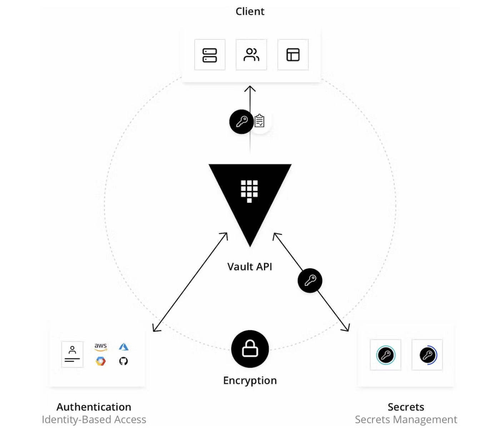

---

> "HashiCorp Vault is an identity-based secrets and encryption management system."
>
> — Hashicorp

---

In this blog I am attempting to use the vault for a custom kafka-keystore implementation. Points form the official documentation that you need to remember

1. Vault encryption layer is referred to as `barrier` and is responsible for encrypt & decrypt vault data.
2. Vault writes data to the configured storage in encrypted format.
3. Vault starts in `sealed` state & before any operation can be performed it needs to be unsealed.
4. By default Vault uses Shamir's secret sharing to split the unseal key (configurable).
5. Secret engines are components which store, generate or encrypt data.
6. Secret engines are enabled at a path in `Vault`.
7. Once a secret engine is enabled, once can interact with it directly at its path according to its own API.
