The only advice I can give to folks who are building helm charts from scratch, is always keep it incremental and do not try to do everything at one go. At least build a decent few before you even try to attempt such a thing, else you will only end up WASTING your precious time on trivial issues which could have been avoided by incremental build, rather than the big bang approach.

All right, back to the topic. In this blog I will build a helm test pod for validating the deployed helm chart and ensuring things work fine. I will continue to improve it in iterations but may be not all in the same blog! ;)

The `helm test <release-name>` will publish the following results.

```text
root@master> helm test demo -n demo --logs

Pod demo-odc-test-connection pending
Pod demo-odc-test-connection pending
Pod demo-odc-test-connection pending
Pod demo-odc-test-connection pending
Pod demo-odc-test-connection running
Pod demo-odc-test-connection succeeded
NAME: demo
LAST DEPLOYED: Thu Nov 25 15:00:00 2021
NAMESPACE: demo
STATUS: deployed
REVISION: 6
TEST SUITE:     demo-odc-test-connection
Last Started:   Fri Nov 26 05:23:59 2021
Last Completed: Fri Nov 26 05:24:06 2021
Phase:          Succeeded
NOTES:
1. Get the application URL by running these commands:
  https://restmon.com/

POD LOGS: demo-odc-test-connection
newman

Restmon

→ VersionTest
  GET https://demo-odc:9090/restmon/api/v1/version [200 OK, 527B, 231ms]
  ✓  Status code is 200
  ✓  Body matches string

→ SchemaTest
  GET https://demo-odc:9090/restmon/api/v1/schema/getAllSchemaName [200 OK, 2.48kB, 40ms]
  ✓  Status code is 200
  ✓  Check the number of schemas read

→ ProfileTest
  GET https://demo-odc:9090/restmon/api/v1/profiles [200 OK, 413B, 13ms]
  ✓  Status code is 200
  ┌
  │ '> ', {}
  └
  ✓  Empty Response

┌─────────────────────────┬───────────────────┬───────────────────┐
│                         │          executed │            failed │
├─────────────────────────┼───────────────────┼───────────────────┤
│              iterations │                 1 │                 0 │
├─────────────────────────┼───────────────────┼───────────────────┤
│                requests │                 3 │                 0 │
├─────────────────────────┼───────────────────┼───────────────────┤
│            test-scripts │                 6 │                 0 │
├─────────────────────────┼───────────────────┼───────────────────┤
│      prerequest-scripts │                 4 │                 0 │
├─────────────────────────┼───────────────────┼───────────────────┤
│              assertions │                 6 │                 0 │
├─────────────────────────┴───────────────────┴───────────────────┤
│ total run duration: 443ms                                       │
├─────────────────────────────────────────────────────────────────┤
│ total data received: 2.1kB (approx)                             │
├─────────────────────────────────────────────────────────────────┤
│ average response time: 94ms [min: 13ms, max: 231ms, s.d.: 97ms] │
└─────────────────────────────────────────────────────────────────┘
```

Few pointers about a HELM chart


A **test** in a helm chart lives under the `templates/` directory and is a job definition that specifies a container with a given command to run.
— https://helm.sh/



*The container should exit successfully (exit 0) for a test to be considered a success.*
— helm.sh


In this blog, I am writing test case for my helm chart which employs a config-map, secret, pod, service and ingress & that leaves loads of scope of incremental add-ons.

## Step - 1: Checking the exposes end points are accessible

To check end points we will use a postman to create suite to define the URL's to invoke along with the arguments and test cases to validate.

### Create New Collection: Restmon

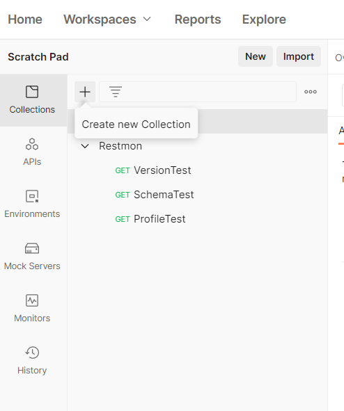

## Step 2: Name Restmon: Basic Auth

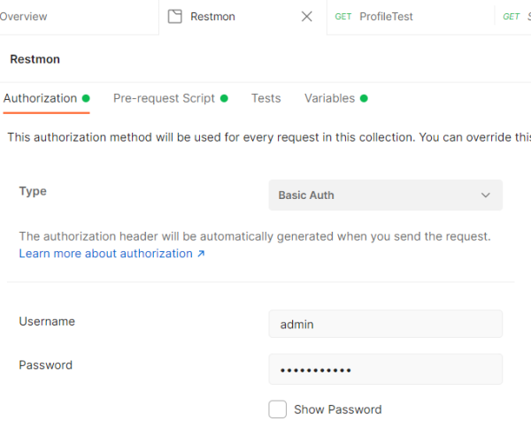

### Add variables: Host, Protocol, Port

Since the endpoint can be hosted on any host on any port & over HTTP or HTTPS, I will introduce variables that can be customised.

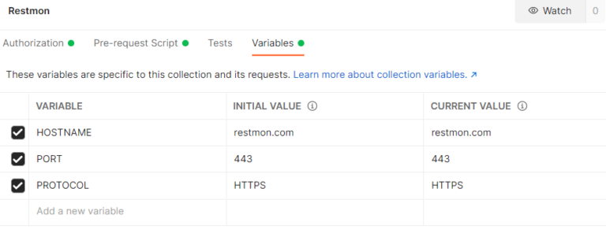

### Add pre-request script

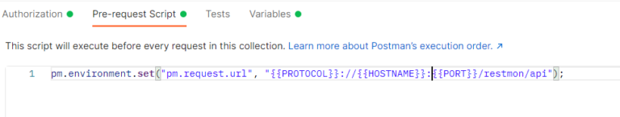

It uses the three variables defined in the previous step to create the request URL which will be used in the subsequent requests.

## Step 3: Click `Add Request`

Click Add request from the collection `Restmon` three dots menu on the left.

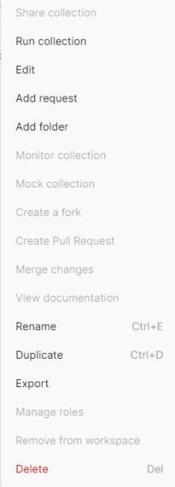

### Validate Version: VersionTest Request

The request is a `GET` and will use the `pm.request.url` which was defined at the collection level.

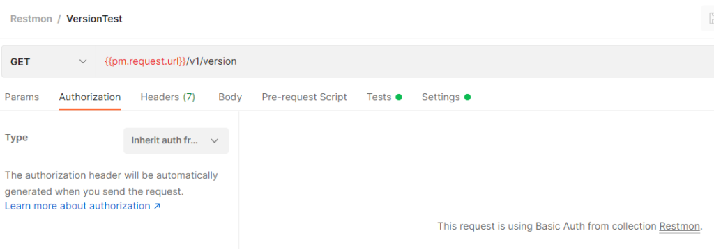

The UI is very intuitive and you can simply explore options on which test might be applicable for your tests. In my case I am just checking the version information.

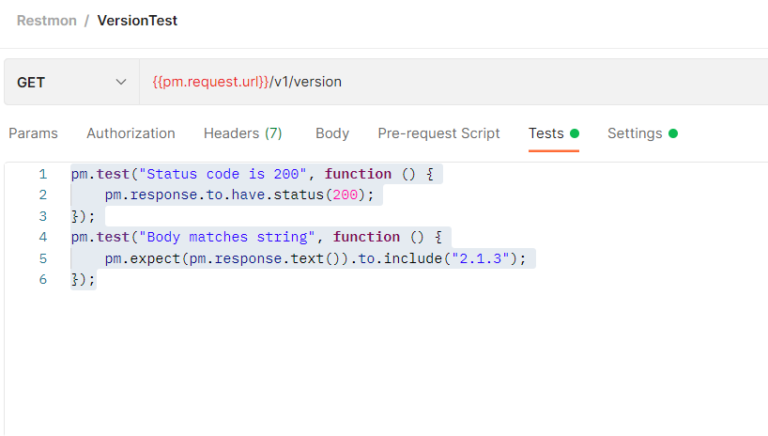

The test cases added check for Status code and the response string. You can do a quick check for the test by pressing the `Send` Button.

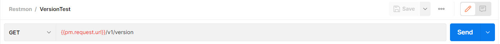

Check the results in the bottom window.

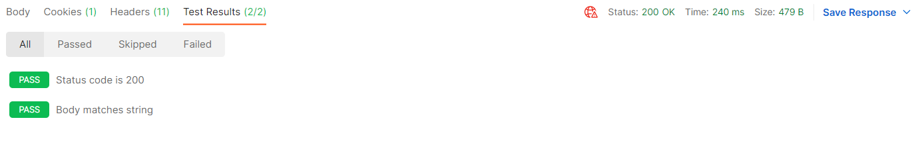

Similarly I have few other API's that I will quickly add to the collection

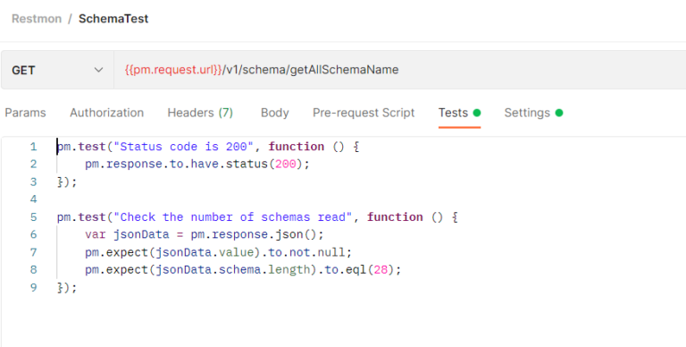

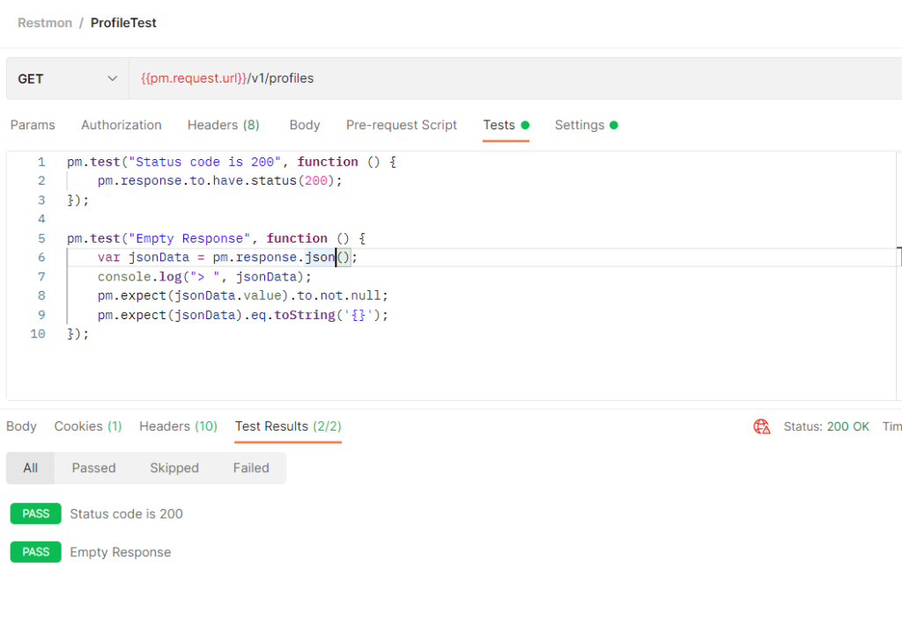

Once the collection is saved you can run the collection by selecting `Run collection` from the three dots menu on the left.

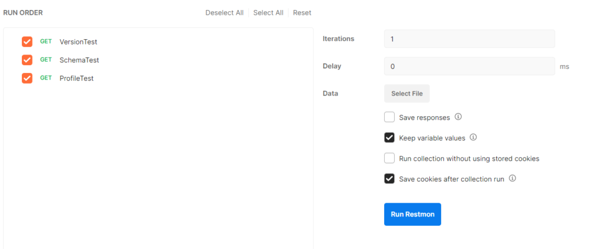

Check the response before we export it by clicking `Export` option in the three dots menu in collection.

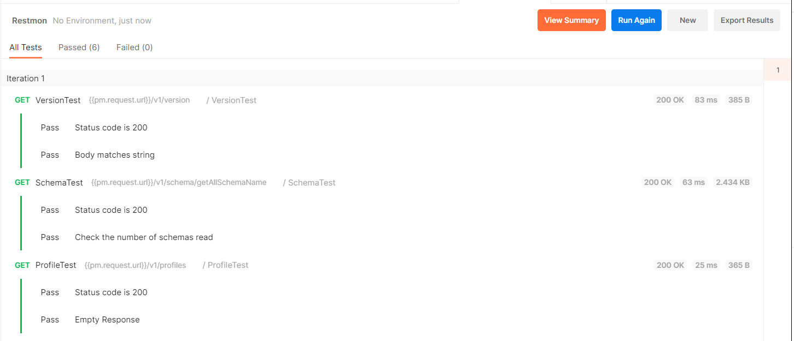

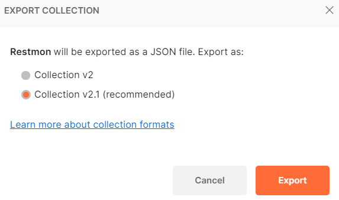


My Project space is a maven project space so the chart is in the src/ folder. Which is critical because when you package chart you have to be careful where the file lies?


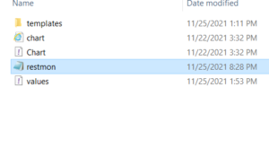

So in the `src/` folder I push my `restmon.json` (Project space of my chart restmon)

I will run this project space using `newman` which is the console runner for postman projects.


Newman is a command-line collection runner for Postman. It allows you to effortlessly run and test a Postman collection directly from the command-line. It is built with extensibility in mind so that you can easily integrate it with your continuous integration servers and build systems.
— NPM


> Refer to the official documentation here.
>
> helm.sh

Time to create the test case. Notice the volumes which loads a config map also given below

```text
apiVersion: v1
kind: ConfigMap
metadata:
  name: postman-cmd
  namespace: {{ .Release.Namespace }}
data:
  restmon.json: |-
  {{ .Files.Get "restmon.json" | nindent 4 }}
```

```text
apiVersion: v1
kind: Pod
metadata:
  namespace: {{ .Release.Namespace }}
  name: "{{ include "odc.fullname" . }}-test-connection"
  labels:
    {{- include "odc.labels" . | nindent 4 }}
  annotations:
    "helm.sh/hook": test
spec:
  containers:
    - name: post-test
      image: postman/newman:latest
      volumeMounts:
        - mountPath: /etc/newman/restmon.json
          name: configv
          subPath: restmon.json
      args:
        - "run"
        - restmon.json
        - --env-var
        - HOSTNAME={{ include "odc.fullname" . }}
        - --env-var
        - PORT={{ include "odc.serviceport" . }}
        - --env-var
        {{- if .Values.ingress.tls }}
        - PROTOCOL=https
        {{- else }}
        - --env-var
        - PROTOCOL=http
        {{ end }}
  volumes:
    - name: configv
      configMap:
        name: postman-cmd
  restartPolicy: Never
```

The Test case will try and execute the postman project using the newman image

```text
newman run --help

Usage: newman run <collection> [options]

Initiate a Postman Collection run from a given URL or path

Options:
  -e, --environment <path>              Specify a URL or path to a Postman Environment
  -g, --globals <path>                  Specify a URL or path to a file containing Postman Globals
  -r, --reporters [reporters]           Specify the reporters to use for this run (default: ["cli"])
  -n, --iteration-count <n>             Define the number of iterations to run
  -d, --iteration-data <path>           Specify a data file to use for iterations (either JSON or CSV)
  --folder <path>                       Specify the folder to run from a collection. Can be specified multiple times to
                                        run multiple folders (default: [])
  --global-var <value>                  Allows the specification of global variables via the command line, in a
                                        key=value format (default: [])
  --env-var <value>                     Allows the specification of environment variables via the command line, in a
                                        key=value format (default: [])
  --export-environment <path>           Exports the final environment to a file after completing the run
  --export-globals <path>               Exports the final globals to a file after completing the run
  --export-collection <path>            Exports the executed collection to a file after completing the run
  --postman-api-key <apiKey>            API Key used to load the resources from the Postman API
  --bail [modifiers]                    Specify whether or not to gracefully stop a collection run on encountering an
                                        error and whether to end the run with an error based on the optional modifier
  --ignore-redirects                    Prevents Newman from automatically following 3XX redirect responses
  -x , --suppress-exit-code             Specify whether or not to override the default exit code for the current run
  --silent                              Prevents Newman from showing output to CLI
  --disable-unicode                     Forces Unicode compliant symbols to be replaced by their plain text equivalents
  --color <value>                       Enable/Disable colored output (auto|on|off) (default: "auto")
  --delay-request [n]                   Specify the extent of delay between requests (milliseconds) (default: 0)
  --timeout [n]                         Specify a timeout for collection run (milliseconds) (default: 0)
  --timeout-request [n]                 Specify a timeout for requests (milliseconds) (default: 0)
  --timeout-script [n]                  Specify a timeout for scripts (milliseconds) (default: 0)
  --working-dir <path>                  Specify the path to the working directory
  --no-insecure-file-read               Prevents reading the files situated outside of the working directory
  -k, --insecure                        Disables SSL validations
  --ssl-client-cert-list <path>         Specify the path to a client certificates configurations (JSON)
  --ssl-client-cert <path>              Specify the path to a client certificate (PEM)
  --ssl-client-key <path>               Specify the path to a client certificate private key
  --ssl-client-passphrase <passphrase>  Specify the client certificate passphrase (for protected key)
  --ssl-extra-ca-certs <path>           Specify additionally trusted CA certificates (PEM)
  --cookie-jar <path>                   Specify the path to a custom cookie jar (serialized tough-cookie JSON)
  --export-cookie-jar <path>            Exports the cookie jar to a file after completing the run
  --verbose                             Show detailed information of collection run and each request sent
  -h, --help                            display help for command
```

Your test is ready, let's try it.

- Deploy the chart `helm install demo ./restmon.tgz -n demo`
- Run the helm test `helm test demo -n demo`

```text
helm test demo -n demo --logs

Pod demo-odc-test-connection pending
Pod demo-odc-test-connection pending
Pod demo-odc-test-connection pending
Pod demo-odc-test-connection pending
Pod demo-odc-test-connection running
Pod demo-odc-test-connection succeeded
NAME: demo
LAST DEPLOYED: Thu Nov 25 15:00:00 2021
NAMESPACE: demo
STATUS: deployed
REVISION: 6
TEST SUITE:     demo-odc-test-connection
Last Started:   Fri Nov 26 05:23:59 2021
Last Completed: Fri Nov 26 05:24:06 2021
Phase:          Succeeded
NOTES:
1. Get the application URL by running these commands:
  https://restmon.com/

POD LOGS: demo-odc-test-connection
newman

Restmon

→ VersionTest
  GET https://demo-odc:9090/restmon/api/v1/version [200 OK, 527B, 231ms]
  ✓  Status code is 200
  ✓  Body matches string

→ SchemaTest
  GET https://demo-odc:9090/restmon/api/v1/schema/getAllSchemaName [200 OK, 2.48kB, 40ms]
  ✓  Status code is 200
  ✓  Check the number of schemas read

→ ProfileTest
  GET https://demo-odc:9090/restmon/api/v1/profiles [200 OK, 413B, 13ms]
  ✓  Status code is 200
  ┌
  │ '> ', {}
  └
  ✓  Empty Response

┌─────────────────────────┬───────────────────┬───────────────────┐
│                         │          executed │            failed │
├─────────────────────────┼───────────────────┼───────────────────┤
│              iterations │                 1 │                 0 │
├─────────────────────────┼───────────────────┼───────────────────┤
│                requests │                 3 │                 0 │
├─────────────────────────┼───────────────────┼───────────────────┤
│            test-scripts │                 6 │                 0 │
├─────────────────────────┼───────────────────┼───────────────────┤
│      prerequest-scripts │                 4 │                 0 │
├─────────────────────────┼───────────────────┼───────────────────┤
│              assertions │                 6 │                 0 │
├─────────────────────────┴───────────────────┴───────────────────┤
│ total run duration: 443ms                                       │
├─────────────────────────────────────────────────────────────────┤
│ total data received: 2.1kB (approx)                             │
├─────────────────────────────────────────────────────────────────┤
│ average response time: 94ms [min: 13ms, max: 231ms, s.d.: 97ms] │
└─────────────────────────────────────────────────────────────────┘
```
