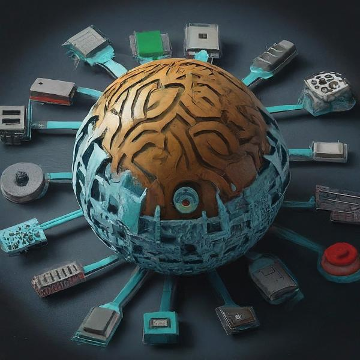
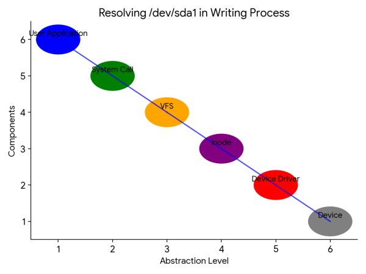

Writing to a file on a device in Linux involves a fascinating journey through different layers of the system.

> 💬 When you write to a file on a device, the inode provides context about the file’s location and properties, while the device driver translates that information into instructions for the specific device. The driver then interacts with the hardware to physically write the data to the storage medium. It’s a seamless collaboration between these two crucial elements that enables efficient and reliable data management across diverse devices in Linux.

Here’s a breakdown:

**User Space:**

1. **User application:** You, the user, initiate the write operation through an application. This application issues a system call, like `write`, with the file path and data to be written.
2. **System call:** The system call handler in the kernel intercepts the request. It translates the user-space file path into a file descriptor, a low-level handle for the file.

**Kernel Space:**

1. **VFS (Virtual File System):** The VFS layer hides the complexity of different file systems and exposes a unified interface. It verifies the user’s permissions, checks if the file exists, and locates the appropriate file system type.
2. **Inode and Device Driver:** Based on the file system type, the VFS finds the corresponding inode (index node) that stores information about the file. The inode holds the device driver associated with the file.
3. **Device Driver:** The system calls the specific device driver responsible for the device where the file resides. This driver acts as an intermediary between the user and the physical device.
4. **Data Transfer:** The driver receives the data from the user space along with instructions (e.g., starting offset). It translates the file offset into device-specific addresses and prepares the data for writing.
5. **Device Communication:** The driver interacts with the physical device hardware using low-level commands specific to that device. This communication can involve DMA (Direct Memory Access) for faster transfers or direct register access.
6. **Data Writing:** Finally, the device processes the data according to its internal logic and writes it to the physical storage medium (e.g., magnetic disk, flash memory).


The **inode** (index node) is like a detailed passport for a file in Linux. It stores all the metadata about the file **except the actual data** itself.
— inode: The File’s Metadata Hub


Here’s what you’ll find within an inode:

- **File permissions:** Who can read, write, and execute the file.
- **Ownership:** Who created and owns the file.
- **Timestamps:** When the file was created, accessed, and modified.
- **File size:** The number of bytes the file occupies.
- **Number of links:** How many references (hard links) point to the same file data.
- **Blocks:** Information about the blocks (chunks) on the storage device where the file data resides. For different devices, block sizes and allocation strategies can vary.

**Information Flow:**

- The initial write request and data flow from the user application down to the device driver.
- Control signals, like error responses or status updates, flow back from the device driver to the user space through the same path.

**Kernel Module Loading:**

- Device drivers are typically implemented as kernel modules. They are not part of the core kernel but can be loaded dynamically when needed.
- The VFS identifies the required driver based on the device identifier associated with the file.
- If the driver is not already loaded, the kernel loads it from the filesystem before proceeding with the write operation.

**Additional Points:**

- Buffering: Data might be temporarily stored in buffers within the kernel or driver before being written to the device.
- Caching: Some devices might have internal caches to improve performance.
- Error Handling: Device drivers handle errors, like full storage or communication failures, and report them back to the user space.

Remember, this is a simplified explanation.

