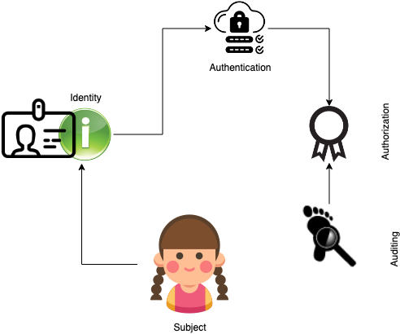

## What is an identity?

Identity is the link that correlates the *subject* and the authentication process. Without a valid identity the system has no way of establishing who the subject is? Identity enables the subject to be identified and validated, and only once it has been established and authorized it is accountable for any actions taken in the system.

In the system where the actions are being executed by an identity, it the identity that is tracked, audited and not the actual subject.
