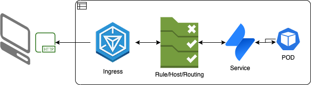
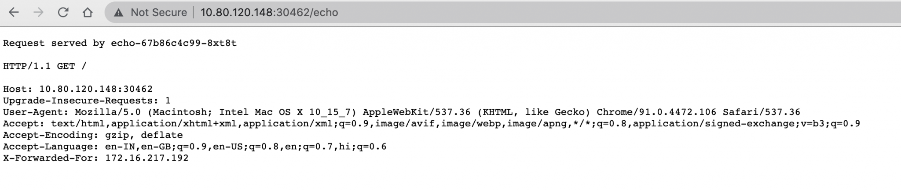

All right, it has been sometime since I last wrote my blog, and it has been disappointing not to have found enough time to collate and put my thoughts in a simple worded doc; better late then never. So, here I am trying to reignite the pursuit of writing at least once a week.

## Topic for the day: Ingress

```text
https://kubernetes.io/docs/concepts/services-networking/ingress/
```




An API object that manages external access to the services in a cluster, typically HTTP.
— kubernetes.io


Till now I had only exposed services (HTTP/HTTPS) using `NodePort` or `ClusterIP` but as the security tightens and K8S evolves (current version `1.22.1`) I had to try out ingress, but that meant few things.

- Identifying the current version which in my case was 1.19 and after repeated attempts to `kubeadm upgrade plan` failed, I created a fresh cluster.
- The fresh install was simple, I just had to reset and upgrade the binaries which were reporting the version skew.




Current Version: v1.22.1


```text
> k version
Client Version: version.Info{Major:"1", Minor:"22", GitVersion:"v1.22.1", GitCommit:"632ed300f2c34f6d6d15ca4cef3d3c7073412212", GitTreeState:"clean", BuildDate:"2021-08-19T15:45:37Z", GoVersion:"go1.16.7", Compiler:"gc", Platform:"linux/amd64"}
Server Version: version.Info{Major:"1", Minor:"22", GitVersion:"v1.22.0", GitCommit:"c2b5237ccd9c0f1d600d3072634ca66cefdf272f", GitTreeState:"clean", BuildDate:"2021-08-04T17:57:25Z", GoVersion:"go1.16.6", Compiler:"gc", Platform:"linux/amd64"}
```

I will try to expose a simple `echoservice` : `jmalloc/echo-server` over ingress


GITHUB: [echo-server](https://github.com/jmalloc/echo-server)

Docker: [echo-server](https://hub.docker.com/r/jmalloc/echo-server/dockerfile)


```text
k describe svc echo-service
Name:              echo-service
Namespace:         default
Labels:            <none>
Annotations:       <none>
Selector:          run=echo
Type:              ClusterIP
IP Family Policy:  SingleStack
IP Families:       IPv4
IP:                10.106.39.121
IPs:               10.106.39.121
Port:              http  80/TCP
TargetPort:        8080/TCP
Endpoints:         172.16.217.198:80
Session Affinity:  None
Events:            <none>
```

The code is references below

```text
apiVersion: apps/v1
kind: Deployment
metadata:
  labels:
    run: echo
  name: echo
spec:
  replicas: 1
  selector:
    matchLabels:
      run: echo
  template:
    metadata:
      labels:
        run: echo
    spec:
      containers:
      - name: echo
        image: jmalloc/echo-server
        ports:
        - containerPort: 8080
        readinessProbe:
          httpGet:
            path: /
            port: 8080
          initialDelaySeconds: 5
          periodSeconds: 5
          successThreshold: 1
---
apiVersion: v1
kind: Service
metadata:
    name: echo-service
spec:
    selector:
      run: echo
    ports:
    - name: http
      protocol: TCP
      port: 80
      targetPort: 8080
```

## What is Ingress?


[Ingress](https://kubernetes.io/docs/reference/generated/kubernetes-api/v1.22/#ingress-v1-networking-k8s-io) exposes HTTP and HTTPS routes from outside the cluster to [services](https://kubernetes.io/docs/concepts/services-networking/service/) within the cluster.


Rules are used to control the incoming traffic.


IngressRule represents the rules mapping the paths under a specified `host` to the related `backend services`. Incoming requests are first evaluated for a host match, then routed to the backend associated with the matching IngressRuleValue.


An Ingress does not expose arbitrary ports or protocols. Exposing services other than HTTP and HTTPS to the internet typically uses a service of type

- [Service.Type=NodePort](https://kubernetes.io/docs/concepts/services-networking/service/#nodeport) or
- [Service.Type=LoadBalancer](https://kubernetes.io/docs/concepts/services-networking/service/#loadbalancer)

Before ingress can be created you need the cluster to have an ingress controller, in my case I deployed HAProxy as the controller

```text
helm install kubernetes-ingress haproxytech/kubernetes-ingress --set controller.logging.level=debug
```

I have enabled logging by using instructions available [here](https://www.haproxy.com/documentation/kubernetes/latest/usage/logging/)

## `helm ls`

```text

NAME                    NAMESPACE       REVISION        UPDATED                                 STATUS          CHART                           APP VERSION
kubernetes-ingress      default         1               2021-08-24 06:10:34.409376867 +0000 UTC deployed        kubernetes-ingress-1.16.2       1.6.5
```

Pods currently running in my system have the `ingress controller` and the `echo-service`

```text
NAME                                                      READY   STATUS    RESTARTS   AGE
pod/echo-67b86c4c99-8xt8t                                 1/1     Running   0          26h
pod/kubernetes-ingress-6f5b6f789c-5l56m                   1/1     Running   0          69m
pod/kubernetes-ingress-6f5b6f789c-66kpk                   1/1     Running   0          69m
pod/kubernetes-ingress-default-backend-759ccc6c98-2shlv   1/1     Running   0          69m
pod/kubernetes-ingress-default-backend-759ccc6c98-ddsnt   1/1     Running   0          69m
```

Services exposed are aas under

```text
NAME                                         TYPE        CLUSTER-IP       EXTERNAL-IP   PORT(S)                                     AGE
service/echo-service                         ClusterIP   10.106.39.121    <none>        80/TCP                                      26h
service/kubernetes                           ClusterIP   10.96.0.1        <none>        443/TCP                                     4d23h
service/kubernetes-ingress                   NodePort    10.109.251.254   <none>        80:30462/TCP,443:31125/TCP,1024:32696/TCP   69m
service/kubernetes-ingress-default-backend   ClusterIP   None             <none>        8080/TCP                                    69m
```

You can see the `NodePort` service for ingress exposed over `30462`

Let's write the ingress for the echo service

```text
---
apiVersion: networking.k8s.io/v1
kind: Ingress
metadata:
  name: echo-ingress
  annotations:
    haproxy.org/path-rewrite: "/"
    haproxy.org/ingress.class: "haproxy"

spec:
  rules:
    - http:
        paths:
        - path: /echo
          pathType: Prefix
          backend:
            service:
              name: echo-service
              port:
                number: 80
```

Once you save this file `ingress.yaml` and apply it using `kubectl apply -f ingress.yaml` you can see the resource created

```text
NAME           CLASS    HOSTS   ADDRESS          PORTS   AGE
echo-ingress   <none>   *       10.109.251.254   80      69m
```

You can check the logs of the haproxy pod to see if the route has been updated

```text
k logs kubernetes-ingress-6f5b6f789c-5l56m
```

```text
2021/08/24 06:13:46 DEBUG   service/service.go:121 Ingress 'default/echo-ingress': new backend 'default-echo-service-http', reload required
2021/08/24 06:13:46 DEBUG   service/service.go:148 Ingress 'default/echo-ingress': backend 'default-echo-service-http' updated, reload required
2021/08/24 06:13:46 DEBUG   service/endpoints.go:133 Server slots in backend 'default-echo-service-http' scaled to match scale-server-slots value: 42, reload required
2021/08/24 06:13:46 DEBUG   haproxy/rules.go:199 New HAProxy rule 'REQ_PATH_REWRITE' created, reload required
2021/08/24 06:13:46 DEBUG   haproxy/rules.go:199 New HAProxy rule 'REQ_PATH_REWRITE' created, reload required
2021/08/24 06:13:46 DEBUG   haproxy/maps.go:116 Map file 'path-exact' updated, reload required
2021/08/24 06:13:46 DEBUG   haproxy/maps.go:116 Map file 'path-prefix' updated, reload required
2021/08/24 06:13:46 DEBUG   haproxy/rules.go:199 New HAProxy rule 'REQ_PATH_REWRITE' created, reload required
2021/08/24 06:13:46 DEBUG   haproxy/rules.go:199 New HAProxy rule 'REQ_PATH_REWRITE' created, reload required
2021/08/24 06:13:46 INFO    controller.go:235 HAProxy reloaded
```

So the ingress is now working and available for incoming traffic, let's give it a try

```text
curl http://10.80.120.148:30462/echo
```

```text
Request served by echo-67b86c4c99-8xt8t

HTTP/1.1 GET /

Host: 10.80.120.148:30462
User-Agent: curl/7.29.0
Accept: */*
X-Forwarded-For: 172.16.217.192
```

### Help

- You can refer to the official [documentation](https://kubernetes.io/docs/concepts/services-networking/ingress/)
- `kubectl create ing --help`
- `https://kubernetes.io/docs/concepts/services-networking/service/`
- `https://kubernetes.io/docs/reference/generated/kubernetes-api/v1.22/`
- `https://kubernetes.io/docs/reference/generated/kubernetes-api/v1.22/#service-v1-core`
- `https://kubernetes.io/docs/reference/generated/kubernetes-api/v1.22/#ingress-v1-networking-k8s-io`
- `https://kubernetes.io/docs/reference/generated/kubernetes-api/v1.22/#ingressrule-v1-networking-k8s-io`
- `https://www.haproxy.com/documentation/kubernetes`
- `https://www.haproxy.com/documentation/kubernetes/latest/usage/logging/`
