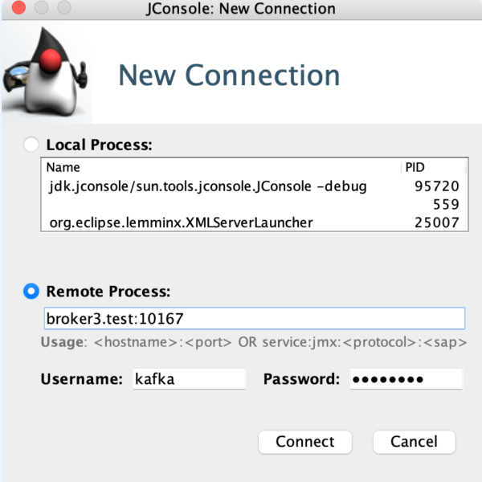
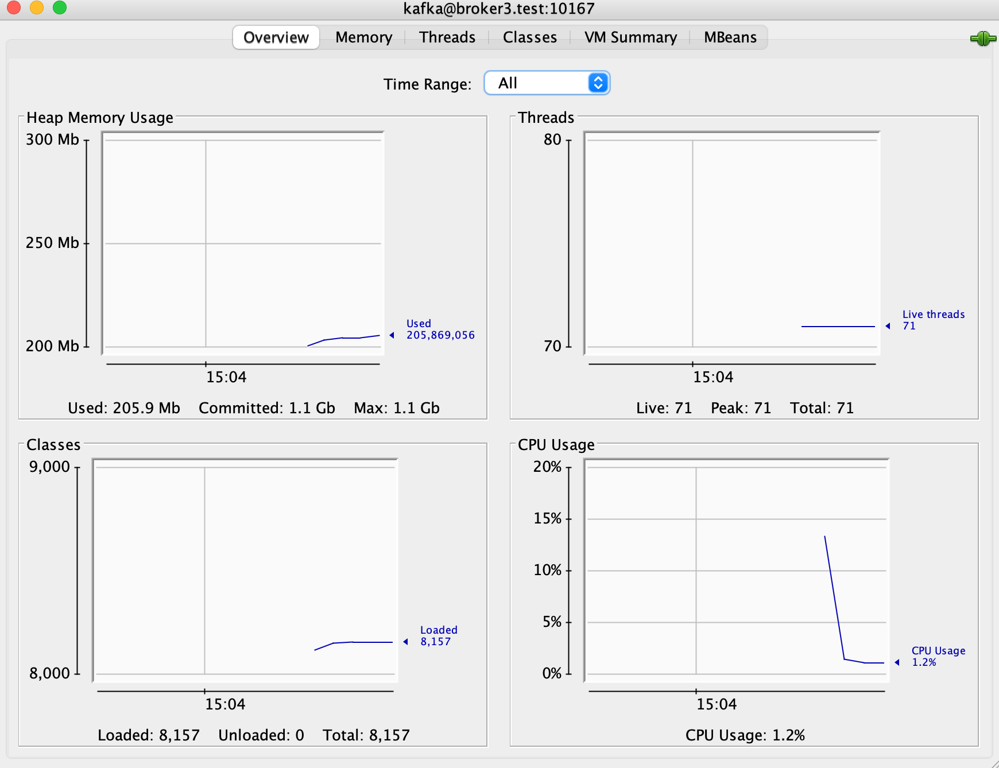

> 💬 The Java virtual machine (Java VM) has built-in instrumentation that enables you to monitor and manage it using the Java Management Extensions (JMX) technology.

To enable and configure monitoring of Java VM for any java-application using the ready-to-use JMX agent, you must set certain system properties when you start the Java VM.

```text
-Doptions1=value1
```

The default location for the configuration file is

```text
jre_home/lib/management/management.properties
```

Or you can set using

```text
-Dcom.sun.management.config.file=<location>
```

### Example: On my OSX

```text
/usr/local/Cellar/openjdk@11/11.0.14.1/libexec/openjdk.jdk/Contents/Home/conf/management
```


You can set ready-to-use monitoring and management properties in a configuration file or on the command line. Properties are defined [here](https://docs.oracle.com/en/java/javase/11/management/monitoring-and-management-using-jmx-technology.html#GUID-2C1922AD-4BA0-4397-A3FE-7823F42A94A3).
— Oracle Documentation


## Monitoring: Kafka

Now let’s configure JMX monitoring specifically for monitoring Kafka Broker.

### Configuration Assumptions

- Kafka SSL configuration is enabled (keystore and truststore)

### Configured as a Service

If your kafka broker is configured as service you need two basic things as environment

```text
Environment="JMX_PORT=10167"
Environment="KAFKA_JMX_OPTS=-Dcom.sun.management.config.file=/opt/kafka/config/jmx.kafka"
```

You might recognize the `com.sun.management.config.file`. This is the same parameter that defines the options for the JMX configuration file location.

#### `jmx.kafka`

In this file the contents identify the specific settings enabled for the JMX monitoring (explained below)

```text
com.sun.management.jmxremote=true
com.sun.management.jmxremote.port=10167
com.sun.management.jmxremote.rmi.port=10168
java.rmi.server.hostname=broker1.test
com.sun.management.jmxremote.password.toHashes=true
java.net.preferIPv4Stack=true
com.sun.management.jmxremote.ssl.config.file=/opt/kafka/config/jmxremote.ssl
com.sun.management.jmxremote.ssl=true
com.sun.management.jmxremote.registry.ssl=true
com.sun.management.jmxremote.authenticate=true
com.sun.management.jmxremote.ssl.need.client.auth=true
com.sun.management.jmxremote.password.file=/opt/kafka/config/jmxremote.password
com.sun.management.jmxremote.access.file=/opt/kafka/config/jmxremote.access
```

Let’s look in some detail

com.sun.management.jmxremote

In the current Java SE platform, it is no longer necessary to set this system property.

com.sun.management.jmxremote.port

- To enable monitoring and management from remote systems define the `jmremote.port`
- Remote monitoring and management requires security to ensure that unauthorized persons cannot control or monitor your application. Password authentication over the Secure Sockets Layer (SSL) and Transport Layer Security (TLS) is enabled by default.

com.sun.management.jmxremote.rmi.port

- Port number to enable JMX RMI connection.
- In addition to publishing an RMI connector for local access, setting this property publishes an additional RMI connector in a private read-only registry at the specified port using the name, `jmxrmi`.

java.rmi.server.hostname

- For remote stubs to be associated with a specific interface address, the `java.rmi.server.hostname` system property must be set.
- Our example uses a vagrant host `broker1.test`

com.sun.management.jmxremote.password.toHashes

If passwords are in clear, they will be overwritten by their hash

com.sun.management.jmxremote.ssl.config.file

Specifies the location of the SSL configuration file.

#### Contents

```text
javax.net.ssl.keyStore=/opt/kafka/ssl/kafka.broker.keystore.jks
javax.net.ssl.keyStorePassword=changeit
javax.net.ssl.trustStore=/opt/kafka/ssl/kafka.broker.truststore.jks
javax.net.ssl.trustStorePassword=changeit
```

com.sun.management.jmxremote.ssl

- Default value is `true`
- Enables secure monitoring using SSL.

com.sun.management.jmxremote.registry.ssl

- Binds the RMI connector stub to an RMI registry that is protected by SSL.

com.sun.management.jmxremote.authenticate

- Enables or disables password authentication for JMX.

com.sun.management.jmxremote.ssl.need.client.auth

- Performs client authentication if this property is `true` and the property `com.sun.management.jmxremote.ssl` is also `true`.

com.sun.management.jmxremote.password.file

- Specifies the location for the password file.
- If `com.sun.management.jmxremote.authenticate` is `false`, then this property, and the password and access files are ignored. Otherwise, the password file must exist and be in the valid format.
- If the password file is empty or nonexistent, then no access is allowed.

com.sun.management.jmxremote.access.file

- Specifies the location for the access file. If `com.sun.management.jmxremote.authenticate` is `false`, then this property, and the password and access files, are ignored. Otherwise, the access file must exist and be in the valid format.
- If the access file is empty or nonexistent, then no access is allowed.

Once all the configuration is supplied and the service is running you can run JConsole and try and connect to the JMX port.

```text
jconsole -debug -J-Djavax.net.ssl.trustStore=kafka.broker.truststore.jks -J-Djavax.net.ssl.trustStorePassword=changeit -J-Djavax.net.ssl.keyStore=kafka.broker.keystore.jks -J-Djavax.net.ssl.keyStorePassword=changeit
```




