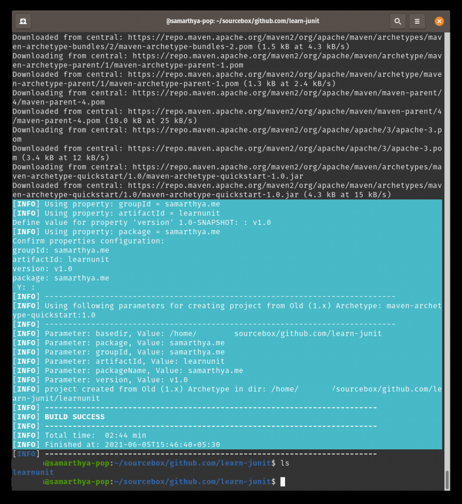
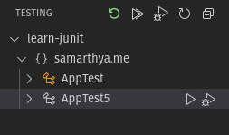
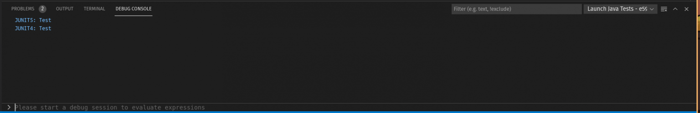
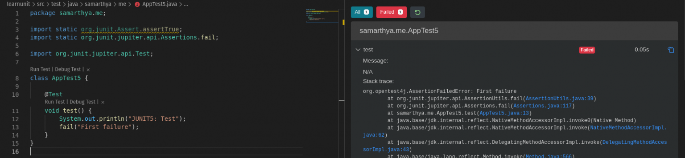
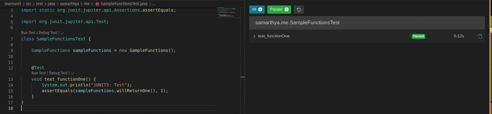

JUnit was developed by **Kent Beck** and **Erich Gamma**. Its first version was released in **1997**.


**JUnit 5 = *JUnit Platform* + *JUnit Jupiter* + *JUnit Vintage***
— https://junit.org/junit5/docs/current/user-guide/


It is powerful testing framework, with many modules. These modules are part of three sub-projects

- **Junit Platform**: Serves as a foundation for [launching testing frameworks](https://junit.org/junit5/docs/current/user-guide/#launcher-api) on the JVM.
- **Junit Jupiter**: It is the combination of the new [programming model](https://junit.org/junit5/docs/current/user-guide/#writing-tests) and [extension model](https://junit.org/junit5/docs/current/user-guide/#extensions) for writing tests and extensions in JUnit 5.
- **Junit Vintage**: Provides a `TestEngine` for running JUnit 3 and JUnit 4 based tests on the platform.

Let's start a basic project structure

```text
mvn archetype:generate -DgroupId=samarthya.me -DartifactId=learnunit -DarchetypeArtifactId=maven-archetype-quickstart -DinteractiveMode=true
```




In previous `JUnit` versions, there was **limited/no** support to allow parameters in test constructors or methods. One of the major changes in `JUnit 5` Jupiter was that both test constructors and test methods are now allowed to have parameters.


## POM: JUNIT4 Support

```text
<project xmlns="http://maven.apache.org/POM/4.0.0" xmlns:xsi="http://www.w3.org/2001/XMLSchema-instance"
  xsi:schemaLocation="http://maven.apache.org/POM/4.0.0 http://maven.apache.org/maven-v4_0_0.xsd">
  <modelVersion>4.0.0</modelVersion>
  <groupId>samarthya.me</groupId>
  <artifactId>learnunit</artifactId>
  <packaging>jar</packaging>
  <version>v1.0</version>
  <name>learnunit</name>
  <url>http://maven.apache.org</url>
  <dependencies>
    <dependency>
      <groupId>junit</groupId>
      <artifactId>junit</artifactId>
      <version>3.8.1</version>
      <scope>test</scope>
    </dependency>
  </dependencies>
</project>
```

## Adding Libraries : JUNIT5

```text
<project xmlns="http://maven.apache.org/POM/4.0.0" xmlns:xsi="http://www.w3.org/2001/XMLSchema-instance" xsi:schemaLocation="http://maven.apache.org/POM/4.0.0 http://maven.apache.org/maven-v4_0_0.xsd">
  <modelVersion>4.0.0</modelVersion>
  <groupId>samarthya.me</groupId>
  <artifactId>learnunit</artifactId>
  <packaging>jar</packaging>
  <version>v1.0</version>
  <name>learnunit</name>
  <url>http://maven.apache.org</url>
  <dependencies>
    <dependency>
      <groupId>org.junit.jupiter</groupId>
      <artifactId>junit-jupiter-api</artifactId>
      <version>5.7.2</version>
      <scope>test</scope>
    </dependency>
    <dependency>
      <groupId>org.junit.jupiter</groupId>
      <artifactId>junit-jupiter-engine</artifactId>
      <version>5.7.2</version>
      <scope>test</scope>
    </dependency>
    <!-- https://mvnrepository.com/artifact/org.junit.vintage/junit-vintage-engine -->
    <dependency>
      <groupId>org.junit.vintage</groupId>
      <artifactId>junit-vintage-engine</artifactId>
      <version>5.7.2</version>
      <scope>test</scope>
    </dependency>
  </dependencies>
</project>
```

## JUNIT

### JUNIT4: Test

```text
package samarthya.me;

import junit.framework.Test;
import junit.framework.TestCase;
import junit.framework.TestSuite;

/**
 * Unit test for simple App.
 */
public class AppTest 
    extends TestCase
{
    /**
     * Create the test case
     *
     * @param testName name of the test case
     */
    public AppTest( String testName )
    {
        super( testName );
    }

    /**
     * @return the suite of tests being tested
     */
    public static Test suite()
    {
        return new TestSuite( AppTest.class );
    }

    /**
     * Rigourous Test :-)
     */
    public void testApp()
    {
        System.out.println("JUNIT4: Test");
        assertTrue( true );
    }
}
```

### JUNIT5: Test case

I will be using the `@Test` annotation that is from the package `org.junit.jupiter.api`.

```text
package samarthya.me;

import static org.junit.Assert.assertTrue;

import org.junit.jupiter.api.Test;

class AppTest5 {

    @Test
    void test() {
        System.out.println("JUNIT5: Test");
        assertTrue(true);
    }    
}
```

Not much is there, but you can execute the suite and see the output. I am using Visual Studio Code and launching test gives the result as below.





You can try some failures as below too..



## SampleFunction

A trivial class with one sample function `willReturnOne()` that return one.

```text
package samarthya.me;

public class SampleFunctions {
    public int willReturnOne() {
        return 1;
    }
}
```



## Help

- TestingEngine: https://junit.org/junit5/docs/current/api/org.junit.platform.engine/org/junit/platform/engine/TestEngine.html
