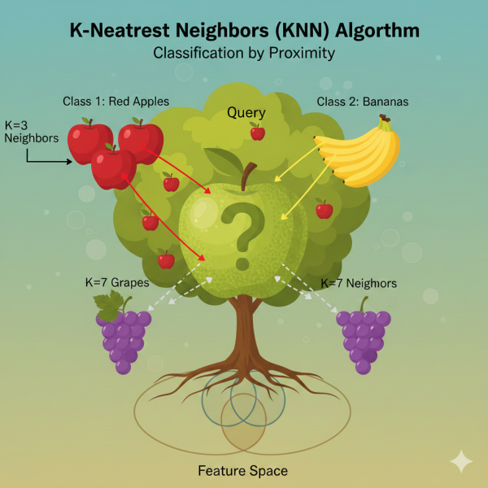

KNN is the friendly, neighborhood algorithm that believes you are defined by the company you keep. It doesn’t try to learn a complex rule; it just looks around and goes with the consensus of its closest, most similar peers.

## In layman terms

### Story – 1

Imagine you just moved into a new neighborhood, and you discover a strange, unknown fruit in your backyard. You have no idea if it’s sweet or sour. What do you do?

You decide to ask your neighbors, the “experts” of the neighborhood. But you’re smart; you won’t just ask anyone. You think, “The people with trees that look most similar to mine probably have the most similar fruit.”

So, you walk around and find the **three closest neighbors** (let’s call this number **K=3**) who have trees that look almost identical to yours.

- **Neighbor 1** (right next door): Has a sweet fruit.
- **Neighbor 2** (across the street): Has a sour fruit.
- **Neighbor 3** (next to them): Has a sweet fruit.

You tally the votes: **Sweet: 2, Sour: 1**.

Based on the majority vote of your **3 Nearest Neighbors**, you conclude: “My mystery fruit is probably **sweet**!”

That’s the essence of KNN. It’s a lazy, friendly algorithm that classifies a new, unknown thing (your fruit) by looking at the **K** most similar, already-known things (your neighbors’ fruits) and letting them vote on the answer.

### Story – 2

Imagine you’re trying to figure out if a new neighbor is a cat person or a dog person. You don’t ask them directly; instead, you look at their immediate friends on the street.

1. **You Pick Your ‘k’:** You decide you’ll look at the **3 closest neighbors** ($k=3$). This is your “k.”
2. **Find the Nearest:** You measure how similar the new neighbor is to everyone else on the street (e.g., how close their houses are, or how similar their yards look).
3. **The Plurality Vote:** You check the pets of those 3 closest neighbors. If 2 of them have dogs and 1 has a cat, you conclude the new neighbor is probably a dog person based on the majority vote of their nearest neighbors.

**k-NN works exactly like this:**

- **New Neighbor** = A new data point to be classified.
- **Street** = Your labeled training data.
- **Distance** = How similar the data points are (measured using metrics like Euclidean distance)2.
- **Plurality Vote** = The class label assigned to the new point3.

## Deep dive

### What Type of Learning Algorithm is KNN?

KNN is primarily a **Supervised Machine Learning** algorithm. This means it learns from a labeled dataset (a dataset where each example has a known answer or category).

More specifically, it is used for:

- **Classification:** Predicting a discrete category (e.g., “spam” or “not spam”, “sweet” or “sour”).
- **Regression:** Predicting a continuous value (e.g., house price). In this case, instead of a majority vote, it takes the *average* of the values of its K-nearest neighbors.

It’s also known as an **Instance-Based** or **Memory-Based Learner** and is often called a **“Lazy Learner”**.

### The “Lazy Learner” and Its Significance

Why “lazy”? Unlike “eager” learners like Decision Trees or Logistic Regression, which create a general model during training, KNN does **absolutely no work** at training time.

- **Training Phase for KNN:** It simply memorizes (stores) the entire dataset. That’s it.
- **Prediction Phase for KNN:** When a new, unlabeled data point comes in, it performs all the calculations to find the nearest neighbors.

### **The Need and Significance of this approach:**

1. **Simplicity and Intuition:** The core idea is incredibly simple to understand and implement, making it a perfect baseline model. If you can’t beat KNN with a more complex model, your complex model might be overkill.
2. **No Assumptions about Data:** Many algorithms assume data follows a specific distribution (e.g., Normal distribution). KNN makes no such assumptions, making it very versatile for real-world, messy data.
3. **Constantly Adapts:** Because it uses the entire dataset for every prediction, it immediately adapts as you add new, correctly labeled data to its “memory.”

## **The Critical Considerations:**

1. **The Choice of ‘K’:** This is the most important hyperparameter.
   - **K too small (e.g., K=1):** The model becomes very sensitive to noise and outliers. It’s like only asking your one, grumpy neighbor and overfitting to his opinion. High variance, low bias.
   - **K too large (e.g., K=all neighbors):** The model becomes too smooth and might miss important patterns. The decision boundary becomes less precise. It’s like asking everyone in the city, including people with cactus plants, about your fruit. High bias, low variance.
   - A good K value is often found through experimentation (e.g., using cross-validation).
2. **The Distance Metric:** How do we define “nearest”?
   - **Euclidean Distance:** The straight-line, “as-the-crow-flies” distance. Most common default.
   - **Manhattan Distance:** The “city block” distance, summing the absolute differences along each axis. Useful for high-dimensional data.
   - The choice of distance metric can significantly change the model’s results.
3. **Computational Cost:** Since it must calculate the distance between the new point and *every single point* in the training set, it can be very slow and memory-intensive for large datasets. This is its primary drawback.
4. **The Curse of Dimensionality:** As the number of features (dimensions) grows, the concept of “distance” becomes less meaningful, and every point can seem equally far away from every other point. This can severely degrade KNN’s performance, making feature selection crucial.

I will try and publish a working example on the [github repo.](https://github.com/samarthya/learn-knn.git)
