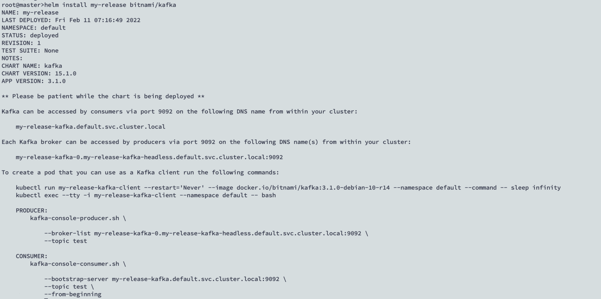
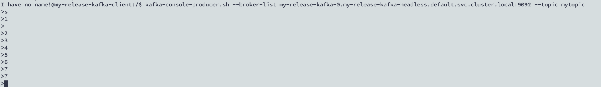
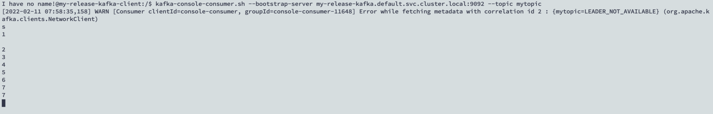

While I continue to learn more about architecture and design of `kafka`, a quickstart to deploy & test kafka is a must.

## Step 1: Add Chart Repo

In my local system it is already present which was confirmed by the listing

```text
root@master>helm repo list
NAME                    URL                                                                                         
stable                  https://charts.helm.sh/stable                                                               
elastic                 https://helm.elastic.co                                                                     
bitnami                 https://charts.bitnami.com/bitnami
```

In your case you will have to `add` the repo.

```text
helm repo add bitnami https://charts.bitnami.com/bitnami
```

## Step 2: Deploy the chart

```text
helm install my-release bitnami/kafka
```



The output identifies the steps you can use to validate the deployment, you can customize as per your needs for the quick test.

## Step 3: Console Producer

Before you test you will need to have a client that can produce the events for a specific [topic](https://kafka.apache.org/documentation/#topicconfigs).

```text
kubectl run my-release-kafka-client --restart='Never' --image docker.io/bitnami/kafka:3.1.0-debian-10-r14 --namespace default --command -- sleep infinity
```

You can check the running pod by issuing `kubectl get pods`

```text
my-release-kafka-client                               1/1     Running   0             22m
```

Get into to the pod

```text
 kubectl exec --tty -i my-release-kafka-client --namespace default -- bash
```



You can either use the same command as outputted by the Helm Install message for validation

```text
kafka-console-producer.sh \
            --broker-list my-release-kafka-0.my-release-kafka-headless.default.svc.cluster.local:9092 \
            --topic test
```

Or customize as per your wish

```text
> kafka-console-producer.sh --broker-list my-release-kafka-0.my-release-kafka-headless.default.svc.cluster.local:9092 --topic mytopic
```

## Step 4: Console Consumer

The information you feed in the producer can be consumed by the client consumer. For that, log into the client

```text
 kubectl exec --tty -i my-release-kafka-client --namespace default -- bash
```

And listen to the topic

```text
kafka-console-consumer.sh \
            --bootstrap-server my-release-kafka.default.svc.cluster.local:9092 \
            --topic test \
            --from-beginning
```

Or for `mytopic`

```text
kafka-console-consumer.sh --bootstrap-server my-release-kafka.default.svc.cluster.local:9092 --topic mytopic
```




Learn more about use cases [here](https://kafka.apache.org/powered-by).
— official documentation

