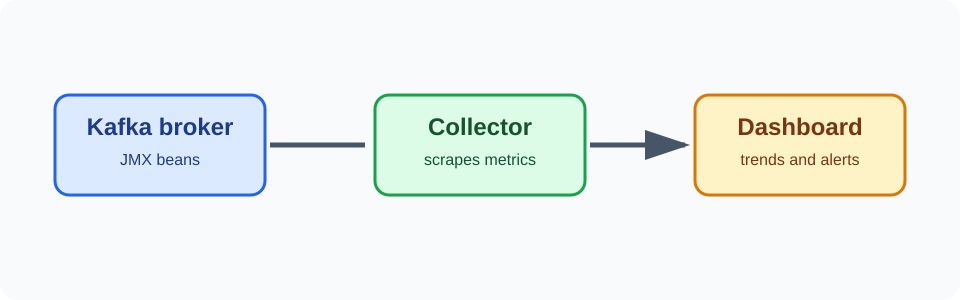

Kafka was running, producers were sending messages, and yet I still felt I was operating it by looking at the console and guessing. I wanted numbers that could tell me whether the broker was busy, whether consumers were falling behind, and whether replication was healthy.

That led me to JMX.


Written up in October 2026 from my notes at the time. The JMX reading below is an illustrative incident example, not a live measurement from the original cluster.




## What JMX gives you

JMX, or Java Management Extensions, exposes management beans from a Java process. Kafka publishes beans for brokers, topics, partitions, producers, consumers, and the JVM itself.

JMX does not magically explain an incident. It gives measurements. The useful work is connecting a measurement to a question:

| Question | Useful area |
| --- | --- |
| Is the broker receiving too much traffic? | `BytesInPerSec`, `MessagesInPerSec` |
| Are consumers falling behind? | consumer group lag metrics |
| Is replication healthy? | under-replicated and offline partition counts |
| Is the JVM under pressure? | heap usage and garbage collection |

## A simple broker setting

For a lab, I started Kafka with a JMX port:

```bash
export JMX_PORT=9999
bin/kafka-server-start.sh config/server.properties
```

For a remote connection, the JVM settings must be planned more carefully. The RMI hostname must be reachable by the monitoring client, and the port must be protected by firewall rules:

```bash
export KAFKA_JMX_OPTS="-Dcom.sun.management.jmxremote \
  -Dcom.sun.management.jmxremote.port=9999 \
  -Dcom.sun.management.jmxremote.rmi.port=9999 \
  -Djava.rmi.server.hostname=broker.example.internal \
  -Dcom.sun.management.jmxremote.authenticate=true \
  -Dcom.sun.management.jmxremote.ssl=true"
```

I would not expose JMX directly to the internet. JMX is an administrative interface. In a real environment I would put it on a management network, restrict the port to the monitoring system, and configure authentication, authorization, and TLS according to the JDK and Kafka distribution guidance.

## The first measurements I look for

### Traffic

`BytesInPerSec` and `BytesOutPerSec` show broker traffic. I look at the trend rather than one point. A sudden increase can explain disk, network, or consumer pressure, but it is not automatically an error.

### Requests

Request queue time, local processing time, and total time help separate broker work from network waiting. If request time rises while traffic is flat, I look at disk latency, CPU, garbage collection, and partition distribution.

### Replication

Under-replicated partitions and offline partitions are the numbers I do not want to ignore. A temporary spike during a controlled restart may be expected. A value that stays above zero needs investigation.

### JVM

Heap usage and garbage collection help explain long pauses and request latency. Increasing the heap is not always the answer. A large heap can also produce longer garbage-collection pauses. I first look for a pattern and correlate it with request latency.

## JMX is only useful with a baseline

I found it difficult to interpret a number until I knew what normal looked like. Run a small workload, record the normal range, then test one change at a time. A dashboard full of green gauges is less useful than four charts with clear questions behind them.

For example, an illustrative consumer incident might look like this:

```text
consumer_group=orders
topic=orders
partition=7
lag=40000
records-consumed-rate=115 records/sec
records-produced-rate=980 records/sec
```

I would read that as a rate problem first, not immediately as a broker failure. The producer was writing roughly eight times faster than this consumer could process. I would then check whether the consumer was blocked on a downstream service, whether a rebalance had just happened, and whether the other partitions showed the same pattern. The number `40000` is alarming, but the difference between production and consumption rates explains why it is growing.

The lesson for me was simple: enable JMX because I have an operational question, not because monitoring tools offer a long list of beans.
