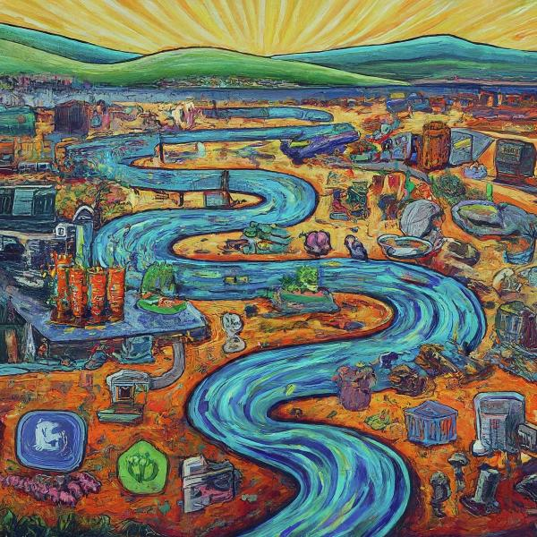

In today’s data-driven world, the ability to process information in real-time is crucial. **Kafka Streams** emerges as a powerful tool for building **real-time applications and microservices** that leverage the **Apache Kafka** distributed streaming platform.

### What are Kafka Streams?

Kafka Streams is a **client library** built on top of Apache Kafka. It allows you to easily **process and analyze** data **streamed** through Kafka topics.

Here are some key aspects of Kafka Streams

- **Ease of Use:** It offers a **high-level API** that simplifies building stream processing applications compared to writing low-level code directly interacting with Kafka.
- **Scalability:** Kafka Streams applications can **scale horizontally** by adding more instances, enabling them to handle large volumes of data efficiently.
- **Fault Tolerance:** Built-in features ensure your applications can recover from failures and continue processing data reliably.
- **State Management:** Kafka Streams handles state management for your applications, allowing you to keep track of ongoing computations and calculations.

Kafka Streams can be utilized for various use cases, including:

- Building real-time dashboards and monitoring systems.
- Streamlining fraud detection and anomaly analysis.
- Implementing real-time recommendations and personalization.
- Performing real-time data aggregation and filtering.
