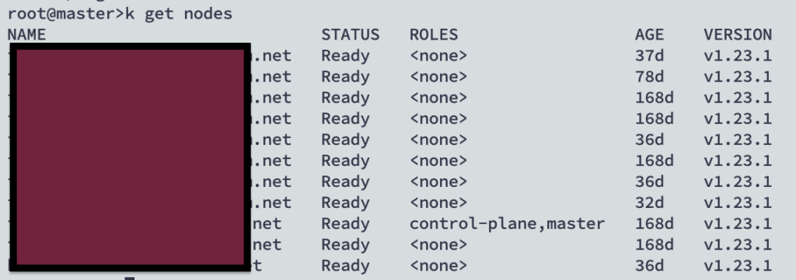
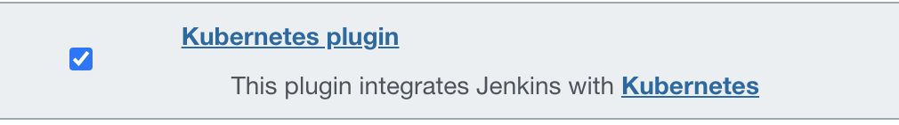
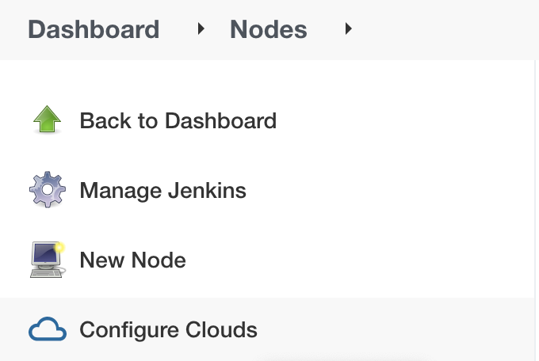
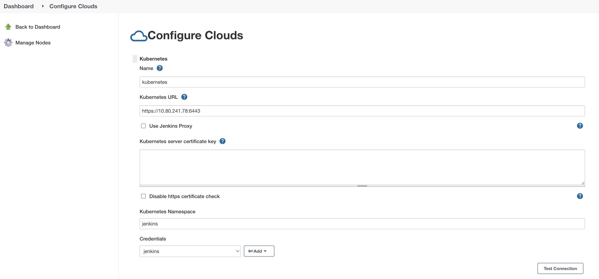
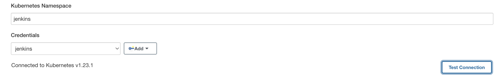
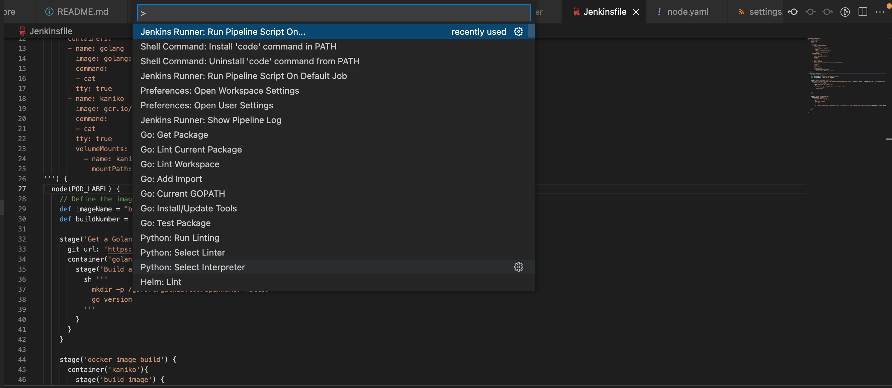
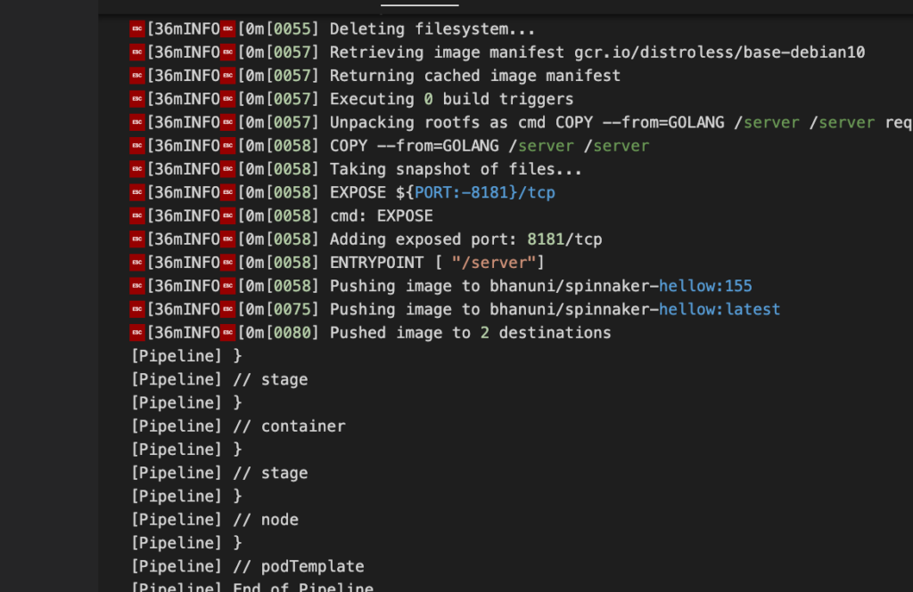
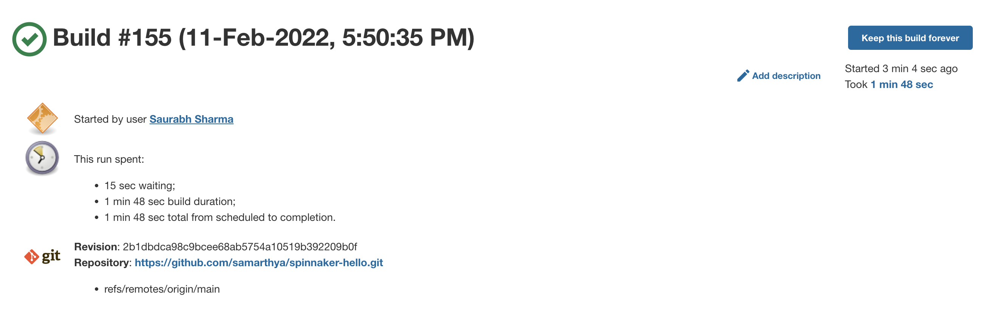
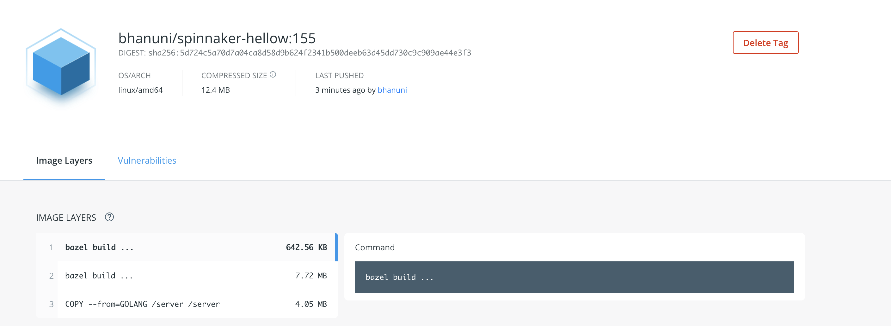

So there are many things I have been simultaneously trying to learn & one of those is to learn how you can configure a pipeline


Read more about Pipeline as Code (PaC)


## Objectives

1. Learn Jenkins deployment on Kubernetes
2. Learn Jenkins Kubernetes Plugin
3. Learn Jenkins Pipeline (`Declarative`)
4. How to build and deploy images in Kubernetes cluster

All right, with so many monkeys on my back I had to do things the way I know it works for me.

## k8s cluster setup

I have a local cluster v1.23.1



## Jenkins Setup

I have already covered steps to deploy a `Jenkins` instance [here](). A detailed list of all entities in the namespace `jenkins` are below

```text
root@master>k get pods,services,pv,pvc,sa,serviceaccount,rolebinding -n jenkins
NAME              READY   STATUS    RESTARTS      AGE
pod/myjenkins-0   2/2     Running   18 (8h ago)   9d

NAME                      TYPE        CLUSTER-IP       EXTERNAL-IP   PORT(S)     AGE
service/myjenkins         ClusterIP   10.103.226.229   <none>        8080/TCP    9d
service/myjenkins-agent   ClusterIP   10.105.132.66    <none>        50000/TCP   9d

NAME                                              CAPACITY   ACCESS MODES   RECLAIM POLICY   STATUS     CLAIM                                     STORAGECLASS   REASON   AGE
persistentvolume/dx-restmon-restmon--default-pv   1Gi        RWO            Retain           Bound      default/dx-restmon-restmon--default-pvc                           71d
persistentvolume/jenkins-pv                       8Gi        RWO            Retain           Bound      jenkins/myjenkins                                                 9d
persistentvolume/kafka-pv                         8Gi        RWO            Retain           Bound      default/data-my-release-zookeeper-0                               3h36m
persistentvolume/prometheus-alertmanager          2Gi        RWO            Retain           Released   default/prometheus-alertmanager                                   88d
persistentvolume/prometheus-server                8Gi        RWO            Retain           Released   default/prometheus-server                                         88d
persistentvolume/zookeper-pv                      8Gi        RWO            Retain           Bound      default/data-my-release-kafka-0                                   3h34m

NAME                              STATUS   VOLUME       CAPACITY   ACCESS MODES   STORAGECLASS   AGE
persistentvolumeclaim/myjenkins   Bound    jenkins-pv   8Gi        RWO                           9d

NAME                       SECRETS   AGE
serviceaccount/default     1         9d
serviceaccount/myjenkins   1         9d

NAME                                                               ROLE                             AGE
rolebinding.rbac.authorization.k8s.io/jenkins-admin-binding        ClusterRole/admin                2d
rolebinding.rbac.authorization.k8s.io/myjenkins-schedule-agents    Role/myjenkins-schedule-agents   9d
rolebinding.rbac.authorization.k8s.io/myjenkins-watch-configmaps   Role/myjenkins-casc-reload       9d
```


[Official documentation is very detailed](https://www.jenkins.io/doc/book/installing/kubernetes/)
— https://www.jenkins.io/doc/book/installing/kubernetes/


## Plugin Kubernetes

Configuring Kubernetes plugin was easier than I thought in Jenkins.


[Kubernetes Plugin](https://plugins.jenkins.io/kubernetes/)
— https://plugins.jenkins.io/kubernetes/




Once plugin is installed time to configure the plugin & nodes



Click the configure clouds



### Server URL

```text
root@master>kubectl config view --minify | grep server
    server: https://10.80.241.78:6443
```

Supply the values of the cluster information set-up the credentials (I named them `jenkins`) and click test connection



In Jenkins create a *Secret Text* credentials and paste the **decoded** value of the ServiceAccount token.

```text
kubectl get secret $(kubectl get sa myjenkins -n jenkins -o jsonpath={.secrets[0].name}) -n jenkins -o jsonpath={.data.token} | base64 --decode
```

You can also retrieve server cert by using the command below

```text
kubectl get secret $(kubectl get sa myjenkins -n jenkins -o jsonpath={.secrets[0].name}) -n jenkins -o jsonpath={.data.'ca\.crt'} | base64 --decode
```

My source code is posted [here (Git HUB)](https://github.com/samarthya/spinnaker-hello)

Two out of 4 objectives are done, time to create a pipeline.


[Please refer to the usage section of the plugin](https://plugins.jenkins.io/kubernetes/#plugin-content-usage).



The Kubernetes plugin allocates Jenkins agents in Kubernetes pods.
— Plugin Kubernetes


## Points to remember

- Within these pods allocated there is always one special container `jnlp` that is running the Jenkins agent. Other containers can run arbitrary processes of your choosing, and it is possible to run commands dynamically in any container in the agent pod.
- We define pod templates to use the kubernetes based pipelines.
- Pod templates defined using the user interface declare a label. (Look for [examples here](https://github.com/jenkinsci/kubernetes-plugin/tree/master/examples))

```text
podTemplate {
    node(POD_LABEL) {
       // Steps...
    }
}
```

### Blocks of Pipeline (Declarative)

- agent
- environment
- stages
- steps
- post

#### AGENT

- The `agent` section defines the worker or machine where the pipeline will be executed.
- Can be defined at the top level inside the pipeline block or overridden at the stage level.

#### ENVIRONMENT

- The `environment` section defines a set of environment variables needed in the pipeline steps.
- The variables can be defined as sequences of key-value pairs.
- Reference credential variables can also be defined by using method `credentials()`, which takes as a parameter the ID of the target credential (defined in `jenkins`)

#### STAGES

- This section defines actions a high level.

#### STEPS

- The `steps` section contains a series of steps to be executed in a given stage directive.

#### POST

- Depending on the location it is defined the post section will run upon the completion of a pipeline or stage run.
- It contains commands or scripts

The above idiom creates a pod template with a generated unique label (available as `POD_LABEL`) and runs commands inside it.


Pod templates are used to create agents. They can be either configured via the user interface, or in a pipeline, using the `podTemplate` step.
— Official documentation


### Example

```text
podTemplate(yaml: '''
    apiVersion: v1
    kind: Pod
    spec:
      volumes:
      - name: kaniko-secret
        secret:
          secretName: regcred
          items:
          - key: .dockerconfigjson
            path: config.json
      containers:
      - name: golang
        image: golang:latest
        command:
        - cat
        tty: true
      - name: kaniko
        image: gcr.io/kaniko-project/executor:debug
        command:
        - cat
        tty: true
        volumeMounts:
          - name: kaniko-secret
            mountPath: /kaniko/.docker
        
        
''')
```


You can read more about pipelines [here](https://www.jenkins.io/doc/book/pipeline/).


## Run the pipeline

I am using VS Code for my code management and `Jenkins Runner` plugin, so it is just matter of executing the pipeline on the default job configured.





& in Jenkins



In the docker hub



If you are curious why not docker in docker? It is a bad option but is well explained [here](https://jpetazzo.github.io/2015/09/03/do-not-use-docker-in-docker-for-ci/).

## Others

- [Blue Ocean](https://plugins.jenkins.io/blueocean/) Plugin
