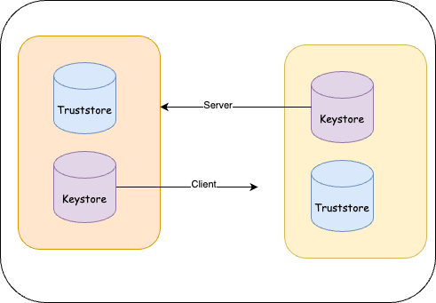

**Keystore and Truststore** are both repositories for storing cryptographic keys and digital certificates. They are used in various security-related operations, particularly in the context of SSL/TLS encryption. While they serve similar purposes, they have different roles and are used in distinct ways:

> Read more about x509 more [here]()

**Keystore**:

1. **Purpose**: A keystore is primarily used to store private keys, public key certificates, and symmetric keys (like encryption keys). Private keys are used for activities like SSL/TLS client authentication and digitally signing data.
2. **Protection**: `Keystores` are typically protected with a **password** or **passphrase**, ensuring that only authorized users or applications can access the private keys stored within.
3. **Usage**: `Keystores` are used by applications or services that need to present a digital identity (e.g., a server certificate for an HTTPS website) or perform cryptographic operations (e.g., data signing) that require access to private keys.
4. **Example**: When configuring an SSL/TLS-enabled web server, you would use a `keystore` to store the server’s **private key** and its corresponding **certificate**.

**Truststore**:

1. **Purpose**: A truststore is used to store trusted certificates (typically public key certificates of Certificate Authorities or CAs). Truststores contain certificates that are used to verify the authenticity of certificates presented by other entities in SSL/TLS connections.
2. **Protection**: Truststores may also be password-protected, but they store public certificates that are used for verification rather than private keys.
3. **Usage**: Truststores are used by clients (e.g., web browsers, SSL/TLS clients) to validate the identity of servers by checking their certificates against the trusted certificates in the truststore.
4. **Example**: When you connect to an HTTPS website, your web browser uses a truststore to verify the authenticity of the website’s certificate. If the certificate is signed by a trusted CA, the connection is considered secure.

**Comparison**:

1. **Content**: Keystores store private keys, public key certificates, and other cryptographic keys. Truststores store public certificates, mainly those of CAs.
2. **Usage**: Keystores are used for authentication and cryptographic operations by entities presenting their own certificates. Truststores are used for verification by entities verifying the authenticity of certificates presented by others.
3. **Protection**: Keystores may contain sensitive private keys, so they are often password-protected. Truststores may also be password-protected but contain only public certificates.
4. **Examples**: Keystores are used by web servers, SSL/TLS clients, and code-signing applications. Truststores are used by web browsers, SSL/TLS clients, and other applications that need to establish secure connections.

At a raw level Keystore and truststore are both used for managing digital certificates and keys in the context of SSL/TLS (Secure Sockets Layer/Transport Layer Security) and other security protocols.

| Feature | Keystore | Truststore |
| --- | --- | --- |
| Purpose | Stores a private key and its associated certificate(s) used to identify the entity (e.g., a server or client). | Stores public keys (certificates) of trusted entities to verify the authenticity of certificates presented by other parties. |
| Content | Contains the private key and associated certificates, typically the entity’s own certificate and its private key. May also store certificates from trusted CAs. | Contains only public keys (certificates) of trusted entities, such as Certificate Authorities (CAs) or other parties you trust. |
| Types | Can store various types of keys and certificates, including SSL/TLS certificates, code-signing certificates, client certificates, etc. | Stores only certificates (usually X.509 certificates). |
| Usage | Used to establish the identity of the entity, usually for server authentication in SSL/TLS. | Used to validate the authenticity of certificates presented by remote parties in SSL/TLS. |
| Password Protection | Typically protected by a strong passphrase or password since it contains sensitive private keys. | Also protected by a passphrase, but it’s generally not as critical as the keystore’s passphrase since it only contains public keys. |
| Modifications | Keystores can be updated with new certificates, private keys, or even revoked certificates, as needed. | Truststores are often static and are less frequently updated. |
| File Formats | Common formats include JKS (Java KeyStore), PKCS#12 (P12 or PFX), and PKCS#8. | Common formats include JKS (Java TrustStore), PEM, and DER. |
| Application Scope | Keystores are used by both SSL/TLS clients (e.g., web browsers, applications making secure connections) and servers. | Truststores are typically used by SSL/TLS clients (e.g., web browsers, applications) to verify the authenticity of servers’ certificates. Servers usually don’t use truststores. |
| Operations | In SSL/TLS, keystore operations include presenting the entity’s own certificate during the handshake and optionally performing client authentication. | In SSL/TLS, truststore operations involve verifying the authenticity of certificates presented by remote parties and making trust decisions. |
| Example Use Cases | SSL/TLS server: Contains the server’s private key and its SSL/TLS certificate. SSL/TLS client: Contains the client’s private key and its SSL/TLS certificate. | SSL/TLS clients: Contains the public keys of trusted CAs and other entities you trust. Used to validate server certificates. |
| Security Considerations | Keystores need to be highly secure to protect the private key. Access to the keystore should be tightly controlled. | Truststores should also be secured to prevent tampering with trusted CA certificates, but the level of protection is typically not as critical as with keystores. |
| Common File Extensions | .jks, .p12, .pfx, .ks, .keystore, .jceks, etc. | .jks, .pem, .cer, .crt, .der, etc. |

## Formats

`Keystore` can have different file formats used for storing keys and certificates, particularly in the context of SSL/TLS (Secure Sockets Layer/Transport Layer Security) and security applications. Here’s a comparison of some common `keystore` formats in tabular form:

| `Keystore Format` | `Description` | Common File Extensions | Software Compatibility |
| --- | --- | --- | --- |
| Java Keystore (JKS) | A proprietary keystore format used by Java applications. | .jks | Widely supported in Java-based applications. |
| PKCS#12 (P12 or PFX) | A standardized format defined by RSA that can store private keys, certificates, and, in some cases, additional data. | .p12, .pfx | Supported by many platforms and applications. |
| PKCS#8 | A format for storing private keys, but it does not typically include certificates. It is commonly used in combination with other formats. | N/A | Supported in various applications and libraries. |
| PEM (Privacy Enhanced Mail) | A common format for certificates and private keys in text form, typically encoded in Base64. May include .crt, .pem, .key, .cer, and other extensions. | .pem, .crt, .key, .cer | Widely supported in various applications and libraries. |
| DER (Distinguished Encoding Rules) | A binary format used to encode certificates, keys, and other ASN.1 (Abstract Syntax Notation One) structures. | .der | Often used in certificates and public key formats. |
| JCEKS (Java Cryptography Extension Keystore) | A Java keystore format that provides additional security features compared to JKS. | .jceks | Supported in Java-based applications. |
| BKS (Bouncy Castle Keystore) | A format used in Bouncy Castle, a popular cryptographic library. It supports various cryptographic algorithms and key types. | .bks | Compatible with applications using Bouncy Castle. |

The choice of `keystore` format depends on the specific requirements of your application and the software you are using. Java-based applications commonly use JKS or PKCS#12 formats, while other software and libraries may support a wider range of formats. The compatibility of a keystore format with your software and platform is a key factor in selecting the appropriate format for your use case.

> 💬 There are multiple certificate formats used in the context of SSL/TLS (Secure Sockets Layer/Transport Layer Security) and public key infrastructure (PKI).
> 
> | Certificate Format | Description | Common File Extensions | Key Features | Use Cases |
> | --- | --- | --- | --- | --- |
> | X.509 (PEM) | A widely used text-based format that can represent certificates and private keys. | .pem, .crt, .cer, .key | Supports a variety of encodings, including Base64, DER, and ASCII. Contains both public and private keys. | Web servers, email servers, general use. |
> | DER | A binary format that is more compact and efficient for network transmission but not human-readable. | .der | Compact and efficient binary encoding. Suitable for efficient data transmission. | Use in PKCS#7, certificate storage. |
> | PKCS#7 (P7B) | A format that can contain multiple certificates, including the certificate chain, and be signed or encrypted. | .p7b, .p7c | Used for certificate distribution and validation. Can include multiple certificates and the chain. | Email encryption, certificate distribution. |
> | PKCS#12 (P12 or PFX) | A standardized format that can store private keys, certificates, and, in some cases, additional data. | .p12, .pfx | Contains private keys and certificates, often protected by a password. | Secure key and certificate storage. |
> | SSH Public Key | A format used for SSH key pairs and user authentication. | .pub | Contains public keys only, typically used for secure shell (SSH) authentication. | SSH server and client authentication. |
> 
> The choice of certificate format depends on the specific use case and the requirements of the application or service.

In summary, `keystore` and `truststore` serve different roles in SSL/TLS and cryptographic operations. `Keystores` are used for maintaining private keys and digital identities, while truststores are used for verifying the authenticity of certificates presented by others. Both are important components in securing network communications.
